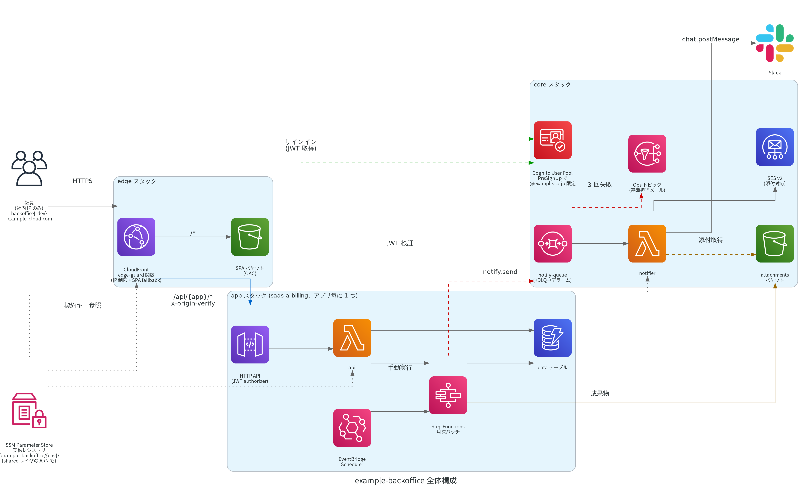
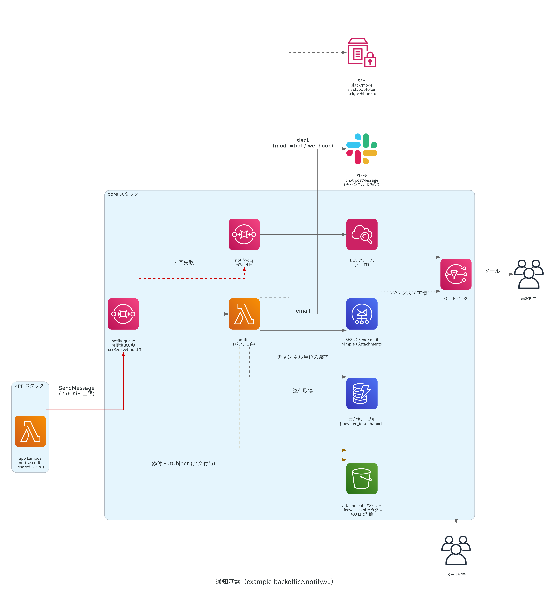

# example-backoffice プラットフォーム設計書

作成日: 2026-08-27
ステータス: 実装済み（2026-09-02 本番リリース前ブラッシュアップ #1005 を反映）
対象: 社内保守管理サイト `example-backoffice`（基盤部分）
関連: [アプリ追加手順](ADD-APP-GUIDE.md) / [第一弾アプリ設計書 saas-a-billing](apps/saas-a-billing/DESIGN.md)

---

## 1. 目的と利用者

### 1.1 目的

- 社内の保守業務（外部 SaaS の課金照合、死活監視、設定管理など）を担うアプリを 1 つのサイトに集約する。
- 認証・メール送信・Slack 通知・入口（ドメイン、IP 制限）を共通基盤として提供し、アプリ開発者は業務ロジックと画面だけを書く。
- 他の社員が新しい保守アプリを追加する作業を「雛形の生成 → 実装 → 数行の登録」で完結させる。

### 1.2 利用者

| 役割 | 人数規模 | 主な操作 |
| --- | --- | --- |
| 一般利用者（CS 部・開発部） | 少人数 | ログイン、レポート閲覧、手動実行 |
| 管理者（`admin` グループ） | 数人 | ユーザー管理（グループ付与・無効化）、アプリ設定の編集 |
| 基盤担当 | 1〜2 人 | core / edge / shared スタックの保守、SSM 契約の管理 |
| アプリ担当 | アプリ毎に 1〜2 人 | `apps/{app}` と `frontend/src/apps/{app}` の開発・デプロイ |

### 1.3 第一弾アプリ

| 項目 | 値 |
| --- | --- |
| アプリ id | `saas-a-billing` |
| 内容 | SaaS_A（外部 SaaS）の月額課金レポート。月次バッチ → Excel 生成 → メール添付 + Slack 通知。設定画面あり |
| SPA ルート | `/saas-a-billing` |
| API | `/api/saas-a-billing/*` |
| スタック | `example-backoffice-app-saas-a-billing-{env}` |
| 設計書 | `Documents/apps/saas-a-billing/DESIGN.md` |

### 1.4 前提技術

| 領域 | 技術 |
| --- | --- |
| IaC | AWS SAM（CloudFormation） |
| バックエンド | Lambda（Python 3.13）、Powertools for AWS Lambda (Python)、社内レイヤ ExamplePowertoolsPython |
| API | API Gateway HTTP API + Cognito JWT authorizer |
| データ | DynamoDB（アプリ毎の単一テーブル）、S3 |
| フロント | Vue 3.5 / Vuetify 4 / Vue Router 5 / Pinia 4 / Vite 8 / TypeScript 6 / Amplify v6 (auth) |
| 認証 | Cognito User Pool（TOTP MFA） |
| 通知 | SQS → notifier Lambda → SES v2 / Slack（Bot token の `chat.postMessage`。未登録時は Incoming Webhook） |
| 入口 | CloudFront + S3(OAC) + CloudFront Function（IP 制限） |
| リージョン | ap-northeast-1（全スタック。CloudFront 用 ACM 証明書だけは us-east-1 の既存証明書を再利用する） |

---

## 2. 全体構成



要点

| 観点 | 決定 |
| --- | --- |
| 入口 | CloudFront 1 ディストリビューションに SPA と全アプリ API を同居させる。同一オリジンのため CORS 不要、IP 制限を 1 箇所で適用できる |
| アプリ境界 | バックエンドは `apps/{app}`（独立 SAM スタック）、フロントは `frontend/src/apps/{app}`（マニフェスト）。アプリ追加で基盤側に触るのは edge の origin + behavior 追記のみ |
| スタック間契約 | SSM Parameter Store `/example-backoffice/{env}/...` を契約レジストリとする。ID や ARN を人がコピーしない |
| 通知 | アプリは SQS にメッセージを投げるだけ。SES / Slack の資格情報と送信処理は core の notifier に集約 |
| 認証 | Cognito User Pool 1 つ。`@example.co.jp` 限定セルフサインアップ、TOTP MFA **必須**（`MfaConfiguration: "ON"`） |
| IP 制限 | CloudFront Function（viewer-request）の IPv4 allowlist。WAF は使わない（7 章）。MFA 必須化後に解除できる構成にしておく |

---

## 3. スタック分割と所有・ライフサイクル

### 3.1 スタック一覧

| スタック名 | リージョン | 内容 | 変更頻度 | 所有 |
| --- | --- | --- | --- | --- |
| `example-backoffice-core-{env}` | ap-northeast-1 | Cognito User Pool / Client / グループ、PreSignUp Lambda、SES EmailIdentity + DNS レコード、SQS notify-queue + DLQ、notifier Lambda、S3 attachments バケット、SSM 契約パラメータ | 低 | 基盤担当 |
| `example-backoffice-shared-{env}` | ap-northeast-1 | 共通 Lambda Layer（`example_backoffice` パッケージ）、SSM `/shared/layer-arn`、SSM `/shared/slack/mode` | 共通コード変更時 | 基盤担当 |
| `example-backoffice-app-{app}-{env}` | ap-northeast-1 | HTTP API + JWT authorizer、Lambda、DynamoDB、Step Functions StateMachine（必要なアプリのみ）、EventBridge Scheduler、DLQ（Scheduler 用 SQS・Lambda 非同期失敗用 SQS）、ログ、SSM `/apps/{app}/api-domain` | アプリ毎 | アプリ担当 |
| `example-backoffice-edge-{env}` | ap-northeast-1 | S3 SPA バケット + OAC、CloudFront、CloudFront Function（IP 判定 + SPA フォールバック）、Route53 レコード、CloudFront 標準ログ用 S3 | アプリ追加時に origin / behavior 追記 | 基盤担当（追記 PR はアプリ担当） |

- `env` ∈ {`dev`, `prod`}。両環境は同一 AWS アカウント（`210000000001`）・同一リージョン（ap-northeast-1）にスタック名の接尾辞で共存する。ref-project-a と同じ前例である。
- us-east-1 にスタックは作らない。CloudFront 用の ACM 証明書は既存のワイルドカード証明書（us-east-1、`*.example-cloud.com`）を ARN で参照するだけである。

### 3.2 分割の根拠

| 分割 | 理由 |
| --- | --- |
| core と edge を分ける | CloudFront は更新に数分かかり失敗時の影響が大きい。アプリ追加以外で触らない Cognito と同じ変更セットに載せない |
| shared を分ける | 共通コードの更新をアプリのデプロイと独立させる。レイヤの新バージョンはアプリ側の再デプロイで取り込む |
| app をアプリ毎に分ける | 複数人が別アプリを並行開発しても CloudFormation の変更セットが競合しない。削除もスタック単位で完結する |
| ネストスタックを使わない | 親 1 本にまとめると全アプリが 1 つの変更セットに載り、他人のアプリの失敗で自分のデプロイがロールバックする |

### 3.3 依存関係とデプロイ順


| 順番 | 対象 | 備考 |
| --- | --- | --- |
| 1 | `shared` | レイヤを公開し `/shared/layer-arn` を書く |
| 2 | `core` | `/shared/layer-arn` を SSM 型パラメータで受け（notifier が共通レイヤを使う）、SSM 契約パラメータを書く |
| 3 | `app-{app}`（各アプリ） | `/apps/{app}/api-domain` を書く |
| 4 | `edge` | 各アプリの `api-domain` を SSM 型パラメータで受ける。ACM 証明書 ARN と許可 IP（`AllowedIpAddresses`）は samconfig の `parameter_overrides` で渡す。`x-origin-verify` の値だけはスクリプトが SSM から復号取得して渡す |
| 5 | `frontend` | ビルド → S3 同期 → CloudFront invalidation |

削除順は逆（frontend → edge → app → core → shared）。edge がアプリの `api-domain` を参照している間はアプリスタックを削除せず、core が `/shared/layer-arn` を参照している間は shared を削除しない。

---

## 4. 契約レジストリ（SSM Parameter Store）

### 4.1 方針

| 項目 | 決定 |
| --- | --- |
| レジストリ | SSM Parameter Store。キー接頭辞 `/example-backoffice/{env}/` |
| 書き手 | core / shared / app スタックが `AWS::SSM::Parameter` リソースで自分の Output を書く |
| 読み手（テンプレート） | `Type: AWS::SSM::Parameter::Value<String>` 型パラメータで受ける。`Default` にキー名を書き、prod は samconfig でキー名（値ではない）を上書きする |
| 読み手（Lambda 実行時） | Powertools Parameters `get_parameter(name, decrypt=True, max_age=300)`。SecureString はテンプレートパラメータ型として使えないため実行時取得のみ |
| 値のコピー | 禁止。ID / ARN / URL を samconfig や `.env` に人が書き写さない |
| CloudFormation Export | core 内部・edge 内部の強参照だけに限定する。Export 名 `example-backoffice-{env}-{layer}-{resource}` |
| 弱参照の注意 | SSM 型パラメータの値はデプロイ時点で固定される。core で Cognito を作り直した場合、全アプリと edge の再デプロイが必要 |
| `Fn::GetStackOutput` | 同一アカウント・同一リージョン内の単純な参照には使ってよい（SAM CLI 1.154 以降はテンプレートへ透過的に通す。cfn-lint は 1.51.3 以上が必要）。`Outputs` 直下・`Fn::Sub` の変数マップ・`Fn::Base64` 内・`Fn::ImportValue` 内・`Conditions` 内では使えないため、契約レジストリの正本は引き続き SSM とする |

### 4.2 キー一覧（正本）

本表が契約レジストリの正本である。キーの追加・変更は本表を更新してから実装する。

| キー（`/example-backoffice/{env}` 配下） | 型 | 書き手 | 読み手 | 値の内容 |
| --- | --- | --- | --- | --- |
| `/cognito/user-pool-id` | String | core | frontend（ビルド時）、運用スクリプト | User Pool ID |
| `/cognito/client-id` | String | core | app（JWT audience）、frontend（ビルド時） | SPA 用 App Client ID |
| `/cognito/issuer` | String | core | app（JWT issuer） | `https://cognito-idp.ap-northeast-1.amazonaws.com/{poolId}` |
| `/notify/queue-url` | String | core | app（Lambda 環境変数）、shared `notify.py` | 通知キュー URL |
| `/notify/queue-arn` | String | core | app（IAM `sqs:SendMessage` の Resource） | 通知キュー ARN |
| `/attachments/bucket` | String | core | app（添付の置き場、IAM の Resource） | 添付バケット名 |
| `/edge/origin-verify-secret` | SecureString | 初期化スクリプト（手動） | edge（デプロイスクリプト経由）、shared `origin_verify.py`（実行時） | CloudFront → HTTP API のカスタムヘッダ値 |
| `/shared/layer-arn` | String | shared | core（notifier の `Layers`）、app（`Layers`） | 共通レイヤのバージョン付き ARN |
| `/shared/slack/mode` | String | shared **のみ**（`SlackMode` パラメータ = samconfig の値。スクリプトからは書かない） | app（api が `GET /settings` で返す `slack_mode`） | `bot` / `webhook`。notifier の投稿方式を人が読める形で公開するための非秘密パラメータ。CloudFormation 管理なので手で `put-parameter` すると shared の作成が `AlreadyExists` で失敗する |
| `/ops/topic-arn` | String | core | app（アラームの `AlarmActions` を SSM 型パラメータ `OpsTopicArn` で受ける） | 運用通知 SNS トピック（`example-backoffice-ops-{env}`）の ARN。基盤担当のメールが購読する（購読は手動作成。13.4） |
| `/apps/{app}/api-domain` | String | app-{app} | edge（origin の DomainName） | `{apiId}.execute-api.ap-northeast-1.amazonaws.com` |
| `/apps/saas-a-billing/targets/{target_env}/base-url` / `user-id` / `password` | SecureString | 手動登録 | app-saas-a-billing（`init` / `api`） | SaaS_A API の接続情報。`target_env` ∈ {`verification`, `production`} |

### 4.3 レジストリ外のパラメータ（規約）

| 種類 | 置き場 | 例 |
| --- | --- | --- |
| notifier 専用の秘密 | `/example-backoffice/{env}/shared/slack/bot-token`、`/example-backoffice/{env}/shared/slack/webhook-url`（いずれも SecureString、手動登録） | Slack Bot token（第一方式）と Incoming Webhook URL（フォールバック）。notifier 以外は読めない |
| アプリ固有の秘密 | `/example-backoffice/{env}/apps/{app}/...`（SecureString、手動登録） | 外部 API の認証情報。当該アプリの Lambda ロールだけに `ssm:GetParameter` を許可 |
| 環境固有の非共有値 | 各スタックの `samconfig.toml` `parameter_overrides` | `LogLevel`、社内レイヤ ExamplePowertoolsPython の ARN（`arn:aws:lambda:ap-northeast-1:210000000001:layer:ExamplePowertoolsPython:86`）、AWS 公開レイヤ AWSLambdaPowertoolsPythonV3 の ARN（`arn:aws:lambda:ap-northeast-1:017000801446:layer:AWSLambdaPowertoolsPythonV3-python313-x86_64:37`。社内レイヤに aws_lambda_powertools が同梱されていないため併用する。テンプレートの `Default` に書かず samconfig で渡す）、Route53 HostedZoneId（`Z0EXAMPLEZONE0`）、ACM 証明書 ARN |

### 4.4 app テンプレートの受け口

```yaml
Parameters:
  Env: { Type: String, AllowedValues: [dev, prod], Default: dev }
  UserPoolIssuer:
    Type: AWS::SSM::Parameter::Value<String>
    Default: /example-backoffice/dev/cognito/issuer
  UserPoolClientId:
    Type: AWS::SSM::Parameter::Value<String>
    Default: /example-backoffice/dev/cognito/client-id
  NotifyQueueUrl:
    Type: AWS::SSM::Parameter::Value<String>
    Default: /example-backoffice/dev/notify/queue-url
  NotifyQueueArn:
    Type: AWS::SSM::Parameter::Value<String>
    Default: /example-backoffice/dev/notify/queue-arn
  AttachmentsBucket:
    Type: AWS::SSM::Parameter::Value<String>
    Default: /example-backoffice/dev/attachments/bucket
  SharedLayerArn:
    Type: AWS::SSM::Parameter::Value<String>
    Default: /example-backoffice/dev/shared/layer-arn
  OpsTopicArn:                    # CloudWatch アラームを持つアプリのみ
    Type: AWS::SSM::Parameter::Value<String>
    Default: /example-backoffice/dev/ops/topic-arn
```

- `Default` に `${Env}` を埋め込めないため、`samconfig.toml` の `[production.deploy.parameters]` で `UserPoolIssuer=/example-backoffice/prod/cognito/issuer` のようにキー名を上書きする。雛形が dev / prod 両方の samconfig を生成する。
- 契約の現状確認は `aws ssm get-parameters-by-path --path /example-backoffice/dev --recursive` で行う。

---

## 5. 入口とルーティング

### 5.1 ドメインと証明書

| 項目 | prod | dev |
| --- | --- | --- |
| ドメイン | `backoffice.example-cloud.com` | `backoffice-dev.example-cloud.com` |
| DNS | Route53 `example-cloud.com` ホストゾーン `Z0EXAMPLEZONE0`（同一アカウントの既存共有ゾーン。HostedZoneId は samconfig パラメータ）に Alias **A のみ**（`IPV6Enabled: false` のため AAAA は作らない。7.1） | 同左 |
| 証明書 | 既存の ACM 証明書 `arn:aws:acm:us-east-1:210000000001:certificate/aaaaaaaa-bbbb-cccc-dddd-eeeeeeeeeeee`（`*.example-cloud.com`、us-east-1、ISSUED）を再利用する。新規発行はしない | 同左 |
| TLS | `TLSv1.2_2021` 以上、`ViewerProtocolPolicy: https-only`（全 behavior） | 同左 |

### 5.2 CloudFront behavior

| PathPattern | オリジン | Cache policy | Origin request policy | AllowedMethods | 付随 |
| --- | --- | --- | --- | --- | --- |
| default (`*`) | S3 SPA バケット（OAC） | `CachingOptimized`（マネージド） | なし | GET, HEAD, OPTIONS | CloudFront Function `edge-guard`（viewer-request、IP 判定 + SPA フォールバック。7.1）、Response headers policy `SecurityHeadersPolicy`（**自前**。CSP + HSTS ほか。12.3） |
| `/api/saas-a-billing/*` | HTTP API (saas-a-billing) | `CachingDisabled`（`4135ea2d-6df8-44a3-9df3-4b5a84be39ad`） | `AllViewerExceptHostHeader`（`b689b0a8-53d0-40ab-baf2-68738e2966ac`） | GET, HEAD, OPTIONS, PUT, PATCH, POST, DELETE | CloudFront Function `edge-guard`（viewer-request、IP 判定）、`Compress: true` |
| `/api/{app}/*` | HTTP API ({app}) | 同上 | 同上 | 同上 | 同上 |

- **viewer-request の CloudFront Function は全 behavior に付ける。** CloudFront はビヘイビアごとに viewer-request 関数を 1 つしか関連付けられないため、IP 判定と SPA フォールバックは同一関数にまとめてある（5.4 / 7.1）。behavior を足して関数を付け忘れると、そのアプリの API だけ IP 制限を素通りする。
- `AllViewerExceptHostHeader` は `Authorization` を含む全ヘッダ・Cookie・クエリを転送し、`Host` だけをオリジンのものに付け替える。`AllViewer`（Host 込み）にすると API Gateway が 403 を返す。
- `AllowedMethods` を省略すると GET / HEAD だけになり POST が拒否される。必ず 7 メソッドを明示する。
- SPA のアセットは Vite がハッシュ付きファイル名で出力するため、default behavior はキャッシュしてよい。`index.html` だけは S3 オブジェクトの `Cache-Control: no-cache` で制御する（デプロイスクリプトが付与）。

### 5.3 HTTP API 側の受け方

| 項目 | 決定 |
| --- | --- |
| ステージ | `$default`（SAM の既定）。`OriginPath` は空にし、環境差分を edge に持ち込まない |
| ルート | `ANY /api/{app}/{proxy+}`。`/api/{app}` 接頭辞は API 側で受ける（CloudFront Function で剥がさない） |
| Lambda | Powertools `APIGatewayHttpResolver(strip_prefixes=["/api/{app}"])`。ハンドラ内のルートは `/reports` のように接頭辞なしで書く |
| 直叩き時のパス | CloudFront 経由と同じ `/api/{app}/...` になるため、ローカルや curl での確認結果が本番経路と一致する |
| タイムアウト | HTTP API 統合 30 秒、CloudFront オリジン応答 30 秒。30 秒を超える処理（Excel 生成など）は API から同期実行せず、非同期（Lambda 非同期 Invoke / SQS / Step Functions）にして SPA はポーリングで受ける |
| アクセスログ | HTTP API の `AccessLogSettings` を CloudWatch Logs に出力（requestId、path、status、sub）。保持 365 日 |

### 5.4 SPA フォールバック（CloudFront Function）

- `CustomErrorResponses`（403/404 → `/index.html` 200）は使わない。ディストリビューション全体に効くため、JWT authorizer の 401/403 が `index.html` の 200 に化ける。
- viewer-request の CloudFront Function（`cloudfront-js-2.0`）で、拡張子のないパスを `/index.html` に書き換える。
- **この関数は 7.1 の IP 判定と同一**（`infra/edge/functions/edge-guard.js`）。CloudFront はビヘイビアごとに viewer-request 関数を 1 つしか関連付けられないため、2 本に分けられない。全 behavior に関連付けるが、書き換えが起きるのは `/api/` で始まらない拡張子なしのパスだけなので、API behavior では実質 IP 判定だけが効く。

```javascript
// edge-guard.js のうち SPA フォールバック部分（IP 判定を通過した後。全文は 7.1）
var req = event.request;
if (!req.uri.startsWith('/api/') && !req.uri.includes('.')) {
  req.uri = '/index.html';
}
return req;
```

### 5.5 直叩き防止（x-origin-verify）

`execute-api` エンドポイントに直接アクセスすると CloudFront を経由しないため、7.1 の IP 制限を迂回できる（HTTP API はリソースポリシーに非対応で、API 側で送信元 IP を絞ることもできない）。JWT は必須なので「認証済み社員が社外から呼べる」状態になる。これを塞ぐ。

| 段階 | 内容 |
| --- | --- |
| 秘密の生成 | `scripts/init-secrets.sh {env}` が乱数（32 バイト以上）を生成し `/example-backoffice/{env}/edge/origin-verify-secret` に SecureString で登録する。CloudFormation は SecureString を作成できないため手動（スクリプト）登録 |
| edge への注入 | edge テンプレートは `OriginVerifySecret`（`Type: String`、`NoEcho: true`）パラメータを持つ。`scripts/deploy-edge.sh {env}` が SSM から復号取得して `parameter_overrides` で渡し、各 API origin の `OriginCustomHeaders` に `x-origin-verify: {値}` を設定する（`{{resolve:ssm-secure}}` は CloudFront リソースで使えない） |
| Lambda 側の検証 | shared レイヤ `origin_verify.py`（Powertools ミドルウェア）が `event.headers["x-origin-verify"]` と SSM の値（`max_age=300` でキャッシュ）を定数時間比較し、不一致は 403 を返す。全 API Lambda に付ける |
| ローテーション | (1) 新しい値を SSM に書く、(2) edge を再デプロイ。Lambda 側キャッシュ（最大 5 分）と CloudFront 伝播（数分）の間は不一致で 403 になり得るため業務時間外に行う |
| Cognito エンドポイント | `cognito-idp.*.amazonaws.com` は CloudFront を経由しないため社外からトークン取得は可能。MFA を必須（6.1）にしてあるためパスワードだけでは認証が完了しない。さらに厳密に閉じる場合は User Pool にリージョナル WebACL を関連付ける（追加費用 $5 + $1/月） |

---

## 6. 認証・認可

### 6.1 Cognito User Pool

| 項目 | 値 | 備考 |
| --- | --- | --- |
| サインイン識別子 | `UsernameAttributes: [email]`、大文字小文字を区別しない | 作成後に変更不可 |
| 必須属性 | `email` のみ | 作成後に変更不可。権限は属性ではなくグループで表現する |
| 自動検証 | `AutoVerifiedAttributes: [email]`（確認コードをメール送信） | `autoConfirmUser` は使わない |
| セルフサインアップ | 許可（`AllowAdminCreateUserOnly: false`） | PreSignUp Lambda で `@example.co.jp` 以外を拒否 |
| パスワードポリシー | 8 文字以上、英大小・数字（記号は要求しない） | 2026-09-01 のユーザー決定で 12 文字・記号必須から緩和。SPA の入力ヒントも同じ文言 |
| MFA | `MfaConfiguration: "ON"`（**必須**）、`EnabledMfas: [SOFTWARE_TOKEN_MFA]` | dev / prod とも必須。TOTP 未登録の利用者は次回サインインで登録を強制される（6.4）。SMS は構成しない（一度有効化すると無効化できない）。YAML 1.1 が `ON` を真偽値に解釈するためテンプレートでは引用符を付ける |
| アカウント復旧 | 検証済みメールのみ | `resetPassword` → `confirmResetPassword` の画面フローを SPA が持つ（9.9） |
| メール送信 | パラメータ `CognitoEmailSendingAccount`（`COGNITO_DEFAULT` / `DEVELOPER`）で切り替える | samconfig は dev / prod とも `DEVELOPER`（送信元 `noreply@{MailDomain}`、`SourceArn` = 自環境の SES Identity、ConfigurationSet 付き）。prod の初回だけ SES Identity の DNS 検証が終わるまで `--parameter-overrides CognitoEmailSendingAccount=COGNITO_DEFAULT` で立てる（13.4） |
| 削除保護 | prod は `DeletionProtection: ACTIVE` | |
| 機能プラン | `UserPoolTier: LITE` | TOTP（`SOFTWARE_TOKEN_MFA`）、Pre sign-up などの Lambda トリガー、WAF WebACL の関連付けはいずれも Lite で利用できる。10,000 MAU まで無料。自前のログイン UI を持つため managed login（Essentials 以上）は不要 |
| App Client（SPA 用） | クライアントシークレットなし、`ALLOW_USER_SRP_AUTH` + `ALLOW_REFRESH_TOKEN_AUTH` | 作成後にシークレット有無は変更不可 |
| トークン有効期間 | ID / アクセス 60 分、リフレッシュ 8 時間 | 社内保守サイトのため既定 30 日から短縮 |

**`DEVELOPER`（自前の SES）に SES の identity policy は要らない。** Cognito は `DEVELOPER` を設定した時点で service-linked role を作り、その role で `ses:SendEmail` を実行する（デプロイに使う権限に `iam:CreateServiceLinkedRole` が要る）。`Principal: email.cognito-idp.amazonaws.com` の identity policy が必要なのは `COGNITO_DEFAULT` のまま独自 From を使う場合だけである。そのため本設計では **`COGNITO_DEFAULT` のときは `From` / `SourceArn` / `ConfigurationSet` を一切付けない**（切替前の送信元は Cognito 既定の `no-reply@verificationemail.com`、1 日 50 通上限）。ap-northeast-1 は "Backwards compatible" 区分なので同一リージョンの Identity をそのまま使える。

### 6.2 サインアップ（PreSignUp Lambda）

- トリガー: `PreSignUp`。`event.request.userAttributes.email` を前後空白除去 + 小文字化したうえで、`@` がちょうど 1 個であることと、ドメイン部が `example.co.jp` に完全一致することを検査する。いずれかを満たさなければ例外を投げて登録を拒否する（部分一致・サブドメイン・複数 `@` を通さない）。
- SPA 側の入力チェックは UX のみで、制限の実体は Lambda 側にある。拒否は Amplify に `UserLambdaValidationException` として返り、SPA は「社内メールアドレス（@example.co.jp）でのみ登録できます」と表示する。
- 確認コードはメール検証で行い、メールアドレスの実在性を担保する。
- 実装は ref-project-a の PreSignUp 関数と同型。core スタックに置く。

### 6.3 グループと認可

| グループ | 権限 | 付与方法 |
| --- | --- | --- |
| （所属なし = 一般） | 全アプリの閲覧・実行 | サインアップ完了で自動的にこの状態 |
| `admin` | 一般の権限 + ユーザー管理（グループ付与・無効化・TOTP リセット）+ アプリ設定の編集 | `scripts/add-admin.sh {env} {email}`（SSM から User Pool ID を引いて `admin-add-user-to-group`）。以降は Cognito コンソール / CLI でも可 |

ユーザー管理 runbook（SPA に管理画面は無い。17 章 #1）:

| 操作 | 手順 |
| --- | --- |
| 最初の管理者を作る | 本人がサインアップして確認を終えてから `scripts/add-admin.sh {env} {email}`。admin が 1 人も居ないとアプリの設定画面が全員読み取り専用のままになる |
| 管理者を増やす / 外す | `scripts/add-admin.sh` / `aws cognito-idp admin-remove-user-from-group`。反映は次回サインイン（ID トークンの再取得）から |
| 退職者の無効化・削除 | Cognito コンソール、または `admin-disable-user` / `admin-delete-user`。削除しても実行履歴の `requested_by`（Cognito の `sub`）は残る |
| 認証アプリ（TOTP）を失った | **ユーザーを削除して作り直す**: 管理者が `admin-delete-user` → 本人が同じメールで再サインアップ（確認コード → 初回サインインで TOTP 再登録）→ 必要なら `scripts/add-admin.sh` で `admin` を付け直す。`MfaConfiguration: "ON"` のプールでは `admin-set-user-mfa-preference` による TOTP 解除が AWS 仕様上できないため、この経路しかない（プールを一時的に `OPTIONAL` へ落とす方式は採らない） |
| 登録状況の確認 | `scripts/list-mfa-status.sh {env}`（TOTP 未登録者を一覧する） |

コマンドの実体は [scripts/README.md](../scripts/README.md) に置く。

| 層 | 判定 |
| --- | --- |
| API Gateway | JWT authorizer が署名・`iss`・`aud` / `client_id`・有効期限を検証。未認証は 401 |
| Lambda（shared `auth.py`） | `requestContext.authorizer.jwt.claims` から `sub` / `email` / `cognito:groups` を取り出す。HTTP API の JWT authorizer は配列クレームを `"[admin]"` 形式の文字列で渡すため配列に正規化する。`require_group("admin")` で 403 を返す。設定変更 API はこの層で必ず再検証する |
| SPA | マニフェストとルート meta の `requiredGroups` でメニュー表示とルート遷移を制御（UX のみ。権限の実体はバックエンド） |

- SPA が送るトークン: **ID トークン**（`Authorization: Bearer`）。`email` と `cognito:groups` を含み、監査記録（更新者）にそのまま使える。JWT authorizer の `audience` には App Client ID を設定し、`aud` で検証する。
- 管理者向けのユーザー管理画面は初期リリースに含めない。将来 `admin` アプリ（`/admin`）として追加できる構造にしておく。

### 6.4 MFA（必須）

TOTP（認証アプリ）のみ。SMS・メール MFA は使わない。**dev / prod とも `MfaConfiguration: "ON"` で作る**（猶予・免除なし）。段階導入（`OPTIONAL` から始めて後で `ON` にする）は採らない。prod は新規 User Pool のため移行対象の利用者が存在せず、dev も利用者が少ないうちに揃えたほうが安全なためである。

| 場面 | 利用者の体験 | SPA の処理 |
| --- | --- | --- |
| TOTP 未登録でサインイン | パスワード入力の直後に QR + シークレットが出て、その場で登録して完了する | `CONTINUE_SIGN_IN_WITH_TOTP_SETUP` |
| TOTP 登録済みでサインイン | 6 桁コードを求められる | `CONFIRM_SIGN_IN_WITH_TOTP_CODE` |
| 端末を替える（旧端末が使える） | サインインしてから `/mfa` で自分で再登録する | `fetchMFAPreference` → 再登録の確認 → `setUpTOTP` |
| 端末を失った（サインインできない） | 管理者がユーザーを削除し、本人が同じメールで再サインアップする（6.3 の runbook）。`ON` のプールでは管理者が TOTP だけを解除できない | 通常のサインアップ → 初回サインインで `CONTINUE_SIGN_IN_WITH_TOTP_SETUP` |

SPA 側の実装

| 箇所 | 内容 |
| --- | --- |
| `stores/auth.ts` `login()` | `signIn()` の戻り値 `nextStep.signInStep` で分岐する。`DONE` / `CONFIRM_SIGN_IN_WITH_TOTP_CODE` / `CONTINUE_SIGN_IN_WITH_TOTP_SETUP` / `CONFIRM_SIGN_IN_WITH_NEW_PASSWORD_REQUIRED` / `CONFIRM_SIGN_UP` / `CONTINUE_SIGN_IN_WITH_MFA_SELECTION`（TOTP を選択）を扱う |
| `stores/auth.ts` `submitChallenge()` | `confirmSignIn({ challengeResponse })` を呼び、戻り値を再度同じ分岐にかける |
| `views/LoginView.vue` | パスワード → (TOTP コード / TOTP 登録 QR / 新パスワード / メール確認) → 完了 を `v-window` のステップとして同一ページ内で表示する。`signIn` と `confirmSignIn` はページのメモリ状態で繋がるため、別ルートへ遷移しない |
| `views/MfaSetupView.vue`（`/mfa`） | 開くとまず `fetchMFAPreference()` で現在の登録状態を読む。登録済みなら QR を出さず「認証アプリは登録済みです」+ 再登録ボタン（確認を挟んでから `setUpTOTP()`）にする。未登録なら `setUpTOTP()` → QR（`otpauth://` URI）と手入力用シークレット（コピーボタン付き）→ `verifyTOTPSetup({ code })` → `updateMFAPreference({ totp: 'PREFERRED' })`。`fetchMFAPreference()` が失敗したときは登録を開始しない（登録済みの利用者のエントリを壊さないため） |
| テスト | `vi.mock('aws-amplify/auth')` で各 `signInStep` を返し、`pending` 状態の遷移を検証する |

### 6.5 E2E テスト用ユーザー

- dev の User Pool に E2E 専用ユーザーを置く。`MfaConfiguration: "ON"` のため TOTP は必須で、Playwright 側で `otplib` により TOTP を生成して入力する（`scripts/get_id_token.py` も `--totp-code` を受ける）。
- TOTP を登録しないユーザーは E2E でも使えない。`scripts/list-mfa-status.sh dev` で未登録者を洗い出す。

---

## 7. IP 制限と将来の解除

### 7.1 構成

**WAF は使わない。** 社内 IP 制限は CloudFront Function（viewer-request）で行う（費用: WAF 方式は 1 環境あたり月約 $6、CloudFront Functions は実質 $0）。

| 項目 | 値 |
| --- | --- |
| 方式 | viewer-request の CloudFront Function（`cloudfront-js-2.0`）が `event.viewer.ip` を許可 CIDR と照合し、一致しなければ `403` を返す。ref-project-a と同じ方式 |
| 関数 | `infra/edge/functions/edge-guard.js`（正本）。edge テンプレートの `FunctionCode: !Sub` にインライン展開する。**IP 判定と SPA フォールバック（5.4）は同一関数**（CloudFront はビヘイビアごとに viewer-request 関数を 1 つしか関連付けられないため） |
| 関連付け | default behavior と全 `/api/{app}/*` behavior の**両方**に `FunctionAssociations`（viewer-request）で付ける。**behavior を足したら必ず付ける**（付け忘れるとそのアプリの API だけ IP 制限を素通りする） |
| 許可 IP | edge テンプレートのパラメータ `AllowedIpAddresses`（`CommaDelimitedList`、初期値は社内 IP `203.0.113.10/32` の 1 件）を samconfig から渡し、`!Join [',', !Ref AllowedIpAddresses]` を `!Sub` で関数コードに埋め込む。**IPv4 CIDR のみ**を扱う |
| IP の追加 | `infra/edge/samconfig.toml` の `AllowedIpAddresses` を直して `scripts/deploy-edge.sh {env}`（CloudFront Function の更新のみなので 1〜2 分） |
| IPv6 | `DistributionConfig.IPV6Enabled: false`、Route53 は A レコードのみ（AAAA を作らない）。判定が IPv4 のみのため、IPv6 で到達される経路を作らない |
| 拒否時の応答 | `403 Forbidden`、`content-type: application/json`、`cache-control: no-store`、本文 `{"ok":false,"error":{"code":"IP_FORBIDDEN"}}`（10.2 のエンベロープに形を揃える） |
| 適用範囲 | SPA と全アプリ API（同一ディストリビューション）。`execute-api` 直叩きは 5.5 で、Cognito エンドポイントは MFA で補う |
| 費用 | CloudFront Functions は 100 万呼出あたり $0.10（無料枠 月 200 万呼出）。本件の規模では実質 $0 |

```javascript
// infra/edge/functions/edge-guard.js（正本。テンプレートの FunctionCode に !Sub でインライン展開する）
// 下の ALLOWED の文字列リテラルはプレースホルダ。テンプレート側ではこの 1 語だけを !Sub の変数参照
// （ドル記号 + 波括弧 + AllowedIps）に置き換え、第 2 要素の AllowedIps: !Join [',', !Ref AllowedIpAddresses]
// が値を埋める。このファイル自体に !Sub の変数参照記法を書いてはいけない（!Sub が解釈してしまう）。
var ALLOWED = '__ALLOWED_IPS__'.split(',').map(function (s) { return s.trim(); });

function ipToLong(ip) {
  var p = ip.split('.');
  if (p.length !== 4) { return -1; }
  var n = 0;
  for (var i = 0; i < 4; i++) {
    if (!/^[0-9]{1,3}$/.test(p[i])) { return -1; }
    var o = Number(p[i]);
    if (o > 255) { return -1; }
    n = n * 256 + o;
  }
  return n;
}

function isAllowed(ip) {
  var addr = ipToLong(ip);
  if (addr < 0) { return false; }
  for (var i = 0; i < ALLOWED.length; i++) {
    var parts = ALLOWED[i].split('/');
    var base = ipToLong(parts[0]);
    if (base < 0) { continue; }
    var bits = 32;
    if (parts.length > 1) {
      if (!/^[0-9]{1,2}$/.test(parts[1])) { continue; }
      bits = Number(parts[1]);
      if (bits > 32) { continue; }
    }
    var block = Math.pow(2, 32 - bits);
    if (Math.floor(addr / block) === Math.floor(base / block)) { return true; }
  }
  return false;
}

function handler(event) {
  var ip = event.viewer ? event.viewer.ip : null;
  if (typeof ip !== 'string' || !isAllowed(ip)) {
    return {
      statusCode: 403,
      statusDescription: 'Forbidden',
      headers: {
        'content-type': { value: 'application/json' },
        'cache-control': { value: 'no-store' }
      },
      body: { encoding: 'text', data: '{"ok":false,"error":{"code":"IP_FORBIDDEN"}}' }
    };
  }
  var req = event.request;
  if (!req.uri.startsWith('/api/') && !req.uri.includes('.')) {
    req.uri = '/index.html';
  }
  return req;
}
```

**WAF を採らない代償（判断の記録）:** WAF のサンプルリクエスト・ブロック件数メトリクス・WAF ログによる監査性と、IP set をデプロイ無しで即時更新できる運用性を失う（IP 変更に `sam deploy` が要る）。監査が必要になったら、us-east-1 に `AWS::WAFv2::WebACL` + `IPSet` を作って `DistributionConfig.WebACLId` に関連付けるだけで戻せる（関数側の IP 判定はそのとき外す）。

### 7.2 解除手順（MFA 必須化後）

1. 6.4 の MFA 必須（`MfaConfiguration: "ON"`）が有効で、`scripts/list-mfa-status.sh {env}` の未登録者がゼロであることを確認する。
2. `infra/edge/samconfig.toml` の `AllowedIpAddresses` に `0.0.0.0/0` を足して `scripts/deploy-edge.sh {env}`（全許可）。1〜2 週間、CloudFront の標準ログ（12.4）で社外アクセスの実態を確認する。
3. 問題が無ければ `edge-guard.js` から IP 判定を外して SPA フォールバックだけの関数に戻し、`AllowedIpAddresses` パラメータを削除する。
4. 5.5 の `x-origin-verify` は残す（IP 制限とは独立に「CloudFront 経由のみ」を保証する）。
5. Cognito User Pool にリージョナル WebACL を付けていた場合は同時に外す。

---

## 8. 通知基盤

### 8.1 構成



| リソース | 設定 |
| --- | --- |
| `notify-queue` | 標準キュー。可視性タイムアウト 360 秒（notifier タイムアウト 60 秒の 6 倍）、保持 4 日、`RedrivePolicy: maxReceiveCount 3` |
| `notify-dlq` | 標準キュー。保持 14 日。`ApproximateNumberOfMessagesVisible >= 1` で CloudWatch アラーム → Ops トピック（`example-backoffice-ops-{env}`。ARN を SSM `/ops/topic-arn` に公開し、アプリのアラームも同じトピックへ送る）。**メール購読は手で作る**（13.4 の手順 6） |
| notifier Lambda | Python 3.13、メモリ 512 MB、タイムアウト 60 秒、バッチサイズ 1、`ReportBatchItemFailures`。Powertools Idempotency（キー = `{message_id}#{channel}`。チャンネル単位で冪等にし、片方だけ成功した場合の再試行で成功済みチャンネルを再送しない。DynamoDB テーブル `example-backoffice-core-idempotency-{env}`、TTL 24 時間）。`requirements.txt` に `boto3>=1.37.27` を固定する（SES v2 `Attachments` 対応の最小版、2025-04-03 リリース） |
| IAM（notifier） | `ses:SendEmail`（送信元 Identity に限定）、`s3:GetObject`（添付バケット）、`ssm:GetParameter`（`/shared/slack/bot-token`、`/shared/slack/webhook-url`）、`kms:Decrypt`、DLQ / Idempotency テーブル |
| IAM（アプリ側） | `sqs:SendMessage`（`/notify/queue-arn`）、`s3:PutObject` + `s3:PutObjectTagging`（`arn:aws:s3:::{bucket}/{app}/*` に限定。`put_attachment()` が既定で `lifecycle=expire` タグを付けるため） |

アプリは SES / Slack の資格情報を持たず、メッセージを組み立てて SQS に送るだけである。送信結果は非同期のため、アプリが「送信完了」を画面に出す必要がある場合は notifier の実行ログ（CloudWatch Logs）または DLQ アラームで把握する。

### 8.2 メッセージスキーマ `example-backoffice.notify.v1`

JSON Schema を `shared/schemas/notify.v1.json` に置き、`notify.py`（送信側）と notifier（受信側）の両方のテストで検証する。

| フィールド | 型 | 必須 | 内容 |
| --- | --- | --- | --- |
| `schema` | string | 必須 | 固定値 `example-backoffice.notify.v1` |
| `message_id` | string (UUID) | 必須 | 冪等性キー。`notify.py` が生成 |
| `app` | string | 必須 | 送信元アプリ id |
| `channels` | string[] | 必須 | `email` / `slack` の組み合わせ |
| `email.to` | string[] | email 時必須 | 宛先 |
| `email.cc` | string[] | 任意 | |
| `email.reply_to` | string[] | 任意 | |
| `email.subject` | string | email 時必須 | UTF-8 |
| `email.text` | string | email 時必須 | text/plain 本文 |
| `email.html` | string | 任意 | text/html 本文 |
| `attachments[]` | object[] | 任意 | `{ "bucket", "key", "filename", "content_type" }`。`bucket` は `/attachments/bucket` の値、`key` は `{app}/` 配下 |
| `slack.channel` | string | 任意 | 投稿先のチャンネル **ID**（例 `C0123ABCD`）。`#name` 形式は使わない。Bot token 方式のときだけ有効で、Webhook フォールバック時は無視される |
| `slack.mention` | string | 任意 | 本文の先頭に付ける文字列（`<!here>` / `<@U0123>` / `<!subteam^S0123>`）。空可 |
| `slack.text` | string | slack 時必須 | 本文（mrkdwn） |
| `slack.blocks` | object[] | 任意 | Block Kit |
| `meta` | object | 任意 | 追跡用（`run_id`、`target_month` など）。notifier はログに出すだけ |

**受信側（notifier）の検証（送信直前の最後の関門）**

| 対象 | 規則 | 違反時 |
| --- | --- | --- |
| `email.to` / `cc` / `reply_to` | ドメインが `@example.co.jp` のものだけを受理する（`@` がちょうど 1 個・ドメイン部を小文字化して完全一致）。許可ドメインは環境変数 `ALLOWED_MAIL_DOMAINS`（カンマ区切り）で上書きできるが、既定値のまま運用する | 恒久エラー（`PermanentError`）。再試行せず DLQ へ退避してログに残す |
| `attachments[].key` | 送信元アプリのプレフィックス `{app}/` 配下であること。パスに `..` セグメントを含まないこと | 同上 |

課金明細のような社外に出せない添付を扱うため、宛先の絞り込みはアプリの設定画面のバリデーションだけに委ねず、notifier 側でも必ず検査する。アプリ設定が汚染された場合でも社外アドレスへは出ない。

- `slack.channel` はチャンネル ID で持つ（Slack 公式が ID 指定を推奨。名前は改称で壊れる）。Webhook フォールバック時は Webhook に紐づくチャンネルへ投稿され、`slack.channel` は無視される。
- 添付のファイル名は ASCII を推奨する（非 ASCII 名は一部メールクライアントで表示互換の問題がある）。
- サイズ: SQS メッセージ上限 256 KiB（標準 `SendMessage`）。`notify.send()` も 256 KiB で検査する。本文が大きい場合は添付と同様に S3 参照にする。

### 8.3 shared レイヤの薄いクライアント

```python
from example_backoffice import notify

notify.send(
    app="saas-a-billing",
    channels=["email", "slack"],
    email=notify.Email(to=[...], subject="...", text="..."),
    attachments=[notify.Attachment(key="saas-a-billing/2026/08/saas_a_billing_2026-08.xlsx",
                                   filename="saas_a_billing_2026-08.xlsx")],
    slack=notify.Slack(channel="C0123ABCD", mention="", text="..."),
    meta={"run_id": "..."},
)
```

- `notify.send()` はスキーマ検証 → `message_id` 生成 → `sqs:SendMessage` を行い `message_id` を返す。キュー URL は環境変数 `NOTIFY_QUEUE_URL`（テンプレートが SSM 型パラメータから注入）、添付バケットは環境変数 `ATTACHMENTS_BUCKET` から取る。
- `notify.put_attachment(app, filename, data: bytes, subprefix: str | None = None)` で添付を S3 に置き、`Attachment` を返す補助関数を用意する。キー規約は `{app}/[{subprefix}/]{yyyy}/{mm}/{filename}` とし、`subprefix` を使うアプリは自分のプレフィックス配下でさらに分割できる（例 `saas-a-billing/production/2026/10/...`）。

### 8.4 SES

| 項目 | 値 |
| --- | --- |
| リージョン | ap-northeast-1（機能差なし。Identity・サンドボックス状態・クォータはリージョン単位） |
| 送信元 | prod `noreply@backoffice.example-cloud.com` / dev `noreply@backoffice-dev.example-cloud.com`（表示名 `example-backoffice`） |
| Identity | `AWS::SES::EmailIdentity` を環境ごとに登録する（prod `backoffice.example-cloud.com` / dev `backoffice-dev.example-cloud.com`）。Easy DKIM（RSA 2048）、カスタム MAIL FROM `bounce.{ドメイン}`。ref-project-a の `stacks/ses/template.yaml` と同じ方式 |
| DNS（core が Route53 に登録） | DKIM CNAME × 3、MAIL FROM の MX（`feedback-smtp.ap-northeast-1.amazonses.com`）と TXT（SPF）、`_dmarc.{ドメイン}` TXT（`p=quarantine`） |
| API | SES v2 `SendEmail`、`Content.Simple` + `Attachments[]`（`RawContent` に S3 から取得したバイト列、`FileName`、`ContentType`）。合計 40 MB 上限。MIME 組立不要 |
| boto3 | `Simple + Attachments` は boto3 / botocore 1.37.27（2025-04-03）以降が必要。ランタイム同梱版に依存せず notifier の `requirements.txt` で `boto3>=1.37.27` を固定する |
| 本番アクセス | 東京リージョンは取得済み（50,000 通/日、14 通/秒）。申請は不要 |
| バウンス / 苦情 | ConfigurationSet + EventDestination（SNS）。基盤担当へ通知 |
| 使い分け | Cognito のメール送信は core のパラメータ `CognitoEmailSendingAccount` で切り替える（6.1）。samconfig は dev / prod とも `DEVELOPER`。prod の初回だけ Identity の DNS 検証が済むまで `COGNITO_DEFAULT` で上書きして立てる |

### 8.5 Slack

| 項目 | 第一方式（採用） | フォールバック |
| --- | --- | --- |
| 方式 | Slack App の Bot token（`xoxb-`）で `chat.postMessage` | Incoming Webhook |
| チャンネル | メッセージの `slack.channel`（チャンネル ID）で可変。アプリの設定画面から変更できる | Webhook 作成時に固定され、API からは変更できない。`slack.channel` は無視される |
| メンション | `slack.mention` を本文先頭に付ける（`<!here>` / `<@U0123>` / `<!subteam^S0123>`） | 同左 |
| ファイル添付 | 添付しない（メールに添付済みである旨とポータル URL を投稿する） | 同左 |
| 秘密 | `/example-backoffice/{env}/shared/slack/bot-token`（SecureString） | `/example-backoffice/{env}/shared/slack/webhook-url`（SecureString） |
| スコープ | `chat:write` + `chat:write.public`（Bot が未参加の公開チャンネルへ投稿するため） | — |
| 依存 | `urllib`（`chat.postMessage` への JSON POST） | `urllib` |

- notifier は `bot-token` が登録されていれば `chat.postMessage`、未登録（パラメータ不在）なら Webhook を使う。初回リリースは Webhook で始めてよく、Bot token を SSM に登録した時点で自動的に切り替わる。
- 現在どちらで動いているかは非秘密の SSM String `/example-backoffice/{env}/shared/slack/mode`（`bot` / `webhook`、既定 `webhook`）で公開する。app の api はこのパラメータだけを読んで画面に表示し、Bot token 本体は読まない。このパラメータを書くのは **shared スタックだけ**（`Value` はパラメータ `SlackMode` = samconfig の値）で、`scripts/register-slack.sh` は `bot-token` / `webhook-url`（SecureString）の登録だけを行い `mode` は書かない。スクリプトが先に手で作ると、shared スタックの作成時に同名パラメータが `AlreadyExists` で失敗する（prod 初回で実際に発生）。方式を変えるときは samconfig の `SlackMode` を直して shared を再デプロイする。運用状況（2026-09-02 時点）: dev / prod とも Bot token 方式（samconfig の `SlackMode` は両環境 `bot`）。
- 既定チャンネルは `#proj-saas-a-billing`（dev / prod 共通の初期値）。チャンネル ID は初期セットアップ（13.4）で Slack から取得してアプリの設定画面に登録する。
- チャンネルは**名前ではなく ID** で保持する。非公開チャンネルへ投稿する場合は `chat:write.public` では足りず、Bot をそのチャンネルに招待する必要がある。
- Slack にファイル（Excel 等）は添付しない。テキスト + サマリ + ポータル URL のみを投稿する。ポータル URL は Cognito 認証が必要なため、権限の無い閲覧者には認証画面が出る（許容する）。
- 将来ファイルを添付する場合は `files:write` を追加し、`files.getUploadURLExternal` → アップロード → `files.completeUploadExternal`（`channel_id` はチャンネル ID のみ）の 3 ステップで行う。旧 `files.upload` は 2025-11-12 に廃止済み。
- Webhook フォールバックで動作している間は、アプリの設定画面のチャンネル ID が無視される旨を UI に表示する。
- S3 の署名付き URL を Slack に貼らない。Lambda ロールの一時クレデンシャルで署名した URL はクレデンシャル失効時に無効になる。恒久リンクは SPA の画面 URL（Cognito 認証あり）にする。

### 8.6 失敗時の挙動

| 事象 | 挙動 |
| --- | --- |
| SES / Slack の一時エラー | notifier が例外を投げ、SQS の再配信で最大 3 回試行（可視性タイムアウト 360 秒間隔） |
| 3 回失敗 | DLQ へ移動 → アラーム → 基盤担当へメール。DLQ のメッセージは原因解消後に「DLQ 再駆動（Start DLQ redrive）」で元キューへ戻す |
| メールは成功、Slack は失敗 | 冪等性キーが `{message_id}#{channel}` なので成功したチャンネルの冪等性レコードだけが残り、再試行時に再送されない |
| 添付が S3 に無い | 恒久エラー。再試行しても直らないため、例外を投げずに正常終了扱いとし、notifier 自身が DLQ へ `sqs:SendMessage` で退避してログに残す（`BatchItemFailures` は一時エラーのときだけ返す） |
| スキーマ不一致 | 同上。送信側の `notify.py` でも事前検証するため通常は発生しない |

---

## 9. フロントエンド

### 9.1 構成

| 項目 | 決定 |
| --- | --- |
| 形態 | 単一 SPA（1 ビルド・1 バケット・1 ディストリビューション）。Module Federation は採用しない |
| アプリ境界 | `frontend/src/apps/{app}/index.ts` のマニフェストを `import.meta.glob` で自動登録。画面はルート単位で遅延ロード |
| SPA ルート | `/{app}/...`（例 `/saas-a-billing/settings`）。API は `/api/{app}/...` |
| 予約パス | `/login` `/signup` `/forgot-password` `/mfa` `/forbidden` `/api` `/assets`。アプリ id にこれらは使えない |
| 言語 | `<html lang="ja">`。Vuetify ロケール `ja` |
| フォント | `font-family` に日本語フォントを明示: `"Yu Gothic UI", Meiryo, "Hiragino Kaku Gothic ProN", "Noto Sans JP", sans-serif`。SimSun / SimHei / Microsoft YaHei / PingFang SC / Noto Sans SC はスタックに入れない |
| テーマ | `defaultTheme: 'light'` を明示（Vuetify 4 の既定は OS 追従） |

### 9.2 バージョン

| パッケージ | 版 |
| --- | --- |
| vue | `^3.5.40` |
| vuetify | `^4.1` |
| vue-router | `^5.2` |
| pinia | `^4.0`（+ `@vue/devtools-api`） |
| aws-amplify | `^6.20` |
| axios | `^1.20` |
| @mdi/font | `^7.4` |
| vite | `^8.2` |
| @vitejs/plugin-vue | `^6.0` |
| vite-plugin-vuetify | `^2.1` |
| typescript | `~6.0`（7.x は vue-tsc 未対応） |
| vue-tsc | `^3.3` |
| vitest | `^4.1` |
| @vue/test-utils | `^2.4` |
| jsdom | `^29` |
| @playwright/test | `^1.62` |
| Node.js | 24 LTS |

ref-project-a と同系統に揃える（example-portal 配下は Vite 5 世代で 1 段古い）。

### 9.3 ディレクトリ

```text
frontend/
├── index.html                  <html lang="ja">
├── vite.config.ts              vue() + vuetify() + server.proxy['/api']
├── vitest.config.ts
├── playwright.config.ts
├── e2e/                        auth.setup.ts, {app}.spec.ts
└── src/
    ├── main.ts                 Amplify.configure → pinia → vuetify → router
    ├── env.d.ts                RouteMeta 拡張
    ├── config/amplify.ts       VITE_COGNITO_* から Amplify 設定を組む
    ├── plugins/vuetify.ts      ja ロケール・light テーマ・defaults
    ├── styles/settings.scss    $body-font-family（日本語フォント）
    ├── router/{index.ts,guards.ts}
    ├── stores/{auth.ts,ui.ts}
    ├── services/http.ts        createAppApi(appId)
    ├── layouts/{ShellLayout.vue,AuthLayout.vue}
    ├── components/             共通部品
    ├── views/                  Login / Signup / MfaSetup / Home / Forbidden / NotFound
    └── apps/
        ├── types.ts            AppManifest 型
        ├── registry.ts         import.meta.glob 自動登録
        ├── registry.test.ts
        ├── _template/          コピー元（先頭 _ はレジストリから除外）
        └── saas-a-billing/    index.ts, routes.ts, api.ts, stores/, views/, components/, __tests__/
```

### 9.4 アプリマニフェストの型定義

```ts
// src/apps/types.ts
import type { RouteRecordRaw } from 'vue-router'

export interface AppNavItem {
  title: string
  to: string                  // '/saas-a-billing/settings' のような絶対パス
  icon?: string               // 'mdi-cog'
  requiredGroups?: string[]   // 未指定ならアプリの requiredGroups を継承
}

export interface AppManifest {
  id: string                  // kebab-case。SPA ルート /{id}、API /api/{id}、Cognito 判定に使う
  title: string               // サイドバー表示名
  icon: string                // mdi アイコン名
  description?: string        // ホーム画面のカード説明
  order?: number              // サイドバー並び順（小さいほど上、既定 50）
  requiredGroups?: string[]   // 空なら全ログインユーザー。設定画面などは nav / route の meta で ['admin']
  routes: RouteRecordRaw[]    // /{id} 配下の子ルート。path は相対、component は () => import()
  nav: AppNavItem[]           // アプリ内サブナビ（app-bar のタブに描画）
}

export function defineApp(manifest: AppManifest): AppManifest { return manifest }
```

- レジストリ: `import.meta.glob<{ default: AppManifest }>(['./*/index.ts', '!./_*/index.ts'], { eager: true })`。マニフェスト（軽量）は eager、ビューはルート単位の `() => import()` で遅延ロードする。
- ルーター: `apps.map((app) => ({ path: `/${app.id}`, meta: { appId, requiredGroups }, children: app.routes }))` をシェルレイアウトの子に結合する。
- `registry.test.ts` で検証する項目: id の重複なし、kebab-case、予約パスと不一致、`routes[].path` が `/` で始まらない、`component` が関数、`_template` が含まれない。

### 9.5 レイアウト

| 領域 | コンポーネント | 内容 |
| --- | --- | --- |
| サイドバー | `v-navigation-drawer`。既定の開閉・`temporary` / `permanent` / `rail` はすべて `useDisplay().mdAndUp`（960px）で決める。狭い画面は「閉じた一時ドロワー」から始まり、ナビを選ぶと自動で閉じる | ホーム、アプリ一覧（`requiredGroups` で表示制御）、末尾にセキュリティ（`/mfa`）とログアウト |
| ヘッダ | `v-app-bar` | ナビアイコンの直後に**サイト環境チップ**（9.8 の `VITE_SITE_ENV`。dev=「検証環境」オレンジ / prod=「本番」緑）を常時表示。続いて現在のアプリ名、ユーザーのメール。`#extension` にマニフェストの `nav` を `v-tabs` で描画 |
| 本体 | `v-main` > `v-container` > `<router-view>` | `keep-alive`（`max: 5`）で一覧画面の状態を保持。キャッシュから復帰する画面は `onActivated` + ルート params の監視で再取得する（`:key` でキャッシュ自体を壊さない） |
| 認証系 | `AuthLayout.vue` | ログイン / サインアップ / 確認コード / TOTP / パスワード再設定を中央寄せカードで表示 |
| 通知 | `stores/ui.ts` のスナックバー | 業務画面の保存・実行結果はスナックバーに統一する（成功は自動で消え、エラーは `timeout: -1` で閉じるまで残す）。認証画面だけは `AuthLayout` 内の `v-alert` を使う |

`v-navigation-drawer` の基準を Vuetify の `mobile`（既定は `lg` = 1280px 未満）ではなく `mdAndUp` にするのは、1024px 級の端末で「開いた状態の一時ドロワー」が画面を覆うのを避けるためである。

### 9.6 ルーターガード

- `beforeEach`: 初回のみ `checkAuth()`（`getCurrentUser` + `fetchAuthSession`）。`meta.requiresAuth !== false` のルートで未認証なら `/login?redirect=...` へ。`to.matched` の `requiredGroups` をすべて集め、ID トークンの `cognito:groups` に 1 つも含まれなければ `/forbidden` へ。
- **`requiredGroups` の親子セマンティクスは OR**: 親ルート（アプリ）と子ルート（画面）の `requiredGroups` を合算した集合のうち**いずれか 1 つ**でも保持していれば通す（AND ではない）。親が `['admin']` で子が別グループを足すと「どちらかを持っていれば通る」に緩む点に注意。絞りたい場合は子だけに指定し、親は空にする。
- **guest 専用ルート**: `login` / `signup` / `forgot-password` は認証済みで開いたらホームへ戻す。
- `afterEach`: `document.title` を `{ルートの title} | 社内保守管理サイト` にする。サイト環境が `dev` のときは先頭に `[検証] ` を付ける（例 `[検証] ホーム | 社内保守管理サイト`）。JS 起動前に見えるのは `index.html` の静的 `<title>`（`社内保守管理サイト | example-backoffice`）。
- リフレッシュ失敗は `Hub.listen('auth')` の `tokenRefresh_failure` で拾い、ストアをクリアしてログインへ戻す。

### 9.7 API クライアント

- `services/http.ts` の `createAppApi(appId)` が `baseURL: /api/{appId}` の axios インスタンスを返す。リクエストインターセプタで `fetchAuthSession()`（期限切れなら自動更新）の ID トークンを `Authorization: Bearer` に付ける。401 は `signOut()` してログインへ。
- 各アプリは `apps/{app}/api.ts` で `createAppApi('{app}')` を作り、エンドポイント関数をまとめる。
- ローカル開発: `vite.config.ts` の `server.proxy['/api']` で dev の CloudFront または `sam local start-api` に転送する。直接 `execute-api` に向ける場合はプロキシで `x-origin-verify` ヘッダを付与する（値は環境変数から。コミットしない）。
- レスポンス形式は 10 章 `response.py` のエンベロープに従う。

### 9.8 ビルド時設定

| 変数 | 出所 | 用途 |
| --- | --- | --- |
| `VITE_COGNITO_USER_POOL_ID` | SSM `/cognito/user-pool-id`（デプロイスクリプトが取得して `vite build` に渡す） | Amplify の設定 |
| `VITE_COGNITO_CLIENT_ID` | SSM `/cognito/client-id` | 同上 |
| `VITE_SITE_ENV` | `scripts/deploy-frontend.sh {env}` が `{env}`（`dev` / `prod`）をそのまま渡す | サイト環境ラベル。`prod` のときだけ「本番」（緑）、それ以外（`dev`・未設定・未知の値）は「検証環境」（オレンジ）として扱う |

ビルド時変数の契約はこの 3 本のみ（`VITE_ENV` は廃止済み。環境差はビルド変数と SSM 由来の値だけで表す）。`.env*` ファイルはコミットしない。ローカル開発用は `.env.local`（gitignore）に dev の値を置く。

`VITE_SITE_ENV` は**表示だけを決める**（アプリバーのチップと `document.title` の `[検証] ` 前置）。権限・接続先・集計対象を分岐させない。既定を `dev` 側に倒してあるので、渡し忘れたビルドは本番の見た目を名乗らない。

### 9.9 認証まわりの画面フロー

| 画面 / 導線 | パス | 内容 |
| --- | --- | --- |
| サインイン | `/login` | パスワード → 6.4 の `signInStep` に応じたステップ（TOTP コード / TOTP 登録 / 新パスワード / メール確認）→ 完了。同一ページ内の `v-window` で進む |
| 未確認ユーザーのサインイン | `/login` | `UserNotConfirmedException` のときは画面内の確認コード入力ステップへ戻す（`/signup` へは飛ばさない。入力済みのパスワードを引き継いでそのままサインインまで進めるため） |
| 確認コードの再送 | `/login`・`/signup` の確認ステップ | `resendSignUpCode`。押下と同時に **30 秒**のカウントダウンで再送ボタンを無効化する（送信の成否に関わらず開始し、連打による `LimitExceededException` を避ける）。「迷惑メールフォルダも確認」の注記を添える |
| パスワード再設定 | `/forgot-password` | `resetPassword`（メール入力）→ `confirmResetPassword`（確認コード + 新パスワード。パスワードポリシーは Cognito と同一）→ 完了（サインインへの導線）。`/login` のパスワード欄の下から入る |
| セキュリティ（MFA） | `/mfa` | 6.4 の表のとおり。`fetchMFAPreference` で登録状態を出し、登録済みは確認を挟んでから再登録する |

- Cognito の例外は日本語辞書（19 件）で置き換える。辞書に無い例外は `予期しないエラーが発生しました（<例外名>）` として例外名を添える。`UserLambdaValidationException` は PreSignUp（6.2）の拒否として「社内メールアドレス（@example.co.jp）でのみ登録できます」に対応付ける。
- タブでサイトを見分けられるように `frontend/public/favicon.svg`（単色の簡素なアイコン）と `<meta name="description">` / `<meta name="theme-color">` を置く。

---

## 10. 共通レイヤ（shared）

### 10.1 構成

| 項目 | 値 |
| --- | --- |
| スタック | `example-backoffice-shared-{env}` |
| ランタイム | Python 3.13 |
| パッケージ | `shared/layers/example_backoffice/`（レイヤ内 `python/example_backoffice/`） |
| 公開 | `AWS::Serverless::LayerVersion`（`RetentionPolicy: Retain`）。バージョン付き ARN を SSM `/shared/layer-arn` に書く |
| 依存 | Powertools（AWS 提供レイヤを app 側で併用）、社内レイヤ ExamplePowertoolsPython（app 側でパラメータ指定）。shared 自身は標準ライブラリ・boto3・aws_lambda_powertools（`origin_verify.py` のミドルウェアと Parameters が使う。実体は AWS 提供レイヤから供給）に依存する |
| 取り込み | app は `Layers: [!Ref SharedLayerArn, !Ref ExamplePowertoolsLayerArn, !Ref PowertoolsLayerArn]`。shared 更新後は app を再デプロイして新バージョンを取り込む |

### 10.2 モジュール

| モジュール | 主な API | 内容 |
| --- | --- | --- |
| `auth.py` | `get_claims(event) -> Claims`、`Claims.sub / email / groups`、`require_group(name)`、`is_admin(claims)` | JWT クレームの取り出し。**`token_use` が `id` 以外なら 401**（アクセストークンでの呼び出しを拒む。`email` / `cognito:groups` を持たないトークンで権限判定が素通りしないようにする。クレーム自体が無い場合は互換のため通す）。`cognito:groups` の文字列 `"[a b]"` を配列に正規化。権限不足は `ForbiddenError`（403） |
| `origin_verify.py` | `origin_verify` ミドルウェア（Powertools `lambda_handler_decorator`） | `x-origin-verify` を SSM の値（`max_age=300`）と定数時間比較。不一致は 403。ローカル実行のための無効化スイッチ（環境変数 `ORIGIN_VERIFY_SKIP=1` / `AWS_SAM_LOCAL=true`）は **`ENV` が `prod` のとき、および `ENV` 未設定のときは無視する**（fail-closed）。本番と環境不明の場合は何を渡しても検証が飛ばない |
| `notify.py` | `send(...)`、`put_attachment(...)`、`Email` / `Attachment` / `Slack` データクラス | 8.3 参照。スキーマ `shared/schemas/notify.v1.json` で検証 |
| `response.py` | `ok(data, meta=None)`、`error(code, message, status)` | JSON エンベロープ `{ "ok": bool, "data": ..., "error": { "code", "message" } | null, "meta": {...} }`。一覧は `meta.total / page / limit` |
| `logging.py` | `get_logger()` | 社内レイヤ ExamplePowertoolsPython の `LambdaLogger` を返す。ハンドラには `@LambdaLogger.contextualize` を付ける（`aws_request_id` をログに含める） |

### 10.3 app ハンドラの型

```python
from aws_lambda_powertools.event_handler import APIGatewayHttpResolver
from example_backoffice import auth, origin_verify, response
from example_backoffice.logging import get_logger, LambdaLogger

logger = get_logger()
app = APIGatewayHttpResolver(strip_prefixes=["/api/saas-a-billing"])

@app.get("/health")
def health():
    return response.ok({"status": "ok"})

@app.put("/settings")
def put_settings():
    claims = auth.get_claims(app.current_event.raw_event)
    auth.require_group(claims, "admin")
    ...

@LambdaLogger.contextualize
@origin_verify.origin_verify
def handler(event, context):
    return app.resolve(event, context)
```

### 10.4 テスト

- `shared/tests/` に pytest。`auth.py` はクレームの正規化と 403、`origin_verify.py` は一致 / 不一致 / ヘッダ無し、`notify.py` はスキーマ検証と `SendMessage` の呼び出し（moto）、`response.py` はエンベロープ形式。
- レイヤ更新の PR では shared のテストに加え、第一弾アプリのテストも実行する。

---

## 11. データ・ストレージ方針

### 11.1 DynamoDB（アプリ毎の単一テーブル）

| 項目 | 規約 |
| --- | --- |
| テーブル | アプリ毎に 1 つ。`example-backoffice-{app}-data-{env}`。アプリスタックが所有 |
| キー | `PK`（String）、`SK`（String）。エンティティ種別を接頭辞で表す（例 PK=`SETTINGS` / SK=`current`、PK=`RUN#{target_env}` / SK=`{YYYY-MM}`、PK=`PRICE` / SK=`EFFECTIVE#{YYYY-MM-DD}`） |
| 課金 | オンデマンド |
| GSI | 必要になったアプリだけが追加する（既定なし） |
| TTL | 属性名 `ttl`（epoch 秒）。一時レコードのみ設定 |
| バックアップ | prod は PITR 有効、`DeletionProtectionEnabled: true` |
| 監査 | 「誰がいつ何を変えたか」はレコードに `updated_by`（Cognito `email`）と `updated_at` を含める。DynamoDB Streams だけでは行為者が取れない |
| 楽観ロック | 設定系は `version` 属性 + `ConditionExpression` |
| 共有 | アプリ間でテーブルを共有しない。基盤（core）が持つテーブルは notifier の冪等性テーブルのみ |

### 11.2 S3

| バケット | 所有 | 用途 | 規約 |
| --- | --- | --- | --- |
| attachments（`/attachments/bucket`） | core | 通知の添付ファイル受け渡し | キー `{app}/[{subprefix}/]{yyyy}/{mm}/{filename}`（`subprefix` は任意。`notify.put_attachment()` の引数）。アプリの IAM は `{app}/*` に限定。ライフサイクル: **タグフィルタ方式** — S3 のライフサイクルはプレフィックス除外ができないため、削除してよいオブジェクトに書き手がタグを付ける。`lifecycle=expire`（400 日。`put_attachment()` が既定で付与し、恒久保存は `retain=True` で省略）と `lifecycle=expire-90`（90 日。アプリの中間ファイル用）の 2 規則。**バージョニング有効**（誤上書き・改ざんからの復元用）で非現行バージョンは 30 日で削除し、残った delete marker も掃除する（`ExpiredObjectDeleteMarker`）。未完了マルチパートは 7 日で破棄 |
| SPA | edge | 静的ファイル | OAC 経由のみ。パブリックアクセスブロック |
| CloudFront ログ | edge | CloudFront 標準ログ | `example-backoffice-cf-logs-{env}-{accountId}`。標準ログの配信要件により `OwnershipControls: BucketOwnerPreferred`（**BucketOwnerEnforced 統一の例外**）。全オブジェクト 365 日で削除 |
| アプリ固有（任意） | app | 長期保存が必要な成果物 | `example-backoffice-{app}-{用途}-{env}`。attachments には送信用コピーを置く |

- すべてのバケットで `BucketEncryption: SSE-S3`、`PublicAccessBlockConfiguration` 全 true、`OwnershipControls: BucketOwnerEnforced`（CloudFront ログバケットのみ配信要件で `BucketOwnerPreferred`）。
- ファイル名は ASCII（例 `saas_a_billing_2026-08.xlsx`）。

### 11.3 SSM Parameter Store

- 契約レジストリ（4 章）と秘密情報（12 章）のみ。アプリの業務設定は DynamoDB に置く。

---

## 12. セキュリティ

### 12.1 秘密情報

| 項目 | 規約 |
| --- | --- |
| 保管 | SSM Parameter Store SecureString（KMS `aws/ssm`）。Secrets Manager は使わない（$0.40/シークレット・月、本件の規模では不要） |
| 取得 | Lambda 実行時に Powertools `get_parameter(decrypt=True, max_age=300)`。Lambda 環境変数・テンプレート・`samconfig`・フロントのソースに秘密を置かない |
| 登録 | `scripts/init-secrets.sh {env}` または手動（`aws ssm put-parameter --type SecureString`）。値をリポジトリに残さない |
| ログ | トークン・パスワード・Webhook URL をログに出さない。LambdaLogger の `details` に秘密を含めない |
| フロント | 認証情報のハードコード禁止。管理者判定は Cognito グループで行う（ref-project-a の `X-Admin-Auth` ヘッダ方式は持ち込まない） |

### 12.2 IAM 最小権限

| 対象 | 規約 |
| --- | --- |
| Lambda ロール | 関数ごとに作る（共有ロール禁止）。SAM ポリシーテンプレートまたはインラインで Resource を限定 |
| SSM | `ssm:GetParameter` は `arn:aws:ssm:{region}:{account}:parameter/example-backoffice/{env}/apps/{app}/*` と `/edge/origin-verify-secret` に限定 |
| S3 | attachments は `{app}/*` プレフィックスに `PutObject` のみ |
| SQS | `sqs:SendMessage` を `/notify/queue-arn` に限定 |
| DynamoDB | 自アプリのテーブル ARN（と GSI）に限定 |
| ワイルドカード | `Resource: "*"` は CloudWatch Logs の作成など Resource を限定できないアクションに限る |

### 12.3 通信・入口

| 項目 | 規約 |
| --- | --- |
| TLS | CloudFront `https-only`、`TLSv1.2_2021`。オリジンへは `https-only` |
| セキュリティヘッダ | edge が持つ**自前の** `AWS::CloudFront::ResponseHeadersPolicy`（下記）。マネージドの `Managed-SecurityHeadersPolicy` は CSP を持たないため使わない |
| S3 | OAC + バケットポリシーでディストリビューション ARN 限定 |
| API | JWT authorizer 必須（`DefaultAuthorizer`）。`/health` も認証あり。Lambda 側でも `token_use == "id"` を再検証する（10.2） |
| 直叩き | `x-origin-verify`（5.5） |
| IP | CloudFront Function（viewer-request）の IPv4 allowlist（7 章）。全 behavior に付ける |

**ResponseHeadersPolicy（`example-backoffice-security-headers-{env}`）の最終値**

| ヘッダ | 値 |
| --- | --- |
| `Content-Security-Policy` | `default-src 'self'; script-src 'self'; style-src 'self' 'unsafe-inline'; img-src 'self' data: blob:; font-src 'self' data:; connect-src 'self' https://cognito-idp.{region}.amazonaws.com; frame-ancestors 'none'; base-uri 'self'; object-src 'none'; form-action 'self'` |
| `Strict-Transport-Security` | `max-age=31536000; includeSubDomains`（`preload` は `example-cloud.com` 全体に効くため付けない） |
| `X-Content-Type-Options` | `nosniff` |
| `X-Frame-Options` | `DENY` |
| `Referrer-Policy` | `strict-origin-when-cross-origin` |

- **適用先は SPA（default）ビヘイビアのみ。** `/api/{app}/*` は JSON 応答で CSP の意味が無く、既存の応答ヘッダ挙動を変えないほうが安全である（HSTS は同一ドメインの SPA 応答でブラウザに入る）。
- Amplify が ID トークンを `localStorage` に置くため、XSS 1 件でトークンごと持ち出される。CSP はその一次防壁として入れる。
- `connect-src` に `'self'` と Cognito しか許さないので、**外部 CDN・Google Fonts を使わない**（`@mdi/font` は npm 同梱でローカル配信）。**Excel などのダウンロードは `fetch` / XHR ではなくアンカー遷移で行う**（S3 のホストを `connect-src` に足さずに済む）。
- `style-src` の `'unsafe-inline'` は Vuetify のインラインスタイル属性のために外せない。
- behavior やライブラリを足したときは、DevTools のコンソールに CSP 違反が出ないことを dev で確認してからマージする。

### 12.4 ログ・監査

| 項目 | 規約 |
| --- | --- |
| Lambda ログ | `AWS::Logs::LogGroup` を明示し保持 365 日。LambdaLogger（JSON、`aws_request_id` 付き） |
| API アクセスログ | HTTP API `AccessLogSettings`、保持 365 日 |
| CloudFront ログ | 標準ログを S3（edge）へ。保持 365 日 |
| IP 制限 | 専用のブロックメトリクスは無い（WAF を使わないため。7.1 のトレードオフ）。拒否は CloudFront 標準ログの 403 で確認する |
| 業務監査 | 設定変更は DynamoDB の監査レコード（11.1）。行為者は Cognito `email` |
| AWS API 監査 | アカウント既存の CloudTrail に依存 |
| ログレベル | `LOG_LEVEL` はアプリロガー（example_backoffice / notifier）のみに適用し、**ルートロガーを DEBUG にしない**。botocore を DEBUG にすると SSM `get_parameter` の復号済み値（トークン等）がログに出る |

---

## 13. 環境とデプロイ

### 13.1 環境

| 項目 | dev | prod |
| --- | --- | --- |
| ドメイン | `backoffice-dev.example-cloud.com` | `backoffice.example-cloud.com` |
| スタック接尾辞 | `-dev` | `-prod` |
| SSM 接頭辞 | `/example-backoffice/dev/` | `/example-backoffice/prod/` |
| Cognito | dev 用 User Pool（E2E ユーザーあり） | prod 用 User Pool |
| MFA | `ON`（必須） | 同左 |
| Cognito のメール送信 | `CognitoEmailSendingAccount=DEVELOPER` | samconfig は `DEVELOPER`。初回だけ `--parameter-overrides CognitoEmailSendingAccount=COGNITO_DEFAULT` で立て、SES Identity の検証後に上書きなしで再デプロイ |
| SES 送信 | 専用 Identity `backoffice-dev.example-cloud.com` | 専用 Identity `backoffice.example-cloud.com` |
| Slack | Bot token 方式（`SlackMode=bot`）。既定チャンネル `#proj-saas-a-billing`（アプリの設定画面で変更可） | 同左 |
| サイト環境ラベル | `VITE_SITE_ENV=dev` →「検証環境」（オレンジ）、タブ名に `[検証] ` | `VITE_SITE_ENV=prod` →「本番」（緑） |
| 用途 | 開発・E2E・レビュー | 業務利用 |

同一 AWS アカウント（`210000000001`）・同一リージョンに共存する。SES の Identity は dev / prod で別ドメインを使い、core-dev / core-prod がそれぞれ自環境の `AWS::SES::EmailIdentity` と DNS レコードを所有する。

### 13.2 samconfig

各スタックの `samconfig.toml` に `[default.deploy.parameters]`（dev）と `[production.deploy.parameters]` を持つ（環境名は `prod` だが、samconfig のセクション名は社内規約に合わせ `production`）。

```toml
[default.deploy.parameters]
stack_name = "example-backoffice-app-saas-a-billing-dev"
region = "ap-northeast-1"
capabilities = "CAPABILITY_IAM"
tags = "Project=example-backoffice App=saas-a-billing Env=dev"
parameter_overrides = "Env=dev LogLevel=DEBUG ExamplePowertoolsLayerArn=arn:aws:lambda:ap-northeast-1:...:layer:ExamplePowertoolsPython:N"

[production.deploy.parameters]
stack_name = "example-backoffice-app-saas-a-billing-prod"
parameter_overrides = "Env=prod LogLevel=INFO UserPoolIssuer=/example-backoffice/prod/cognito/issuer UserPoolClientId=/example-backoffice/prod/cognito/client-id NotifyQueueUrl=/example-backoffice/prod/notify/queue-url NotifyQueueArn=/example-backoffice/prod/notify/queue-arn AttachmentsBucket=/example-backoffice/prod/attachments/bucket SharedLayerArn=/example-backoffice/prod/shared/layer-arn ExamplePowertoolsLayerArn=..."
```

- prod 側で上書きするのは SSM の**キー名**であり、値ではない。
- `AWS_PROFILE` は環境変数で指定し、samconfig に書かない。

### 13.3 デプロイコマンド

| 対象 | dev | prod |
| --- | --- | --- |
| shared | `cd shared && sam build --use-container && sam deploy` | `... --config-env production` |
| core | `cd infra/core && sam build --use-container && sam deploy` | 同左 |
| app | `cd apps/{app} && sam build --use-container && sam deploy` | 同左 |
| edge | `scripts/deploy-edge.sh dev`（SSM から origin-verify を復号取得して `sam deploy`。許可 IP は samconfig の `AllowedIpAddresses`） | `scripts/deploy-edge.sh prod` |
| frontend | `scripts/deploy-frontend.sh dev`（SSM から Cognito ID 取得 → `npm ci && npm run build` → `aws s3 sync --delete` → `index.html` に `Cache-Control: no-cache` → invalidation `/*`） | `scripts/deploy-frontend.sh prod` |
| 初回一括 | `scripts/deploy-all.sh dev` | `scripts/deploy-all.sh prod` |

- `sam build --use-container` を必ず先に実行する（`requirements.txt` の依存を含めるため）。
- **prod の初回だけ core を 2 回流す**（`COGNITO_DEFAULT` で作成 → SES Identity の検証完了後に `DEVELOPER` で再デプロイ。13.4 の手順 5 と 10）。
- 初期運用は手動デプロイ（スクリプト）。CI/CD は 17 章。
- テンプレートの検証には `cfn-lint>=1.51.3` を使う（`Fn::GetStackOutput` を含むテンプレートで誤検知しない最小版）。

### 13.4 初回セットアップ手順

**SSM の登録はすべてデプロイより先に行う。** テンプレートが SSM 型パラメータで受ける値（`ops/topic-arn` など）はデプロイ時に解決されるため、書き手のスタックが先に立っている必要がある。

| # | 手順 | 内容 |
| --- | --- | --- |
| 1 | origin-verify の秘密を登録 | `scripts/init-secrets.sh {env}`。`/edge/origin-verify-secret` を SecureString で登録する。**dev と prod で別の値**にする |
| 2 | Slack の Bot token を登録 | Slack App を作成してワークスペースにインストールし、Bot に `chat:write` + `chat:write.public` を付与する。通知先チャンネル（既定 `#proj-saas-a-billing`）の ID を控え、`scripts/register-slack.sh {env} bot` で `/shared/slack/bot-token`（SecureString）を登録する。**shared のデプロイの前後どちらでもよい**（notifier は実行時に読む）。投稿方式 `/shared/slack/mode` は shared が samconfig の `SlackMode`（dev / prod とも `bot`）から作るため、スクリプトも人も手では書かない |
| 3 | アプリ固有の秘密を登録 | 例: saas-a-billing なら `/apps/saas-a-billing/targets/{target_env}/{base-url,user-id,password}` の 3 本（prod は `targets/production` のみ。アプリ設計書 14.1） |
| 4 | `shared` をデプロイ | レイヤを公開し `/shared/layer-arn` を書く |
| 5 | `core` をデプロイ | `/shared/layer-arn` を読む。SES の DKIM / MAIL FROM / DMARC レコードが Route53 に登録される（東京は本番アクセス済みのため申請不要）。**prod の初回だけ `sam deploy ... --parameter-overrides CognitoEmailSendingAccount=COGNITO_DEFAULT` で上書きして立てる**（samconfig の値は `DEVELOPER` だが、SES Identity が未検証のうちは作成に失敗する。手順 10 で上書きを外す）。`/ops/topic-arn` と `/notify/*`、`/attachments/bucket`、`/cognito/*` がこの時点で揃う |
| 6 | Ops トピックのメール購読を作る | **CloudFormation のインライン `Subscription` は確認期限（3 日）を過ぎると破棄され、再デプロイしても復活しない**（dev で購読 0 件を実測）。core のデプロイ直後に必ず手で購読を作り、届いた確認メールのリンクを 3 日以内に踏む（下記コマンド） |
| 7 | `app-{app}` をデプロイ | `OpsTopicArn` を SSM 型パラメータで受けるため、手順 5 の後でなければ解決に失敗する。`/apps/{app}/api-domain` が書かれる |
| 8 | `edge` をデプロイ | `scripts/deploy-edge.sh {env}`。ACM 証明書は既存の `*.example-cloud.com`（us-east-1）を ARN で参照するため発行作業は不要 |
| 9 | `frontend` をデプロイ | `scripts/deploy-frontend.sh {env}`（`VITE_SITE_ENV={env}` を渡す） |
| 10 | （prod のみ）Cognito のメールを SES へ | SES Identity が `Success` になったら、手順 5 の `--parameter-overrides` を**付けずに** core を再デプロイする（samconfig の `CognitoEmailSendingAccount=DEVELOPER` がそのまま効き、送信元が `noreply@backoffice.example-cloud.com` になる） |
| 11 | 最初の管理者を作る | 本人がサインアップ（`@example.co.jp`、確認コード、TOTP 登録）→ `scripts/add-admin.sh {env} {email}`。admin が居ないとアプリの設定画面が全員読み取り専用のままになる |
| 12 | アプリの初期設定 | 各アプリの設定画面で通知先（メール宛先・Slack チャンネル ID）などを登録する |

手順 4〜9 は `scripts/deploy-all.sh {env}` で一括に流せる（`shared` → `core` → `apps/*` → `edge` → `frontend`）。ただし手順 6 は core と app の間に入れる。

```bash
# 手順 6: Ops トピックのメール購読（core デプロイ直後。CloudFormation では担保できない）
TOPIC=$(aws ssm get-parameter --name /example-backoffice/{env}/ops/topic-arn --query Parameter.Value --output text)
aws sns subscribe --topic-arn "$TOPIC" --protocol email --notification-endpoint <運用メール>
# 届いた確認メールのリンクを 3 日以内に踏み、Confirmed になったことを確かめる
aws sns list-subscriptions-by-topic --topic-arn "$TOPIC" \
  --query 'Subscriptions[].[Endpoint,SubscriptionArn]' --output text
```

dev では続けて**アラームのスモークテスト**を行い、購読が実際に届くことを確認する（状態は自動で復帰する）。

```bash
aws cloudwatch set-alarm-state --alarm-name example-backoffice-saas-a-billing-lambda-errors-dev \
  --state-value ALARM --state-reason smoke
```

---

## 14. 命名規約とタグ

### 14.1 命名

| 対象 | 規約 | 例 |
| --- | --- | --- |
| アプリ id | 小文字英数とハイフン（kebab-case）、3〜30 文字、予約パス以外 | `saas-a-billing` |
| スタック | `example-backoffice-{core|shared|edge|app-{app}}-{env}` | `example-backoffice-app-saas-a-billing-dev` |
| SSM キー | `/example-backoffice/{env}/{domain}/{key}`（小文字ケバブ） | `/example-backoffice/dev/notify/queue-url` |
| Export 名（内部のみ） | `example-backoffice-{env}-{layer}-{resource}` | `example-backoffice-dev-core-user-pool-arn` |
| Lambda 関数 | `example-backoffice-{app|core|edge}-{role}-{env}` | `example-backoffice-saas-a-billing-api-dev` |
| DynamoDB | `example-backoffice-{app}-{table}-{env}` | `example-backoffice-saas-a-billing-data-dev` |
| S3 | `example-backoffice-{用途}-{env}-{accountId}` | `example-backoffice-attachments-dev-123456789012` |
| SQS | `example-backoffice-{用途}-{env}` | `example-backoffice-notify-queue-dev` |
| CloudWatch Logs | `/aws/lambda/{関数名}`、`/aws/apigateway/example-backoffice-{app}-{env}` | |
| API パス | `/api/{app}/{resource}`（複数形の名詞、kebab-case） | `/api/saas-a-billing/reports` |
| SPA ルート | `/{app}/{page}` | `/saas-a-billing/settings` |
| Pinia ストア id | `{app}/{name}` | `saas-a-billing/settings` |
| Vue ルート名 | `{app}.{page}` | `saas-a-billing.settings` |

### 14.2 タグ

| タグ | 値 | 付与先 |
| --- | --- | --- |
| `Project` | `example-backoffice`（必須） | 全リソース（samconfig の `tags` でスタック全体に付与） |
| `Name` | リソースの役割（必須）: `Function` / `Api` / `Bucket` / `Distribution` / `EdgeFunction`（`AWS::CloudFront::Function`）/ `Queue` / `Table` / `LogGroup` / `Role` / `UserPool` / `Layer` / `StateMachine` / `Schedule` / `Topic`（`AWS::SNS::Topic`）/ `Alarm`（`AWS::CloudWatch::Alarm`）/ `ConfigurationSet`（`AWS::SES::ConfigurationSet`）/ `EventSourceMapping`（`AWS::Lambda::EventSourceMapping`）/ `EmailIdentity`（`AWS::SES::EmailIdentity`） | 各リソースの `Tags` |
| `App` | アプリ id（app スタック）、`core` / `shared` / `edge`（基盤） | スタック全体 |
| `Env` | `dev` / `prod` | スタック全体 |

`Project` + `Name` はコスト配分タグとして必須。付け忘れは `tests/infra/test_template_tags.py` が全テンプレートを機械検査する（許容値の正本は同テストの `ALLOWED_NAME_VALUES`。Tags プロパティを持たない型 — `AWS::Serverless::LayerVersion` や `AWS::Route53::RecordSet` 等 — は `UNTAGGABLE_TYPES` として検査対象外）。新しい役割のリソース型を足すときは許容値に追加してから使う。

---

## 15. テスト方針

| 層 | 対象 | ツール | 内容 |
| --- | --- | --- | --- |
| ユニット（バックエンド） | `apps/{app}/src`、`shared/layers` | pytest、moto（AWS）、responses（外部 REST） | 純関数（集計・日付・判定）と handler の一気通貫。カバレッジ 80% 以上 |
| 契約 | `notify.v1` スキーマ | pytest + jsonschema | `notify.py` が生成するメッセージと notifier の受理条件を同一スキーマで検証 |
| ユニット（フロント） | `frontend/src` | Vitest、@vue/test-utils、@pinia/testing | `registry.test.ts`（マニフェスト規約）、`stores/auth.test.ts`（`signInStep` 分岐）、`router/guards.test.ts`、`services/http.test.ts`（Bearer 付与・401） |
| テンプレート | `template.yaml` | `sam validate --lint`（cfn-lint 1.51.3 以上）、`bash scripts/validate-templates.sh` | PR ごとに実行 |
| テンプレート・samconfig の規約 | 全スタックの `template.yaml` / `samconfig.toml` | pytest（`tests/infra/`） | タグ（`Project` / `Name`）の網羅、SSM キー名、`[production]` が prod のキー・`Env=prod`・`LogLevel=INFO`・`confirm_changeset=true`・prod ドメインであること、`[default]` が dev であること |
| 結合（dev） | デプロイ済み API | curl / pytest | `execute-api` に `Authorization` + `x-origin-verify` で `/health`、CloudFront 経由で同じルート |
| E2E（dev） | SPA 主要導線 | Playwright（`@playwright/test`、`storageState` で 1 回ログイン） | ログイン → サイドバー → 一覧表示 → 設定保存。`data-testid` を第一選択、`v-select` は `getByRole('option')` |
| 手動確認（prod） | リリース後 | チェックリスト | ログイン、各アプリの一覧表示、通知の受信 |

- 原則 TDD。テストを先に書き、失敗を確認してから実装する。
- ローカルの画面確認は Playwright MCP、CI 相当の E2E は `@playwright/test` を使う。
- カバレッジ 80% は目標値であり、自動ゲート（CI での `--cov-fail-under` 等）は未導入（17 章）。

---

## 16. コスト概算（東京リージョン、月額、USD）

前提: 利用者 50 人、営業日 20 日、1 人 1 日 20 API 呼出（2 万 req/月）、CloudFront 10 万 req / 100 MB（従量課金）、Lambda 4 万呼出 × 300 ms × 256 MB、月次バッチは EventBridge Scheduler が毎日 06:00 に `trigger` Lambda を 1 回起動し、締め日翌日だけ Step Functions（Standard）が `Init` → `CollectTenants`（Map、〜50 テナント、`MaxConcurrency: 2`）→ `Aggregate` を実行（状態遷移 約 250 回/月）、DynamoDB 10 万書込 / 30 万読取 / 1 GB、SES 200 通 + 添付 0.2 GB、Cognito 50 MAU。

| サービス | 主な課金要素 | 備考 |
| --- | --- | --- |
| CloudFront Functions | 呼出数（100 万呼出 $0.10、月 200 万まで無料枠） | 社内 IP 判定 + SPA フォールバック。実質 $0 |
| CloudFront | 従量課金（リクエスト + 転送） | 定額プランは採らない（下記） |
| Cognito | MAU 課金（Lite / Essentials は 10,000 MAU まで無料） | 本件は無料枠内 |
| API Gateway HTTP API | リクエスト課金 | |
| Lambda | 呼出数 + GB-秒 | `api` / `trigger` / batch 4 関数 / notifier |
| Step Functions（Standard） | 状態遷移数 | 月 1 回の集計 + 再実行分。無料枠（4,000 遷移/月）の範囲 |
| DynamoDB オンデマンド | 書込 / 読込 / ストレージ | |
| SES | 通数 + 添付データ量 | |
| SQS / EventBridge Scheduler / S3 | 呼出数・保管量 | Scheduler は毎日 1 回 |
| CloudWatch Logs | 取込量（保持 365 日） | Step Functions の実行ログを含む |
| SSM Parameter Store（Standard） | 無料 | |

- 単価と試算値は `Documents/COST-ESTIMATE.md` を正本とする。本章には項目と概算合計だけを載せる。
- 概算合計: dev / prod の 2 環境で **約 $0.5/月**。WAF を使わない（7.1）ため月 $5 単位の固定費が無く、残るのはすべて従量課金である。
- 利用者や API 呼出が 10 倍になっても、増分は月 $1 未満にとどまる。
- CloudFront は**従量課金を既定**とする。定額 Free プランを採らない理由は 2 点: (1) CloudFormation / SAM から指定できず CLI・API による後処理が必要、(2) アクセスログが出ないため 12.4 のログ要件を満たせない。定額化は運用開始後の任意の最適化として、`aws pricing-plan-manager` による加入手順が存在することだけを記しておく。

---

## 17. 要確認事項

事実として列挙する。決定は別途行う。

| # | 事項 | 現状 |
| --- | --- | --- |
| 1 | ユーザー管理 UI | 初期は `scripts/add-admin.sh` + Cognito コンソール運用（6.3 の runbook）。SPA 内の `admin` アプリは未着手 |
| 2 | CI/CD | 初期は手動デプロイ（スクリプト）。GitHub Actions / CodePipeline の導入時期は未定 |
| 3 | MFA `ON` 時の TOTP 解除 | `ON` のプールでは `AdminSetUserMFAPreference` による TOTP 解除ができない。端末紛失時は「ユーザー削除 → 再サインアップ」で復旧する運用にした（6.3）。この手順を dev で実測していない |
| 4 | `x-origin-verify` のローテーション | 現方式は伝播中に最大 5 分程度の 403 が発生し得る。無停止化（新旧 2 値の受理）は未実装 |
| 5 | CloudFront ログバケットのバージョニング | 監査ログの改ざん検知は未対応（添付バケットのみバージョニング有効。11.2） |
| 6 | `cognito:groups` の受け渡し形式 | dev で実測済み: 文字列 `"[admin]"` 形式で渡る。`auth.py` が配列へ正規化する（両形式を受理） |
| 7 | Ops トピックの購読 | CloudFormation のインライン `Subscription` は確認期限切れで破棄され、再デプロイでも復活しない（dev で購読 0 件を実測）。**初回セットアップの手動手順**（13.4 の手順 6）で担保している。IaC 化の方法は未検討 |
| 8 | カバレッジ 80% の自動ゲート | pytest / vitest とも目標 80% だが CI ゲート未導入。導入時期は CI/CD（#2）と合わせて判断 |
| 9 | prod の Cognito メール | 初回だけ `COGNITO_DEFAULT` で立てる（1 日 50 通・送信元 `no-reply@verificationemail.com`）。多数の利用者が同時にサインアップすると上限に当たり得るため、SES Identity の検証後すみやかに上書きを外して `DEVELOPER`（samconfig の値）に戻す（13.4 の手順 10）。切替まで確認コードの遅延・不着が起こり得る |

---

## 付録: 出典 URL

### AWS 公式

- CloudFront マネージド origin request policy: https://docs.aws.amazon.com/AmazonCloudFront/latest/DeveloperGuide/using-managed-origin-request-policies.html
- CloudFront Authorization ヘッダ転送: https://repost.aws/knowledge-center/cloudfront-authorization-header
- CloudFront + API Gateway: https://repost.aws/knowledge-center/api-gateway-cloudfront-distribution
- CloudFront クォータ: https://docs.aws.amazon.com/AmazonCloudFront/latest/DeveloperGuide/cloudfront-limits.html
- CloudFront 定額プラン: https://docs.aws.amazon.com/AmazonCloudFront/latest/DeveloperGuide/flat-rate-pricing-plan.html
- PricingPlanManager（定額プランの加入手順）: https://docs.aws.amazon.com/PricingPlanManager/latest/UserGuide/plan-management.html
- CloudFront 料金: https://aws.amazon.com/cloudfront/pricing/
- CloudFront カスタムエラーページ: https://docs.aws.amazon.com/AmazonCloudFront/latest/DeveloperGuide/GeneratingCustomErrorPages.html
- CloudFront Functions イベント構造（`event.viewer.ip`）: https://docs.aws.amazon.com/AmazonCloudFront/latest/DeveloperGuide/functions-event-structure.html
- CloudFront Functions で応答を生成する: https://docs.aws.amazon.com/AmazonCloudFront/latest/DeveloperGuide/functions-event-structure.html#functions-event-structure-response
- API Gateway REST API と HTTP API の比較: https://docs.aws.amazon.com/apigateway/latest/developerguide/http-api-vs-rest.html
- HTTP API JWT authorizer: https://docs.aws.amazon.com/apigateway/latest/developerguide/http-api-jwt-authorizer.html
- HTTP API ステージ: https://docs.aws.amazon.com/apigateway/latest/developerguide/http-api-stages.html
- HTTP API を CloudFront 経由に限定する: https://aws.amazon.com/blogs/networking-and-content-delivery/restricting-access-http-api-gateway-lambda-authorizer
- API Gateway 料金: https://aws.amazon.com/api-gateway/pricing/
- SAM `AWS::Serverless::HttpApi`: https://docs.aws.amazon.com/serverless-application-model/latest/developerguide/sam-resource-httpapi.html
- SAM `sam init`: https://docs.aws.amazon.com/serverless-application-model/latest/developerguide/sam-cli-command-reference-sam-init.html
- SAM ScheduleV2: https://docs.aws.amazon.com/serverless-application-model/latest/developerguide/sam-property-function-schedulev2.html
- CloudFormation ベストプラクティス: https://docs.aws.amazon.com/AWSCloudFormation/latest/UserGuide/best-practices.html
- CloudFormation SSM パラメータ型: https://docs.aws.amazon.com/AWSCloudFormation/latest/UserGuide/cloudformation-supplied-parameter-types.html
- CloudFormation `Fn::GetStackOutput`: https://docs.aws.amazon.com/AWSCloudFormation/latest/TemplateReference/intrinsic-function-reference-getstackoutput.html
- CloudFormation `Fn::ImportValue`: https://docs.aws.amazon.com/AWSCloudFormation/latest/TemplateReference/intrinsic-function-reference-importvalue.html
- AWS WAF 料金: https://aws.amazon.com/waf/pricing/
- Cognito WebACL 関連付け: https://docs.aws.amazon.com/cognito/latest/developerguide/user-pool-waf.html
- Cognito Pre sign-up Lambda トリガー: https://docs.aws.amazon.com/cognito/latest/developerguide/user-pool-lambda-pre-sign-up.html
- Cognito 作成後に変更できない設定: https://docs.aws.amazon.com/cognito/latest/developerguide/cognito-user-pool-updating.html
- Cognito MFA: https://docs.aws.amazon.com/cognito/latest/developerguide/user-pool-settings-mfa.html
- Cognito TOTP: https://docs.aws.amazon.com/cognito/latest/developerguide/user-pool-settings-mfa-totp.html
- Cognito 機能プラン: https://docs.aws.amazon.com/cognito/latest/developerguide/cognito-sign-in-feature-plans.html
- Cognito Managed Login: https://docs.aws.amazon.com/cognito/latest/developerguide/cognito-user-pools-managed-login.html
- Cognito SetUserPoolMfaConfig: https://docs.aws.amazon.com/cognito-user-identity-pools/latest/APIReference/API_SetUserPoolMfaConfig.html
- Cognito 料金: https://aws.amazon.com/cognito/pricing/
- SES 添付: https://docs.aws.amazon.com/ses/latest/dg/attachments.html
- SES 添付サポート発表（2025-04）: https://aws.amazon.com/about-aws/whats-new/2025/04/amazon-ses-attachments-sending-apis
- SES クォータ: https://docs.aws.amazon.com/ses/latest/dg/quotas.html
- SES リージョン: https://docs.aws.amazon.com/ses/latest/dg/regions.html
- SES 本番アクセス申請: https://docs.aws.amazon.com/ses/latest/dg/request-production-access.html
- SES Easy DKIM: https://docs.aws.amazon.com/ses/latest/dg/send-email-authentication-dkim-easy.html
- SES カスタム MAIL FROM: https://docs.aws.amazon.com/ses/latest/dg/mail-from.html
- SES DMARC: https://docs.aws.amazon.com/ses/latest/dg/send-email-authentication-dmarc.html
- `AWS::SES::EmailIdentity`: https://docs.aws.amazon.com/AWSCloudFormation/latest/TemplateReference/aws-resource-ses-emailidentity.html
- SES 料金: https://aws.amazon.com/ses/pricing/
- SQS メッセージ上限 1 MiB: https://aws.amazon.com/about-aws/whats-new/2025/08/amazon-sqs-max-payload-size-1mib
- Lambda ベストプラクティス: https://docs.aws.amazon.com/lambda/latest/dg/best-practices.html
- Lambda 料金: https://aws.amazon.com/lambda/pricing/
- DynamoDB オンデマンド料金: https://aws.amazon.com/dynamodb/pricing/on-demand/
- S3 署名付き URL の有効期限: https://docs.aws.amazon.com/AmazonS3/latest/userguide/using-presigned-url.html
- Powertools Event Handler（`strip_prefixes`）: https://docs.aws.amazon.com/powertools/python/latest/core/event_handler/api_gateway/
- Powertools Parameters: https://docs.aws.amazon.com/powertools/python/latest/utilities/parameters/
- Powertools Idempotency: https://docs.aws.amazon.com/powertools/python/latest/utilities/idempotency/
- Parameter Store SecureString と KMS: https://docs.aws.amazon.com/kms/latest/developerguide/services-parameter-store.html
- Lambda 外部パラメータ取得方式の比較: https://aws.amazon.com/blogs/compute/choosing-the-right-solution-for-aws-lambda-external-parameters/

### Amplify / Vue / Vuetify / ツール

- Amplify Multi-step sign-in: https://docs.amplify.aws/javascript/frontend/auth/multi-step-sign-in/
- Amplify 既存 Cognito リソースの利用: https://docs.amplify.aws/javascript/build-a-backend/auth/use-existing-cognito-resources/
- Amplify セッション管理: https://docs.amplify.aws/javascript/build-a-backend/auth/connect-your-frontend/manage-user-sessions/
- Amplify auth イベント: https://docs.amplify.aws/javascript/build-a-backend/auth/connect-your-frontend/listen-to-auth-events/
- Amplify トークン保存先: https://docs.amplify.aws/javascript/build-a-backend/auth/concepts/tokens-and-credentials/
- Amplify MFA 管理: https://docs.amplify.aws/gen1/javascript/build-a-backend/auth/manage-mfa/
- amplify-js `signIn` / `confirmSignIn` の状態: https://github.com/aws-amplify/amplify-js/issues/13175
- Vue Router 5 移行: https://router.vuejs.org/guide/migration/v4-to-v5
- Vue Router Route Meta: https://router.vuejs.org/guide/advanced/meta.html
- Vue Router Lazy Loading: https://router.vuejs.org/guide/advanced/lazy-loading.html
- Vite Glob Import: https://vite.dev/guide/features#glob-import
- Vite server.proxy: https://vite.dev/config/server-options#server-proxy
- Vite 8: https://vite.dev/blog/announcing-vite8
- Vuetify Application layout: https://vuetifyjs.com/en/features/application-layout/
- Vuetify Upgrade guide: https://vuetifyjs.com/en/getting-started/upgrade-guide/
- Vuetify v4.0.0: https://github.com/vuetifyjs/vuetify/releases/tag/v4.0.0
- Vuetify Unit testing: https://vuetifyjs.com/en/getting-started/unit-testing/
- Vuetify と Playwright: https://github.com/vuetifyjs/vuetify/discussions/18742
- Pinia v4.0.0: https://github.com/vuejs/pinia/releases/tag/v4.0.0
- vue-tsc と TypeScript 7: https://github.com/vuejs/language-tools/discussions/6121
- Playwright Authentication: https://playwright.dev/docs/auth
- Slack `chat.postMessage`: https://docs.slack.dev/reference/methods/chat.postMessage
- Slack Incoming Webhook の制約: https://docs.slack.dev/messaging/sending-messages-using-incoming-webhooks/
- Slack メッセージのメンション記法: https://docs.slack.dev/messaging/formatting-message-text
- Slack ファイルアップロード: https://docs.slack.dev/messaging/working-with-files/
- Slack `files.upload` 廃止: https://docs.slack.dev/changelog/2024-04-a-better-way-to-upload-files-is-here-to-stay
- Copier vs Cookiecutter: https://copier.readthedocs.io/en/stable/comparisons/

### 先行事例

- aws-samples/integrate-httpapi-with-cloudfront-and-waf: https://github.com/aws-samples/integrate-httpapi-with-cloudfront-and-waf
- aws-samples/serverless-patterns: https://github.com/aws-samples/serverless-patterns
- aws-samples/cookiecutter-aws-sam-python: https://github.com/aws-samples/cookiecutter-aws-sam-python
- aws-samples/amazon-cloudfront-waf-secretsmanager: https://github.com/aws-samples/amazon-cloudfront-waf-secretsmanager
- CustomErrorResponses が API 応答を書き換える事故報告: https://github.com/aws-samples/sample-collaborative-ai-dlc/issues/186
- vue-pure-admin ルート自動集約: https://github.com/pure-admin/vue-pure-admin/blob/main/src/router/index.ts
- Accuro-management モジュールローダ: https://github.com/stijnvandepol/Accuro-management/blob/5f2b989cdf605ae7474e7534f1bf683d042f600b/frontend/src/modules/loader.ts
- 社内: ref-project-a（Cognito PreSignUp、SQS → notifier、CloudFront Function IP 制限、SES Identity + DKIM）、example-portal（独立スタック構成、Export 命名規約）
