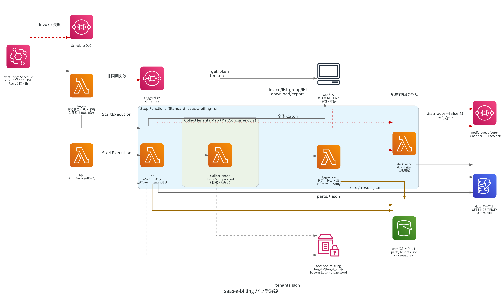
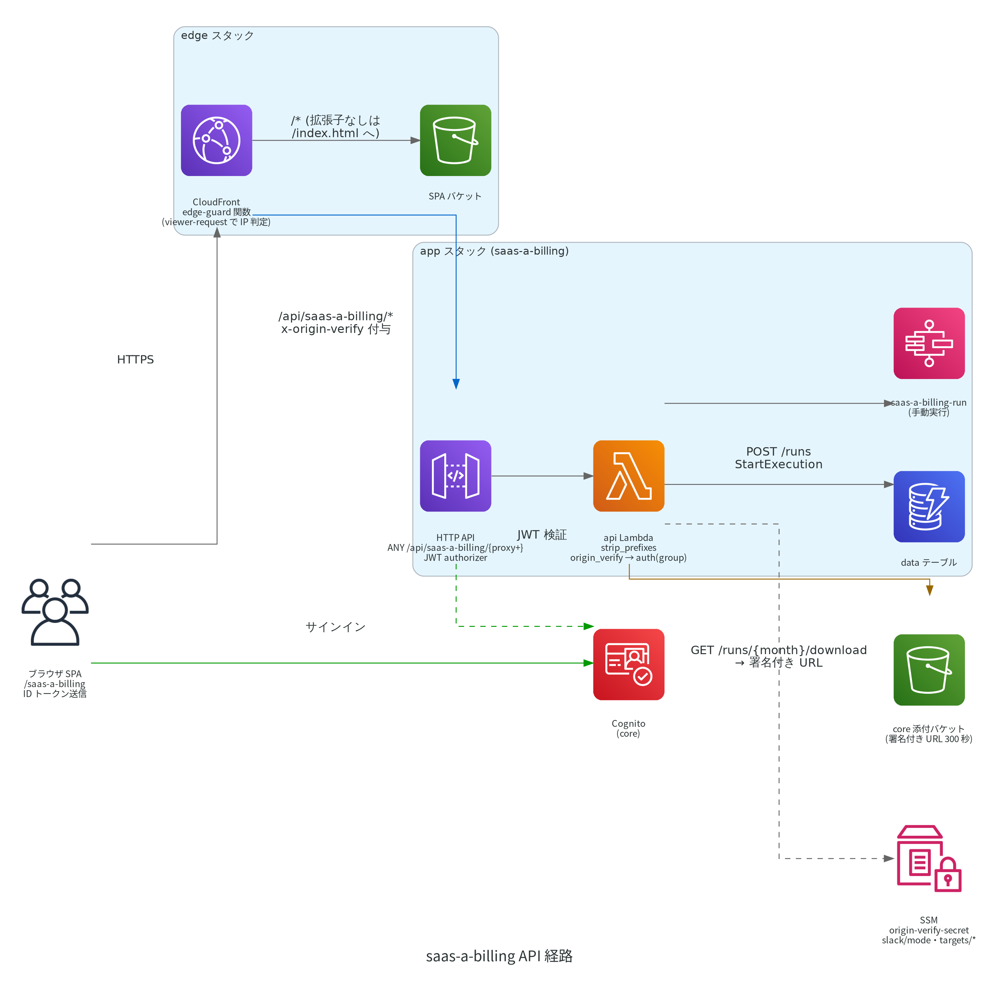

# SaaS_A 月額課金レポート アプリ設計書（saas-a-billing）

作成日: 2026-08-27
ステータス: 実装済み（2026-09-02 本番リリース。#1006 同時実行防止・配布見送り / #1009 ログ画面 / #1010 テナント説明とデモ行の色分け / #1011 Slack の候補入力 / #1015 自動実行を月 1 回に限定 を反映。2026-09-28 チケット #1017 で判定の基準時点（2.2）と Excel・メール・画面の文言（観測データの日時基準、前月分の結果）を反映）
改訂（2026-10-01、#1018）: メール添付 Excel のシート範囲を設定で選択。既定はシート1のみ、画面ダウンロードは常に2シート（3.3・3.5・6.6〜6.8・7〜11・13章）
親設計書: [../../DESIGN.md](../../DESIGN.md)（example-backoffice プラットフォーム）
注記: 図は `images/` の生成画像を参照する（AWS 構成図は Python diagrams による PNG、状態遷移図は mermaid-cli による SVG。生成スクリプトは同ディレクトリ）。

---

## 1. 目的

SaaS_A 本番環境の全テナント・全地点を毎月の締め日で棚卸しし、ベンダーAから届く月額ライセンス請求書を照合するための一覧（Excel）を自動生成・自動配布する。

- 対象: ベンダーA → 弊社の請求（顧客への請求ではない）
- 現状: `.claude/skills/saas-a-billing-report`（AI が検証環境を手動集計して PDF 化）。これを本番環境・無人運転に置き換える
- 運用開始目標: 2026年10月分（10/20 締め → 10/21 06:00 初回自動実行）

## 2. 業務ルール

### 2.1 締め日時と課金対象期間
- 締め日時は設定できる。設定項目は `cutoff_day`（1〜28、既定 20）と `cutoff_time`（`HH:MM`、既定 `24:00`。`24:00` は「その日の終わりまで含む」= 翌日 00:00 の意味）
- 締め日時 = 対象月の `cutoff_day` 日 `cutoff_time`
- 課金対象期間 = [前月の締め日時, 当月の締め日時)。既定では **前月21日 00:00:00 〜 当月20日 23:59:59**（観測データの日時 `change_datetime` 基準、JST）。本書では課金対象期間を「締め期間」とも呼ぶ
- export の日時列 `change_datetime` は観測データの日時で、サーバーが受け取った時刻ではない（2026-09-28 本番実測: 全地点すべてで秒が 00）。ロガーがためて後から送ったデータは、観測が期間内なら期間内に数える。集計の実行時点でまだ届いていないデータは数えられない
- 対象月 = 締め日が属する年月（既定では 20 日が属する月）
- 商慣習上の「20日締め」は 20 日いっぱいを含む解釈であり、ベンダーA営業の「20 日に 1 か月分を締める（人力）」もこの解釈で運用する
- 設定画面の表記は「締め日: 毎月 20 日 / 締め時刻: 24:00（その日の終わりまで含む）」とし、レポート先頭に課金対象期間を展開して表記する

### 2.2 課金判定（地点ごと）
1. **除外（課金対象外）**: テナントの説明欄（`tenant_description`）または地点の備考欄（`device_description`）に除外キーワード（既定「デモ」）を含む地点。地点名・地点CD・現場名は判定に使わない
2. **通信なし（0円）**: 除外でない地点のうち、課金対象期間内に受信データが 1 件も無い地点（課金対象期間の export に当該地点CDの行が 1 行も現れない地点）。単価は表示するが金額 0 円、色分けで明示する
3. **課金**: 上記以外。単価 = 単価表（保存期間 × 項目数帯 / カメラ）

優先順位: 除外 > 通信なし > 課金。

- 課金対象期間内の受信が「期間の初日のみ」または「最終日のみ」の地点は、判定・金額を変えずに明細の備考へ「境界日のみ受信」と印を付ける（赤字ではなく通常色）。人力締めとの境界ずれを説明するため

判定の基準時点（ユーザー決定 2026-09-28、チケット #1017。判定ルール自体は上記のまま）:

| 項目 | 基準 |
|---|---|
| 受信 | 課金対象期間内に受信データが 1 件でもあれば課金。締め日当日の稼働だけを見るのではない |
| 除外キーワード（「デモ」） | 集計を実行した時点のテナント説明欄・地点備考欄で判定する。過去の時点の内容は取得できない |
| 地点の有無 | 集計を実行した時点の地点一覧（`device/list`）に載っている地点が対象 |

- 期間で見る理由: 従来の考え方は締め日当日の稼働だったが、1 週間間隔の観測など送信間隔の長い使い方を今後想定するため、期間内の受信で判定するのが公平である
- 自動実行は締めの翌朝 06:00 なので、説明欄・備考欄は実質的に締め日の状態で判定される。後日の手動実行・再実行ではその時点の値になり、締め後に説明欄を変えると結果が変わる（実例: 2026-09-24 にテナント説明へ除外キーワードを入れたあとの実行では、全地点が除外になった）

### 2.3 単価表（既定値: support-tracker #2001、2025/9/1 時点）

| 項目数帯 | 3年保存 | 1年保存 |
|---|---|---|
| 〜500 | 650円 | 450円 |
| 〜800 | 1,000円 | 700円 |
| 〜1,600 | 1,200円 | 900円 |
| 〜1,700 | 1,350円 | 1,000円 |
| カメラ地点 | 1,800円 | 1,400円 |

- 保存期間はテナント属性（`retention_period` = 1 または 3）
- 項目数は地点のフォーマット項目数（`device/list` 応答の `format_detail` 配列の要素数。MCP 応答では `format_detail_count`）
- カメラ地点以外で 1,700 超は上限帯の単価を仮適用して課金し（合計に含める）、赤字の「要確認」を付ける。`retention_period` が 1 / 3 以外（null 含む）の地点も 3 年扱いの仮単価で課金し、同じく「要確認」を付ける
- カメラ地点以外で項目数が 0 の地点は 0 円で計上し、赤字の「要確認」（`NO_ITEMS`）を付ける（カメラ地点は項目数を見ずにカメラ単価）
- 単価表は設定画面から編集でき、**適用開始日付きで履歴保持**する。各月の集計は「その締め日に有効な単価表」で計算し、レポートに使用した単価表を明記する
- **既定値の自動シード**: 単価表が 1 版も登録されていない場合、初回の読み出し時に本表（#2001）を適用開始日 `2025-09-01` で自動投入する（未来日の版だけがある状態では投入しない。登録済みの版には触れない）。手作業での初版登録は不要
- 設定画面の単価表 UI: 「現在の単価」を円表記の表で常時表示し、改定は「単価を改定する」ボタンで開く入力フォームから登録する（適用予定の未来版は予告表示、過去の版は折りたたみの履歴に出す）

### 2.4 カメラ地点の判定
- 課金対象期間の export（CSV）はフォーマットごとのブロックに分かれ、ブロック先頭にヘッダ行が再出現する。ヘッダ行に「Base64形式データ」列を含むブロックに現れた地点CDをカメラ地点とみなす。数えるのは `change_datetime` が課金対象期間内の行だけである（R4 実測: CamA-MC のヘッダは `field_name,point_cd,point_name,change_datetime,パケット種別,ファイル名,Base64形式データ`。Base64 列の値は "SUCCESS" 固定で画像本体は含まれない）
- 課金対象期間に受信が無いカメラ地点はヘッダで判定できないため、設定画面の「カメラ扱いフォーマット名リスト」（`format_name` の完全一致）で補強する。両方の判定結果は OR で扱い、明細にどちらで判定したかを残す

### 2.5 照合時に差異が出うる要因（レポート脚注に記載）
- 集計を実行するまでに削除された地点は API の地点一覧に現れない。前月分の結果（7.1 末尾）と突き合わせて「消えた地点」として検出し、シート2に列挙する（金額は計上しない）
- 課金対象期間中に追加された地点は、受信があれば 1 か月分として課金扱いになる（日割り無し）
- ベンダーA側の締め処理時刻との微差（境界日のみ受信の地点は明細に印を付ける）
- メール添付がシート1のみの場合は、削除された地点の脚注からシート2への言及を外し、境界日の脚注は載せない（6.6）

## 3. 機能要件

### 3.1 月次自動実行
- EventBridge Scheduler が毎日 06:00 JST に trigger Lambda を起動する。trigger は「最新の締め日時が現在時刻以前」の対象月を、その月にまだ自動実行していなければ 1 回だけ集計して配布する（自動実行は月 1 回きり。締め日時を過ぎてから手動実行で配布まで済んだ月は走らない。締め前の手動実行の結果は上書きする。6.2）。既定（20日 24:00 締め）では毎月 21 日 06:00 に実行される
- 収集 → 判定・集計 → Excel 生成 → S3 保存 → 共通 notify へ投函（メール: Excel を添付、Slack: テキスト + サマリ + ポータル URL）→ 実行履歴に記録
- 自動実行が失敗しても、翌日以降に自動では再実行しない。失敗通知（6.8）を見て画面から手動で実行する（14.3）
- 「未実行の検知」はこの trigger のロジックで兼ねる（別アラームは作らない）
- 同一対象月の二重送信は実行履歴テーブルで冪等化する。自動実行は月 1 回きりで、締め後に配布まで済んだ月は走らない。ただし締め前に配布ありで手動実行した月は、締め後の自動実行が集計し直して再度配る（6.2）
- **同じ集計環境で別の月の RUN が走っている間は起動しない**（SaaS_A の管理 API が 1 ユーザー 1 トークンのため。6.2）。最長 10 分待ち、空かなければ見送って手動実行を促す通知を出す
- **取得失敗のテナントがある月は Excel を配布しない**。金額が過少になるため、配布見送りの通知だけを出して再実行を促す（6.8）

### 3.2 手動実行
- 画面から「対象月を指定して実行」できる
- **集計対象環境は選べない**。サイトに固定された環境（3.7）で必ず実行する。画面は固定環境をチップで表示するだけで、`POST /runs` にも環境を送らない
- 用途: 締め前の事前確認・テスト実行（`distribute=false` で配布せず画面と Excel だけ確認する）、失敗後の再実行、締め後のデモ、登録漏れのテナント/地点が見つかったときの再集計、再送（`force=true` で成功済みの月を再集計して配布し直す）
- **締め日時より前に始めた手動実行の結果は確定値ではない**。締め日時を過ぎた翌 06:00 のスケジュール実行が集計し直して上書きする。締め日時を過ぎてから手動実行で配布まで済ませた月は、スケジュール実行は走らない（6.2）
- **配布の既定は「しない」**（`distribute=false`）。配布する場合は画面で実際の宛先（メール宛先・Slack チャンネル）を表示し、確認チェックを必須にする
- 固定環境の SSM 3 件（base-url / user-id / password）が未登録の場合は実行前にバリデーションエラーにする
- 誰がいつ手動実行したかを RUN に残す（`request_history`。直近 20 件。7.1）
- **同じ集計環境に実行中の RUN があるときと、スケジュール実行の直前 1 分は実行できない**（409。6.2 / 8 章）。画面には実行中の月や次に実行できる時刻がそのまま出る

### 3.3 設定画面
| 設定 | 内容 | 既定値 |
|---|---|---|
| 集計対象環境 | `target_env`。**表示のみ**（3.7 のスタックパラメータで固定。画面からは変更できない） | サイトの固定値 |
| 締め日 | `cutoff_day`。1〜28 | 20 |
| 締め時刻 | `cutoff_time`。`HH:MM`。`24:00` は「その日の終わりまで含む」 | `24:00` |
| 自動実行 | 有効 / 無効（無効時は trigger を空振りさせる。dev は無効運用） | 無効（導入手順で有効化） |
| 自動実行の開始月 | `auto_run_from_month`。`YYYY-MM`。これより前の対象月は自動実行しない | 導入月（seed 時は当月） |
| 実行時刻 | 06:00 JST 固定（template の `ScheduleHour` / `ScheduleMinute`。Scheduler の cron と api の直前判定が同じ値を使う） | 06:00 |
| メール配布 | `mail_enabled`。メール配布の有効 / 無効（Slack とは独立のトグル） | 無効 |
| Slack 配布 | `slack_enabled`。Slack 配布の有効 / 無効（メールとは独立のトグル） | 無効 |
| メール宛先 | To / Cc のアドレスリスト。**メール配布が有効なときのみ To が必須** | To=`["devA@example.co.jp"]` / Cc=空（dev / prod とも） |
| メールに添付する Excel | `mail_attachment_sheets`。シート 1（請求照合）のみ（`billing_only`）/ 両方のシート（請求照合 + 全地点）（`all`） | `billing_only`（シート 1 のみ） |
| Slack チャンネル | `slack_channel_id`。**Slack 配布が有効なときのみ必須**。欄に `#` を打つと候補が出て、選ぶと名前のチップになる（#1011）。保存値は Slack のチャンネル ID（例 `C0123ABCD`。名前は改称で壊れるため ID で保持する）で、**画面には ID を出さない**。送信は共通 notify 経由（投稿用のトークンは core の notifier が持つ） | `#proj-saas-a-billing`（初期セットアップで候補から選ぶ） |
| Slack チャンネル表示名 | `slack_channel_label`。画面表示用の人向けメモで、投稿先の決定には使わない。**手入力の欄は廃止**（候補から選んだ名前を自動でセットする。#1011）。保存形式は変えない | `#proj-saas-a-billing` |
| Slack メンション | `slack_mention`。本文先頭に付ける文字列（`<!here>` / `<@U0123>` / `<!subteam^S0123>` を空白区切り）。空可。欄に `@` を打つと候補（ユーザー・`@here`・`@channel`）が出て、選ぶと名前のチップになる（ユーザーグループは候補に出さない。保存済みの `<!subteam^…>` は `@グループ` のチップで残る）。複数指定できる。保存形式は変えない（#1011） | 空 |
| Slack 文面 | テンプレート。プレースホルダ `{month}` `{period}` `{tenants}` `{devices}` `{billable}` `{total}` `{url}` | 3.6 の既定文 |
| 単価表 | 保存期間 × 項目数帯、カメラ単価、適用開始日 | #2001 の値 |
| 除外キーワード | 説明欄・備考欄に含まれたら除外（配列） | `["デモ"]` |
| カメラ扱いフォーマット名 | 明示指定リスト | 空 |
| 接続先 | 固定環境に対応する SSM SecureString のベース URL。画面は表示のみ（ホスト名と環境バッジ） | dev=検証環境、prod=本番 |

- 変更は誰がいつ何を変えたかを記録する（`updated_by` = Cognito の sub、`updated_by_email` = email、`updated_at` = 更新日時）
- **配布は既定で両方無効**。メール / Slack を配布に使うには設定画面で明示的に有効化する（既存の設定レコードに `mail_enabled` / `slack_enabled` が無い場合は読み出し時に無効として補完する）。両方無効でも集計・画面の内訳表示・Excel ダウンロードは全く制限されない
- Slack が Webhook フォールバック（プラットフォーム設計 8.5）で動作している間は、選んだチャンネルが無視される（投稿先は Webhook 側で固定される）旨を画面に表示する
- **チャンネル・メンションは候補から選ぶ**（`GET /slack/directory`）。自由入力は保存しない。候補に無い保存値（改称・退職・取得失敗）は失わず、チャンネルは `slack_channel_label`、メンションは `@不明なユーザー` / `@グループ` に読み替えてチップで見せる（`slack_channel_label` も空のときに限り `#<ID>` を最後の手段として出す）。候補の取得に失敗しても警告と「再取得」ボタンを出すだけで、設定の編集と保存は続けられる（#1011）
- **候補の流れ**: 設定画面を開いた時点で（`admin` のときだけ・未取得のときだけ）`GET /slack/directory` を 1 回呼び、返ったチャンネルとユーザーを画面に持つ。`#` / `@` に続けて打った文字で名前・ハンドル・実名を絞り込み、選んだ時点で保存値（チャンネル ID / メンション記法）が入る。画面に出るのは名前だけである。「再取得」は同じ API を `?refresh=1` で呼ぶ。取得元・キャッシュ・エラーは 8 章の `GET /slack/directory` を見る
- **`target_env` は保存できない**。`PUT /settings` に固定値と異なる値が来たら 400 `TARGET_ENV_FIXED` で拒否する（省略は許容し、画面は送らない）。固定環境の SSM SecureString 3 件（`base-url` / `user-id` / `password`）が未登録なら 400 `TARGET_ENV_NOT_CONFIGURED` で保存を拒否する
- 画面上部のサマリカードに固定の集計対象環境と接続先ホストを常時表示し、検証環境のときはオレンジ、本番のときは緑のバッジを出す。「このサイトでは固定です（画面からは変更できません）」の注記を添える
- **保存できないときは理由を画面に表示する**（入力エラーの列挙、SSM 未登録の名指し等）
- 未保存の変更があるまま画面を離れようとしたら確認ダイアログで止める（`onBeforeRouteLeave` + `beforeunload`）。「変更を破棄」でサーバの値に戻す
- 保存結果・単価改定の結果はスナックバーで通知する。`admin` 以外は入力を `disabled` にして読み取り専用であることを見た目で分かるようにする

メールの配布先には全件のシートが不要で、外注先に全地点の一覧を渡したくないという要望がある。今後の配布方針の変更に備え、メール添付のシート範囲をアプリごとに 1 つの設定にする（2026-10-01、#1018）。

- 保存済みの設定に `mail_attachment_sheets` が無い場合は、読み出し時に `billing_only` で補完する。画面でも項目が返らなければ同じ既定値を使う。変更はほかの設定と同じ監査に残し、項目名は「メールに添付する Excel」と表示する

### 3.4 レポート閲覧
- 過去の実行結果一覧（集計対象環境、対象月、実行日時、テナント数、地点数、通信なし数、除外数、合計金額、配布状況、Excel ダウンロード）
- **環境の絞り込みは無い**（サイト固定のため）。ただし各行の環境バッジ（検証=オレンジ、本番=緑）は残す。dev には過去の `RUN#production` 行が残るため識別に要る
- 一覧は画面に入るたび取り直し、更新ボタンと最終更新時刻を出す。実行中（`queued` / `running`）の RUN がある間だけ 10 秒ごとに自動更新し、画面を離れたら止める
- 選択した月の内訳を画面表示（テナント → 現場 → 地点。色分けは Excel と同じ）。**合計金額は内訳の先頭に大きく太字で出す**（一覧の合計金額列も太字）
- テナント行にはテナント説明を薄字で添える。**テナント説明が除外キーワードに一致するテナント（デモ）はテナント行を除外色 `#DFE9F8` で塗る**（Excel のテナント別サマリと同じ意味・同じ色）
- 判定の凡例（判定 5 種 + 要確認 3 種 + デモテナント）を折りたたみで添える
- **消えた地点は薄いピンク `#FCE4EC`・文字色 `#616161`** で塗る（Excel と同じ色）。塗りなしだと「課金」と見分けが付かなかった（#1012）
- 画面の語（「要確認のみ」「境界日のみ受信」等）の意味は**ヘルプモード**で補う。アプリバーの「？」を ON にすると、件数タイル・列見出し・判定チップ・凡例・絞り込み・各入力欄にマウスオーバーで説明が出る（プラットフォーム設計 9.5 の `HelpTip`）。文言は `apps/saas-a-billing/help.ts` に集約し、同じ語が複数画面に出るときも 1 か所だけを直す
- 日時は JST `YYYY-MM-DD HH:mm`（課金対象期間のみ秒まで）、金額は `¥1,234,567` に統一する

### 3.5 Excel レイアウト
画面からダウンロードする Excel は、`mail_attachment_sheets` に関係なく常に 2 シート構成とする。メール添付は `billing_only` ならシート1のみ、`all` なら両方のシートを含める。各シートの先頭に、設定値から生成した処理仕様ブロック（対象月・**合計金額**・集計処理日時・締め日時・集計対象環境・課金対象期間・除外ルール・使用単価表・環境・試行回数・取得失敗テナント）を置く。合計金額は太字・大きめ・塗りで強調し、シートを開いた瞬間に読めるようにする。

- シート1「請求照合」: ベンダーA請求書との突合用。判定が「課金」の地点だけを載せる。合計ブロック（課金地点数・合計金額・保存期間別内訳・カメラ内訳）→ テナントブロック（見出し・地点行・小計）→ 課金地点なしのテナント一覧 → 使用単価表 → 脚注
- シート2「全地点（管理用）」: 判定別件数 → テナント別サマリ表 → 全地点明細（Excel のテーブル + オートフィルタ）
- 色: 通信なし=アンバー、除外=青、取得失敗=灰、消えた地点=薄いピンク、要確認=赤文字。保存期間セルは 3年=緑、1年=紫、不明=赤字（モノクロ印刷でも文字で判別できる）
- 日本語フォント: Meiryo（中華フォント禁止）

レイアウトの詳細は 6.6 に記載する。

### 3.6 通知
- **配布先はメール（`mail_enabled`）と Slack（`slack_enabled`）の独立トグルで決まる**（既定は両方無効）。有効な配布先が無ければ何も送らない（集計・画面表示・ダウンロードは影響を受けない）
- メール: 件名「【SaaS_A】月額ライセンス料金一覧 YYYY年M月分（M/20締め）」（月はゼロ埋めしない）、本文にサマリ（テナント数・地点数・通信なし・除外・要確認・消えた地点・合計）と画面URL、設定 `mail_attachment_sheets` に従った Excel 添付（既定はシート1のみ）
- Slack: テキスト + サマリ + ポータル URL。既定文面は「{month} の SaaS_A 月額課金レポートを送付しました。ベンダーA請求書との照合を忘れずに。合計 {total}（課金 {billable} 地点）」＋ポータル URL。Excel は添付しない
- 集計対象環境が検証環境のときは、件名末尾に `[検証環境]`、Slack 本文の先頭に `【検証環境】` を付け、添付名を `saas_a_billing_{YYYY-MM}_verification.xlsx` にする（6.8）
- 失敗時: 設定で有効な配布先（Slack チャンネル / `mail_to`）にアラーム通知（エラー概要・再実行手順の画面URL）。別チャンネルは作らない
- **手動実行の「配布しない」（`distribute=false`）は設定より優先する**。この RUN では成功レポートも失敗通知も一切送らない（テスト実行で通知が飛ばないことを保証する）
- 宛先は共通 notify が送信直前に `@example.co.jp` だけに絞る（プラットフォーム設計 8.2）。設定画面のバリデーションを抜けた社外アドレスもここで止まる

### 3.7 集計対象環境の固定

集計対象の SaaS_A 環境（`target_env`）は**サイトごとにスタックパラメータで固定**し、画面・API・実行入力のいずれからも切り替えられない。

| サイト | `TargetEnv` | 集計対象 | ラベル |
|---|---|---|---|
| dev（`backoffice-dev.example-cloud.com`） | `verification` | SaaS_A 検証環境 | 「検証環境」オレンジ |
| prod（`backoffice.example-cloud.com`） | `production` | SaaS_A 本番 | 「本番」緑 |

- `TargetEnv` は `apps/saas-a-billing/template.yaml` のパラメータ（`AllowedValues: [verification, production]`）で、`samconfig.toml` が dev=`verification` / prod=`production` を渡す。全 Lambda に環境変数 `TARGET_ENV` として入る
- **正は環境変数**。`trigger` / `init` / `aggregate` / `mark_failed` は設定レコードや実行入力ではなく `TARGET_ENV` を読む。`GET /settings` の `target_env` は保存値に関わらず固定値を返す
- `TARGET_ENV` が未設定・想定外の値のときは `verification` にフォールバックする（誤って本番ラベルで配布するより検証ラベルで止まるほうが安全。prod では `targets/verification/*` が SSM に無いので `Init` が `TARGET_ENV_NOT_CONFIGURED` で落ちる）。フォールバックが起きたことは警告ログに残す
- **参照する SSM は固定環境の 3 本だけ**。IAM の `ssm:GetParameter*` も `targets/{TargetEnv}` とその配下に限定してあるため、もう一方の環境は読めない
- **ラベルは維持する**（環境バッジ、メール件名の `[検証環境]`、Slack 本文先頭の `【検証環境】`、Excel ファイル名の `_verification`、S3 プレフィックス、RUN の PK `RUN#{target_env}`）。成果物だけを見ても検証か本番かを判別できる状態を保つ

この方式（サイト固定）を採った理由: 画面から本番を選べる限り、検証のつもりで本番を集計して社外向けの請求照合データを配布してしまう事故が起こりうる。環境の選択をデプロイ時の決定に落とすことで、実行時の操作ミスで本番に触れる経路そのものを無くす。

## 4. SaaS_A API の利用

| 用途 | エンドポイント | 備考 |
|---|---|---|
| 認証 | `POST /api/v2/getToken` | 実行のたびにログイン。`token_info.access_token` をメモリ内のみで保持。ログアウト API は無く、トークンは `expires_at` で失効する |
| テナント一覧 | `GET /api/v2/tenant/list` | `tenant_description` / `retention_period` / `device_count`。`page`/`perPage` でページング（`data.count` と `data.rows`） |
| 現場一覧 | `GET /api/v2/group/list` | 現場名の表示順用（`groups[]`） |
| 地点一覧 | `GET /api/v2/device/list` | `device_description` / `format_name` / `format_detail[]` / `group_cds` / `group_names`。`perPage=999` で全ページ取得 |
| 受信有無 | `GET /api/v2/download/export` | **テナント一括**（`group_cd=all&device_cd=all&push_type=csv&output_type=raw_data`）を **7 日窓**で分割して取得（R4 で確定）。CSV は Shift-JIS（`cp932`）。1 回の上限 100,000 行。超過時は HTTP 400 `Error.Export.LimitOver,<件数>,<上限>` |

- 検証環境・本番のそれぞれに専用 API ユーザーを作成する（1 ユーザー 1 トークンのため、人や `saasa-dev` MCP と共用しない）。export は権限レベル「システム管理者・テナント管理者・現場管理者」、全テナント横断にはシステム管理者権限が必要
- 接続先はサイト固定の `TARGET_ENV`（3.7）で決まる。認証情報は SSM Parameter Store SecureString `/example-backoffice/{env}/apps/saas-a-billing/targets/{TARGET_ENV}/base-url` / `user-id` / `password` に置く。**サイトが読むのは固定環境の 1 セットだけ**（dev は `targets/verification/*`、prod は `targets/production/*`）
- `base-url` は `https://` 以外のスキームを受け付けない（読み出し時に検査し、違反は接続前に失敗させる）
- 本番 API（Bearer 版）の公開前は検証環境の URL を `targets/production/base-url` に登録して prod サイトを立ち上げてよい（公開後に `aws ssm put-parameter --overwrite` で差し替える。14.4）

## 5. アーキテクチャ

### 5.1 スタックと配置

| 項目 | 値 |
|---|---|
| スタック名 | `example-backoffice-app-saas-a-billing-{env}`（env ∈ {dev, prod}） |
| 集計対象環境 | パラメータ `TargetEnv`（`verification` / `production`）。dev=`verification` / prod=`production`（3.7）。全 Lambda の環境変数 `TARGET_ENV` |
| リージョン | ap-northeast-1 |
| ランタイム | Python 3.13 / SAM |
| 前提規模 | 当面 〜50 テナント・〜500 地点。将来 2,000〜3,000 地点 |
| Lambda | `api`（HTTP API ハンドラ）、`trigger`（実行判定）、`init` / `collect_tenant` / `aggregate` / `mark_failed`（ステートマシンのタスク） |
| ステートマシン | Step Functions（Standard）`saas-a-billing-run`。収集をテナント分割する |
| ストレージ | DynamoDB `example-backoffice-saas-a-billing-data-{env}`（プラットフォーム設計 14.1 の命名規約）、S3 は core の添付バケット（プレフィックス `saas-a-billing/`） |
| スケジュール | EventBridge Scheduler `cron(0 6 * * ? *)`、`ScheduleExpressionTimezone: Asia/Tokyo`、FlexibleTimeWindow OFF → `trigger` Lambda |
| 通知 | core の共通 notify SQS（shared レイヤの `notify.send`） |
| ポータル URL | prod `https://backoffice.example-cloud.com/saas-a-billing`、dev `https://backoffice-dev.example-cloud.com/saas-a-billing` |
| API ルート | `ANY /api/saas-a-billing/{proxy+}`（JWT authorizer = Cognito） |

### 5.2 バッチ経路



### 5.3 API 経路



### 5.4 プラットフォームとの契約（SSM）

| 方向 | キー | 用途 |
|---|---|---|
| 読む（テンプレートパラメータ `AWS::SSM::Parameter::Value<String>`） | `/example-backoffice/{env}/cognito/user-pool-id` | 参照用 |
| 同上 | `/example-backoffice/{env}/cognito/client-id` | JWT authorizer の audience |
| 同上 | `/example-backoffice/{env}/cognito/issuer` | JWT authorizer の issuer |
| 同上 | `/example-backoffice/{env}/notify/queue-url` | `notify.send` の投函先（環境変数 `NOTIFY_QUEUE_URL`） |
| 同上 | `/example-backoffice/{env}/notify/queue-arn` | IAM `sqs:SendMessage` の Resource |
| 同上 | `/example-backoffice/{env}/attachments/bucket` | Excel / result.json の保存先（環境変数 `ATTACHMENTS_BUCKET`） |
| 同上 | `/example-backoffice/{env}/shared/layer-arn` | shared レイヤ |
| 同上 | `/example-backoffice/{env}/ops/topic-arn` | パラメータ `OpsTopicArn`。アラーム 4 本の `AlarmActions` |
| 読む（Lambda 実行時、SecureString） | `/example-backoffice/{env}/edge/origin-verify-secret` | shared の `origin_verify` ミドルウェア |
| 読む（Lambda 実行時、SecureString） | `/example-backoffice/{env}/apps/saas-a-billing/targets/{TARGET_ENV}/base-url` / `user-id` / `password` | SaaS_A API 接続。**サイト固定の 1 セットのみ**（3.7） |
| 読む（Lambda 実行時、String） | `/example-backoffice/{env}/shared/slack/mode` | `GET /settings` が返す `slack_mode`。書き手は shared スタックだけ（samconfig の `SlackMode`）で、登録スクリプトは書かない |
| 読む（Lambda 実行時、SecureString） | `/example-backoffice/{env}/shared/slack/bot-token` | `GET /slack/directory` の候補検索だけに使う読み取り（#1011）。投稿は core の notifier が行い、アプリは Slack の書き込み系 API を呼ばない |
| 書く（`AWS::SSM::Parameter`） | `/example-backoffice/{env}/apps/saas-a-billing/api-domain` | edge が origin として読む |

- prod は `samconfig.toml` の `[production.deploy.parameters]` でキー名（値ではない）を `/example-backoffice/prod/...` に上書きする。`tests/infra/test_samconfig.py` が dev / prod 両方の `parameter_overrides` を機械検査する
- IAM の `ssm:GetParameter*` は `targets/{TargetEnv}` とその配下の 2 本に限定する。`get_parameters_by_path` はパスそのものの ARN にも権限が要るため、配下（`/*`）だけでは足りない

### 5.5 コード構成

```text
apps/saas-a-billing/
  template.yaml                  # HttpApi, api/trigger/batch Function, StateMachine, Table, ScheduleV2, DLQ, SSM書出し
  statemachine/
    run.asl.json                 # saas-a-billing-run の定義（DefinitionSubstitutions で関数 ARN を注入）
  samconfig.toml                 # [default]=dev, [production]
  functions/                     # 全関数が共有する 1 パッケージ（CodeUri は 1 つ、Handler だけを分ける）
    requirements.txt             # XlsxWriter, requests（boto3/Powertools はランタイム同梱・レイヤ）
    api/app.py                   # APIGatewayHttpResolver。ルート定義のみ
    batch/handlers/
      trigger.py                 # 締め日時と RUN 状態を判定して StartExecution
      init.py                    # RUN 取得・設定/単価解決・getToken・tenant/list 全ページ
      collect_tenant.py          # テナント 1 件の収集 → S3 parts/{tenant_cd}.json
      aggregate.py               # parts 集約・判定・削除地点差分・Excel・S3・RUN 更新・notify
      mark_failed.py             # RUN=failed + エラー要約 + 失敗通知
    saas_a_billing/
      period.py                  # 締め日時・課金対象期間・対象月・窓分割（純粋関数）
      schedule.py                # スケジュール実行の直前判定（純粋関数。手動実行の 409）
      saasa_client.py          # getToken / list / export（requests、ストリーム）
      export_parser.py           # CSV 行ストリーム → 受信あり集合・カメラ集合・初回/最終受信日時
      billing.py                 # 除外/通信なし/課金 判定・金額計算（純粋関数）
      pricing.py                 # 単価表の版解決・単価引き（純粋関数）
      distribution.py            # 配布先判定（mail_enabled / slack_enabled → channels。全送信経路が共用）
      excel.py                   # XlsxWriter で 2 シートを生成（BytesIO）
      repo.py                    # DynamoDB アクセス（SETTINGS/PRICE/RUN/AUDIT）
      storage.py                 # S3 put/get/presign（parts / xlsx / result.json）
      messages.py                # メール件名・本文・Slack 文面の組立
      slack_directory.py         # 設定画面の #/@ 候補（conversations.list / users.list、300 秒キャッシュ）
  tests/
    unit/                        # period / schedule / billing / pricing / export_parser / excel
    integration/                 # moto + responses で handler を一気通貫
    fixtures/                    # R4 由来の縮小 CSV（cp932）、API 応答 JSON
```

- 6 つの関数（`api` / `trigger` / `init` / `collect_tenant` / `aggregate` / `mark_failed`）は同一 `CodeUri: functions/` を共有し、Handler だけを分ける（ビルド 1 回、共通パッケージの二重管理なし）
- 画面側の #1011 分は `frontend/src/components/TriggerSuggestField.vue`（`#` / `@` の候補入力。アプリに依存しない共通部品）と `frontend/src/apps/saas-a-billing/utils/slackMention.ts`（`slack_mention` の保存文字列 ⇄ トークン配列の変換）にある
- `api`: timeout 29 秒、メモリ 512MB。`trigger`: timeout 900 秒（実行中 RUN の待機。6.2）、メモリ 256MB。`init` / `aggregate` / `mark_failed` / `collect_tenant`: timeout 900 秒、メモリ 1024MB。すべてに shared レイヤを付ける

## 6. バッチ処理の詳細

### 6.1 起動イベント

| trigger | 発行元 | ステートマシンへの入力 | distribute | force |
|---|---|---|---|---|
| `scheduled` | EventBridge Scheduler（毎日 06:00 JST）→ `trigger` Lambda → `StartExecution` | `{"trigger":"scheduled","target_env":"production","month":"2026-10","attempt":1,"run_token":"<uuid>","distribute":true,"force":true}` | 常に true | 常に true（締め前の手動実行の結果や失敗の RUN を奪うため。6.2） |
| `manual` | api（`POST /runs`）→ `StartExecution` | `{"trigger":"manual","target_env":"verification","month":"2026-09","attempt":1,"distribute":false,"force":false,"run_token":"<uuid>","requested_by":"<cognito sub>","requested_by_email":"<email>"}` | 画面指定（**既定 false**） | 画面指定（既定 false） |

- ステートマシンへの入力には実行名・実行履歴の可読性のために `target_env` を載せるが、**Lambda はこれを読まない**。各ハンドラは環境変数 `TARGET_ENV` を正とする（3.7）
- 実行名は `{target_env}-{YYYY-MM}-{attempt}-{uuid8}`。同一環境・同一対象月・同一試行の二重起動は実行名の重複で弾かれる

### 6.2 実行判定（trigger Lambda）

```text
settings = repo.get_settings()
target   = repo.target_env()                    # 環境変数 TARGET_ENV（サイト固定。3.7）
now      = now(JST)
cutoff   = latest_cutoff(now, settings.cutoff_day, settings.cutoff_time)
           # 現在時刻以前で最も新しい締め日時。cutoff_time が 24:00 なら翌日 00:00
month    = target_month(cutoff)                 # 締め日が属する年月
if not settings.auto_run_enabled:               -> 空振り（AUTO_RUN_DISABLED。INFO ログのみ）
if month < settings.auto_run_from_month:        -> 空振り（BEFORE_AUTO_RUN_FROM_MONTH。導入前の月を拾わない）
run = repo.get_run(target, month)
if run is None:                                 -> 起動へ（START）
if run.request_history に trigger == "scheduled" がある:
                                                -> 空振り（ALREADY_SCHEDULED。結果を問わず月 1 回きり）
if run.status in (queued, running) and not stale(run):
                                                -> 空振り（IN_PROGRESS）
if 配布した attempt の開始時刻 >= cutoff:        -> 空振り（ALREADY_DISTRIBUTED。締め後に配布済み）
                                                # run.distributed_started_at。無い旧 RUN は
                                                #   status == distributed の started_at で代える
それ以外                                         -> 起動へ（START。締め前の手動結果・失敗・stale・
                                                #   締め後でも配布なしの成功を上書き）
wait_for_idle(target)                           # active_runs(target) が空くまで 15 秒間隔・最長 10 分
if まだ実行中の RUN がある:                       -> 空振り（BUSY_SKIP）+ 「見送り」通知
if 待った:                                        RUN を読み直して上の判定をやり直す
acquire_run(target, month, trigger="scheduled", force=true, guard_active=true)
                                                # status=queued, attempt+1, request_history に scheduled を追記
                                                # 実行中の RUN は奪わない。奪えなければ
                                                #   -> 空振り（ACQUIRE_CONFLICT。通知なし）
                                        -> StartExecution
```

- **自動実行は月 1 回きり**（#1015）。RUN の `request_history` に `trigger == "scheduled"` の要素が 1 件でもあれば、その結果（成功・失敗・stale）を問わず、そのあとに手動実行があっても 2 回目は起動しない。定刻以外の自動配布は受信者の混乱のもとになるため。`request_history` は直近 20 件に切り詰めるが、1 か月に 20 回を超える attempt は運用上起きないので取りこぼしは許容する
- **締め日時を過ぎてから配布まで済んだ月は起動しない**。`finish_distributed` が配布した attempt の `started_at` を RUN の `distributed_started_at` に写し（6.9 / 7.1）、それが対象月の締め日時以上なら配布済みとみなす（締め日時ちょうども含む）。この属性を持たない旧 RUN は `status == distributed` かつ `started_at >= 締め日時` で同じ判定をする。`distributed_started_at` は後の attempt が失敗しても残す。配布先が両方無効・取得失敗による配布見送り・`distribute=false` の実行は `succeeded` 止まりで `distributed` にならないので、この判定には当たらない
- **それ以外は上書きする**。締め前に始めた手動実行の結果（事前確認・テスト）、失敗、stale、締め後でも配布なしで終わった手動実行（`succeeded`）は確定値ではないので、`force=true` で奪って集計し直し、配布する。締め前に配布ありで手動実行した月は、締め後の自動実行が再度配る（件名は「再送（第 n 回）」。6.8）。配布したくない事前確認は `distribute=false` で行う
- **実行中の RUN は force でも奪わない**。`acquire_run` に `guard_active` を付け、`succeeded` / `distributed` / `failed` か stale のときだけ奪う（6.9）。判定と待機を抜けた数百 ms の隙に手動実行が RUN を取った場合は `ACQUIRE_CONFLICT` で当日を見送る（通知はしない。`request_history` に scheduled は積まれないので、翌日の判定がやり直す）
- 待機（下記）を経たときは RUN を読み直して判定をやり直す。待っている間に手動実行が締め後の配布まで済ませた月を奪って二重に配らないため
- 既定（`cutoff_day=20`, `cutoff_time=24:00`）では 21 日 06:00 が最初の実行機会になる。**失敗しても翌日以降に自動では再実行しない**（#1015 で自動再試行と「要手動」アラームを廃止）。失敗は `MarkFailed` の失敗通知（6.8）で知らせ、画面から手動で実行する（14.3）
- `acquire_run` 後に `StartExecution` が失敗した場合は RUN を `failed`（`error: "StartExecution に失敗しました"`）に戻す。`queued` のまま残さないため、当日中の手動実行が 409 にならない。この経路は `MarkFailed` を通らず、翌日の自動実行も走らない（月 1 回きり）ため、trigger が設定で有効な配布先へ失敗通知（メール・Slack。原因「スケジュール実行の起動（StartExecution）に失敗しました。手動で実行してください」）を送ってから例外を送出し直す。失敗通知（メール・Slack）と Lambda Errors アラームの両方で知らせる。通知自体の失敗はログに留め、元の例外を隠さない
- 「未実行の検知」はこの判定で兼ねる。締め後にスケジュール実行がまだ起動していない月は毎日 06:00 に再評価される（`BUSY_SKIP` / `ACQUIRE_CONFLICT` で起動できなかった日の翌日を含む）ため、別のアラームは作らない。起動したあとの失敗は失敗通知で知らせる
- `stale(run)` = 翌日 06:00 の判定時点でまだ `queued` / `running` のまま残っている RUN（`started_at` が前日以前）。手動実行が刺さったまま残った RUN は翌日の trigger が奪取する。スケジュール実行が刺さった RUN は月 1 回きりの規則で奪取しないので、14.3 の手順で手動で取り直す
- **同じ集計環境で別の月の RUN が走っている間は起動しない**。SaaS_A の管理 API は 1 ユーザー 1 トークンで、後発の `Init` の `getToken` が先発のトークンを無効化するため、重ねると先発の残りテナントが全部 401 になり「取得失敗」入りの Excel ができる。`repo.active_runs(target_env)`（`queued` / `running` で `stale` でない RUN）が空くまで 15 秒間隔で最長 10 分待ってから起動する。待ち時間は `trigger` の戻り値 `waited_sec` に残す（TriggerFunction の timeout は 900 秒）
- 10 分待っても空かなければ起動せず、`skipped_reason: "BUSY_SKIP"` で見送り、「実行中の RUN があるためスケジュール実行を見送りました。手動で実行してください」を通知する（6.8）。見送った日は `request_history` に scheduled が積まれず、翌日 06:00 に同じ判定をやり直すため、二重送信の防止は置かない
- 手動実行も同じ理由で、同じ集計環境に実行中の RUN があれば 409 `OTHER_RUN_RUNNING`、スケジュール実行の直前 1 分は 409 `SCHEDULE_IMMINENT` で断る（8 章）。判定に `stale` を使うのは待機・409 の両方で同じで、落ちたまま `running` の RUN が実行を永久に塞ぐことはない
- スケジュール時刻は `template.yaml` の `ScheduleHour` / `ScheduleMinute` が正で、Scheduler の cron と api の環境変数（`SCHEDULE_HOUR` / `SCHEDULE_MINUTE` / `SCHEDULE_TIMEZONE`）を同じ値から作る。直前判定は `schedule.is_imminent()`（純粋関数）に閉じ、当日の発火時刻を過ぎていれば翌日の発火時刻と比べる（`ScheduleHour: 0` でも窓が効く）
- **残るレース**: 手動の 409 判定と `acquire_run` の間、および待機明けと `acquire_run` の間は check-then-act で、DynamoDB の条件式は同一月しか守らない。別々の月への要求がミリ秒差で来ると 2 本走り得る（発生時は従来どおり後発にトークンを奪われて「取得失敗」になる）。発火時刻ちょうど（06:00:00）を許可する仕様も、trigger が RUN を取るまでの数百 ms が素通しになる点で同じ性質。完全に潰すには `RUN#{target_env}` 単位のロックと `TransactWriteItems` が要るため、今回のスコープでは取らない
- 締め日・締め時刻を画面で変えても翌日の判定から反映される（IaC 変更なし）
- スケジュール実行の集計対象環境はサイト固定（`TARGET_ENV`）。設定レコードに別の値が残っていても使わない
- 手動実行（manual）はこの判定を通らず、api が取得済みの RUN（status=queued）を引き継ぐ。scheduled も同じく trigger が RUN を `queued` で取得してから `StartExecution` する（起動経路によらず `queued` → `running` の遷移になる）

### 6.3 ステートマシン `saas-a-billing-run`

| # | ステート | 種別 | 内容 | 失敗時 |
|---|---|---|---|---|
| 1 | `Init` | Task（Lambda） | RUN 取得（条件付き書き込みで二重起動防止）、設定・単価解決、`target_env` の確定（環境変数 `TARGET_ENV`）と当該環境の SSM 3 件の存在確認、`getToken`、トークンを RUN アイテムの属性 `api_token` に保存（`token_expires_at` = `expires_at`）、`tenant/list` 全ページ。出力はテナント ID 配列・`target_env`・`run_id` のみ | 全体 Catch → `MarkFailed`。SSM 3 件が揃わない場合は `TARGET_ENV_NOT_CONFIGURED` で即失敗 |
| 2 | `CollectTenants` | Map（`ItemsPath: $.tenants`、`MaxConcurrency: 2`、`ItemSelector` で `run_id` / `target_env` / `month` / `tenant_id` を各要素に注入） | 各要素で `CollectTenant`（Lambda）を呼ぶ。RUN からトークンを読み、6.4 の収集（device/list, group/list, export の窓分割）を行い、結果を S3 `saas-a-billing/{target_env}/{YYYY}/{MM}/parts/{tenant_cd}.json` に PUT する。戻り値は `tenant_cd` と件数サマリのみ | `Retry`（`States.TaskFailed`、2 回、`BackoffRate: 2.0`）。`Catch` は `ResultPath: $.error` を指定して元入力（`tenant_id` / `tenant_cd` 等）を保持したまま `failed: true` を返し、Map を続行する |
| 3 | `Aggregate` | Task（Lambda） | Map 出力の `tenant_cd` 一覧から parts キーを組み立てて読み込み（S3 の一覧走査に依存しない）、6.5 の判定・集計、削除地点差分、Excel 生成（6.6）、S3 PUT（6.7）、RUN=`succeeded`、`distribute` なら notify（6.8） | 全体 Catch → `MarkFailed` |
| 4 | `MarkFailed` | Task（Lambda） | RUN=`failed` + エラー要約 + 失敗通知 | 通知自体の失敗は CloudWatch ログのみ |

- **Lambda の一時エラー Retry**: `Init` / `Aggregate` / `MarkFailed` の各 Task に `Lambda.ServiceException` / `Lambda.AWSLambdaException` / `Lambda.SdkClientException` / `Lambda.TooManyRequestsException` の `Retry`（最大 3 回、間隔 2 秒、`BackoffRate: 2.0`）を付ける（`CollectTenant` は Map 内の `States.TaskFailed` Retry が兼ねる）。`MarkFailed` に `Catch` は無く、業務失敗でも実行自体は `SUCCEEDED` で終わる
- トークンは同一 API ユーザーで 1 つしか有効にならないため、**ログインは `Init` の 1 回だけ**行う。`CollectTenant` は再ログインしない（401 が出たら当該テナントの失敗として記録する）。`Aggregate` / `MarkFailed` は終了時に RUN の `api_token` / `token_expires_at` 属性を削除する
- トークンはステートマシンの入出力・実行履歴に載せない。RUN アイテム経由で受け渡す（テーブルは KMS SSE）
- 起動は `trigger` Lambda（Scheduler 毎日 06:00）と api（`POST /runs`）の双方が `StartExecution` を呼ぶ
- SAM は `AWS::Serverless::StateMachine`（`DefinitionUri: statemachine/run.asl.json`、`DefinitionSubstitutions` で 4 関数の ARN を注入）で定義する
- IAM: ステートマシンロールに 4 関数（`init` / `collect_tenant` / `aggregate` / `mark_failed`）の `lambda:InvokeFunction`、`trigger` と api のロールに `states:StartExecution`

### 6.4 テナント別収集（CollectTenant）

```text
collect_tenant(tenant, run, period, deadline):
    token   = run.api_token                                        # Init が RUN に保存したトークン
    devices = all_pages(GET device/list, tenant_id, perPage=999)   # data.count に達するまで
    groups  = GET group/list (tenant_id)
    received, camera, first_seen, last_seen = export_received(tenant, run, period, deadline)
    put_s3(f"saas-a-billing/{target_env}/{YYYY}/{MM}/parts/{tenant_cd}.json", TenantPart(...))
    return {"tenant_cd": ..., "devices": n, "received": m, "failed": false}

export_received(tenant, run, period, deadline):
    received = set(); camera = set(); first_seen = {}; last_seen = {}   # point_cd -> change_datetime
    for (ws, we) in windows(period.start, period.end, days=EXPORT_WINDOW_DAYS):   # 既定 7
        fetch_window(ws, we)
    return received, camera, first_seen, last_seen

fetch_window(ws, we):
    if remaining(deadline) < 0: raise TimeBudgetExceeded
    resp = GET download/export?tenant_id&start_date=ws&end_date=we
           &group_cd=all&device_cd=all&push_type=csv&output_type=raw_data (stream=True)
    if resp.status == 400 and resp.message startswith "Error.Export.LimitOver":
        days = (we - ws).days + 1
        if days > 1:
            mid = ws + (days // 2 - 1)
            fetch_window(ws, mid); fetch_window(mid + 1, we)     # 窓を半分にして再帰
        else:
            fetch_per_device(ws, we)                              # 1 日でも超える → 地点単位
        return
    if resp.status == 200 and (body is empty or JSON errorStatus == "Error.Export.NoRecords"):
        return                                                    # 受信なし
    parse_stream(resp, received, camera, first_seen, last_seen)

fetch_per_device(ws, we):
    for device_cd in devices - received:                          # 未確認の地点だけ
        resp = GET download/export?...&group_cd=all&device_cd=<device_cd>
        if resp.status == 400 and LimitOver: received.add(device_cd)   # 上限超過 = 受信あり確定
        elif 200 with body: parse_stream(...)
```

- 窓は日付単位（`start_date`/`end_date` は `YYYY-MM-DD`、両端を含む）。課金対象期間 8/21〜9/20 を 7 日窓で切ると 8/21〜27, 8/28〜9/3, 9/4〜10, 9/11〜17, 9/18〜20 の 5 回
- `cutoff_time` が `24:00` 以外の場合、両端の日は日付単位で取得したうえで `change_datetime` により課金対象期間の内外を判定する（境界日の行を時刻で絞り込む）
- `end_date` が未来日の場合は API 側が現在時刻に丸める（課金対象期間が未了の手動実行でも動く）
- 並列度: Map の `MaxConcurrency: 2` × テナント内の窓は直列 = 同時接続 2（R4 で 4 並列まで問題なし）
- HTTP: `requests` + `Retry(total=3, backoff_factor=1, status_forcelist=[429,500,502,503,504], respect_retry_after_header=True)`、timeout `(5, 120)`。401 はトークン競合（他所で同ユーザーがログイン）の可能性が高いため再試行せず、当該テナントを取得失敗として記録する
- トークンは `Init` が 1 回だけ取得して RUN アイテムに保存し、`CollectTenant` は読み取りのみ行う。ログに出さない
- `deadline` は Lambda の残り時間（`context.get_remaining_time_in_millis()`）から `TIME_BUDGET_MARGIN_SEC` を引いた値。超過したテナントは `failed: true`（時間切れ）として parts に記録する
- 収集結果は S3 の parts（`target_env` 配下）に置き、ステートマシンへの戻り値は件数サマリだけにする（ステート入出力のサイズ上限対策）

#### CSV ストリーム処理（export_parser）

```text
parse_stream(resp, received, camera, first_seen, last_seen):
    lines  = (raw.decode("cp932", errors="replace") for raw in resp.iter_lines())
    reader = csv.reader(lines)                    # 引用符内のカンマ・改行を csv モジュールに任せる
    in_camera_block = False
    for row in reader:
        if not row: continue
        if row[0] == "field_name":                # ブロック境界（ヘッダ行）
            in_camera_block = "Base64形式データ" in row
            continue
        point_cd = row[1]
        if len(row) > 3:
            ts = row[3]                           # "YYYY/MM/DD HH:MM:SS" は文字列比較で可
            if not in_period(ts): continue        # 境界日の時刻絞り込み
            if ts < first_seen.get(point_cd, "9999"): first_seen[point_cd] = ts
            if ts > last_seen.get(point_cd, ""):      last_seen[point_cd] = ts
        received.add(point_cd)
        if in_camera_block: camera.add(point_cd)
```

- 行を保持しない（集合 2 つと辞書 2 つのみ）。7 日窓 12MB / 25 日窓 43MB でもメモリは数 MB
- `field_name`（現場名）は複数現場所属だと `"現場A,現場B"` のように引用符付きで来るため、単純な `split(",")` は使わない
- `point_cd` は `device/list` の `device_cd` と一致する（R4 で確認）

### 6.5 判定・金額計算（純粋関数）

```text
classify(tenant, device, received, camera_by_export, settings) -> Judgement:
    excluded = is_tenant_excluded(tenant, settings.exclude_keywords)                  # テナント説明欄だけを見る
            or contains_any(device.device_description, settings.exclude_keywords)   # 大文字小文字無視・部分一致
    is_camera = device.device_cd in camera_by_export
             or device.format_name in settings.camera_format_names
    unit_price, flags = resolve_price(price_table, tenant.retention_period,
                                      len(device.format_detail), is_camera)
    if excluded:                      status = "excluded";  amount = 0
    elif device.device_cd not in received: status = "no_data"; amount = 0
    else:                             status = "billable";  amount = unit_price

resolve_price(table, retention, item_count, is_camera) -> (unit_price, flags):
    col = "price_1y" if retention == 1 else "price_3y"
    flags = [] if retention in (1, 3) else ["RETENTION_UNKNOWN"]     # 3 年扱いで仮計算
    if is_camera: return table.camera[col], flags
    if not item_count: return 0, flags + ["NO_ITEMS"]
    for band in table.bands (max_items 昇順):
        if item_count <= band.max_items: return band[col], flags
    return table.bands[-1][col], flags + ["OVER_MAX_ITEMS"]           # 上限帯を仮適用・要確認

boundary_only(first_seen, last_seen, period) -> bool:
    # 受信が課金対象期間の初日だけ、または最終日だけに収まっている
    d1, d2 = date(first_seen), date(last_seen)
    return d1 == d2 and d1 in (period.first_date, period.last_date)

missing_devices(prev_result, current_device_cds) -> list:
    # 同一 target_env の前月分の結果（直前の対象月で succeeded の RUN の result.json）との差分
    if prev_result is None: return []                                # 前月分の結果が無ければ差分なし
    return [d for d in prev_result.devices if d.device_cd not in current_device_cds]
```

| 判定 | 表示色 | 金額 | 備考 |
|---|---|---|---|
| `billable`（課金） | 白 | 単価 | |
| `no_data`（通信なし） | アンバー | 0 | 単価は表示。「課金対象期間に受信データがある機器でデモ機以外を課金」が業務ルール |
| `excluded`（除外） | 青 | 0 | 単価は取り消し線で参考表示 |
| `failed`（取得失敗） | 灰 | 集計外 | テナントの収集に失敗。合計に含めない |
| `missing`（消えた地点） | 薄いピンク | 計上しない | 前月分の結果にあり今回の `device/list` に無い地点。シート2に列挙し、サマリに件数を出す |
| フラグ `OVER_MAX_ITEMS` / `NO_ITEMS` / `RETENTION_UNKNOWN` | 赤文字 | 上記どおり | 仮単価で課金して合計に含め、「要確認」列に理由を書く。シート1にも載せる |

- `is_tenant_excluded(tenant, keywords)` はテナント説明欄だけを見る純粋関数。地点の除外判定と `result.json` の `tenants[].tenant_excluded` の両方がこれを使う（テナント丸ごとデモかどうかを地点単位の判定に埋もれさせない）
- 「境界日のみ受信」は判定・金額を変えない。明細の備考に印を付けるだけの補助情報である
- 現行スキル `aggregate_report.py` の `calc_fee` からの移植点: (1) 除外判定の対象を説明欄・備考欄に限定（現行は地点名・地点CDも対象）、(2) 通信なし地点は 0 円（現行は課金加算）、(3) 単価表を DynamoDB の版から受け取る（現行はハードコード）
- テナントの並び: `tenant_cd` 昇順。地点の並び: 先頭 `group_cd` 昇順 → `device_cd` 昇順（照合時に毎月同じ順で並ぶ）

### 6.6 Excel 生成（XlsxWriter）

- `io.BytesIO` に書き、S3 へ PUT。`/tmp` は使わない。全セルの既定書式は `font_name: Meiryo, font_size: 10`
- **ワークブックは `{"strings_to_formulas": False, "strings_to_urls": False}` で開き、文字列セルは `write_string` で書く。** SaaS_A 由来の地点名・備考に `=`・`+`・`-`・`@` で始まる文字列（`{=...}` の配列数式表記を含む）が入っていても数式やハイパーリンクに変換されず、そのまま文字列として書かれる（CSV インジェクション対策）。`write()` の型自動判定に任せない
- 数値は数値型で書き、通貨は `"¥"#,##0`。日時は JST の naive `datetime` で `yyyy/mm/dd hh:mm`。合計は Python 側で計算した値を書く（数式は使わない）
- 色分けは Python 側で判定して静的塗り（条件付き書式に頼らない）
- 列幅は `unicodedata.east_asian_width` で全角=2 として計算した最大幅 + 2
- ファイル名は本番が `saas_a_billing_{YYYY-MM}.xlsx`、検証環境が `saas_a_billing_{YYYY-MM}_verification.xlsx`
- `build_workbook(result, *, billing_only=False)` の既定は2シート。画面用は既定のまま生成する。メール添付のシート1のみの版は `billing_only=True` を渡し、シート2の生成（`_write_sheet2`）を呼ばない。管理用の明細・サマリ・消えた地点の表は作らず、共有文字列・非表示シート・定義名にも残さない。シート1の内容は脚注以外を2シート版と揃える
- 月の見出し・件名の月は**ゼロ埋めしない**（「2026年3月分」「3/20締め」。`messages.py` と Excel で共通の表記）。処理仕様ブロックの「集計対象」は環境名にホスト名を併記する

#### 処理仕様ブロック（両シートの先頭。設定値から生成する）

```text
SaaS_A 月額課金レポート  2026年10月分
集計処理日時: 2026/10/21 06:03（締め日時: 2026/10/20 24:00）
集計対象: 本番環境（saas-a.example.jp）    ※検証環境のときは「集計対象: 検証環境（verify.saas-a.example.net）」
課金対象期間: 2026/09/21 00:00:00 〜 2026/10/20 23:59:59 に受信データがある地点を課金対象とする（観測データの日時基準・JST）
除外: テナント説明欄または地点備考欄に「デモ」を含む地点は課金対象外（集計を実行した時点の内容で判定）
使用単価表: 2025/09/01 適用版   環境: prod   試行: 1 回目
取得失敗テナント: なし（あれば赤字で「T003 ○○（集計外）」）
合計金額                        ¥312,000   ← 7 行の直下。太字 14pt・右寄せ・"¥"#,##0・薄い黄色 #FFF2CC の塗り
```

**合計金額の強調（両シート共通）**

| 位置 | 書式 |
|---|---|
| 処理仕様ブロックの直下（両シート） | ラベル「合計金額」+ 金額。**太字・14pt**（本文は 10pt）・右寄せ・`"¥"#,##0`・塗り `#FFF2CC`・行高を広げる |
| シート1 合計ブロックの「課金地点」行 | 太字・塗り `#FFF2CC`（サイズは本文どおり） |
| シート2 テナント別サマリ末尾の「合計金額」行 | 同上 |

- **合計金額を先頭ブロックに置く**のは、この帳票を受け取る人が最初に見るのが合計金額だからである。シート1 の合計ブロックまでスクロールしないと分からない状態を避ける。値はシート1 の合計ブロック・RUN の `summary.total_amount`・画面の合計金額カードと必ず一致する
- ラベルは画面と同じ「合計金額」に揃える（「（税抜）」等の付記は付けない）

#### シート1「請求照合」

ベンダーA請求書との突合用。判定が「課金」の地点だけを載せる。A4 横印刷、1 ページ幅に収める、タイトル行の繰り返し印刷、フッタにページ番号。

| ブロック | 内容 |
|---|---|
| 処理仕様 | 上記 |
| 合計 | 課金地点数・合計金額、保存期間別内訳（3年: n 地点 ¥x / 1年: m 地点 ¥y）、カメラ内訳（n 地点 ¥z） |
| テナント（`tenant_cd` 昇順） | 見出し行「■ T001 ○○株式会社 ｜ 保存期間 [3年]（色付きバッジ、太字・やや大きめ）｜ 課金 12 地点 ｜ 小計 ¥12,300」→ 地点行 → 小計行 |
| 地点行の列 | 現場 / 地点CD / 地点名 / フォーマット / 項目数 / 保存期間（色付きセル）/ カメラ / 単価 / 金額 / 要確認。並びは `group_cd` → `device_cd` 昇順 |
| 末尾 | 「課金地点なしのテナント」一覧（例 `T005 △△（全地点デモ）`、`T009 □□（通信なし）`）、使用単価表、脚注（通信なし 0 円・除外ルール・保存期間不明の仮単価・カメラ地点の判定・カメラ地点以外の項目数の上限帯超過と 0・2.5 の差異要因・境界日のみ受信の意味） |

- 要確認（仮単価）の地点は載せたうえで赤字にする。通信なし・除外・取得失敗・消えた地点は載せない
- 2シート版の脚注の差異要因（2.5）・カメラ地点・項目数の行は次の文言とする（チケット #1017）
  - 『・集計を実行するまでに削除された地点は地点一覧に現れない。前月分の結果との差分を「消えた地点」としてシート2に列挙する（金額は計上しない）』
  - 『・カメラ地点: 課金対象期間の受信データに「Base64形式データ」の列がある地点、または設定の「カメラ扱いフォーマット名」に一致する地点にカメラ単価を適用する（項目数は見ない）』（保存期間の脚注の直後）
  - 『・カメラ地点以外で、項目数が単価表の上限帯を超える地点は上限帯の仮単価で計算し、項目数が 0 の地点は 0 円とする。どちらも赤字で要確認を付ける』（上の行の直後）
- シート1のみの版では削除された地点の脚注を『・集計を実行するまでに削除された地点は地点一覧に現れない（金額は計上しない）』に置き換え、シート2への言及を外す。『・ベンダーA側の締め処理時刻と微差が出うるため、受信が課金対象期間の初日のみ・最終日のみだった地点はシート2の備考に「境界日のみ受信」と印を付ける』の脚注は載せない
- シート2の全地点明細の末尾に並べる消えた地点の行は、備考に「前月分（{月}）に存在」と書く

#### シート2「全地点（管理用）」

| ブロック | 内容 |
|---|---|
| 処理仕様 | 上記 |
| 判定別件数 | 課金 / 通信なし / 除外 / 要確認 / 取得失敗 / 消えた地点 |
| テナント別サマリ | テナントCD / テナント名 / 保存期間（色）/ 地点数 / 課金 / 通信なし / 除外 / 要確認 / 取得失敗 / 小計 / 説明（`tenant_description`） |
| 全地点明細 | テナントCD / テナント名 / 保存期間（色）/ 現場 / 地点CD / 地点名 / フォーマット / 項目数 / カメラ（export / 設定 / -）/ 最終受信日時 / 判定 / 単価 / 金額 / 要確認 / 備考（`device_description`。境界日のみ受信の印もここに書く） |

- 明細の「最終受信日時」列（`result.json` の `last_received_at`）の値は、期間内の観測データの日時（`change_datetime`）の最大である。列見出しとキー名は従来のまま
- 明細は Excel の「テーブル」（XlsxWriter `add_table`、オートフィルタ付き）にする。サマリが上にあるためウィンドウ枠固定は使わず、テーブル内をスクロールすると列見出しが列番号の位置に表示される Excel の機能に頼る
- 行色は判定で塗る。通信なし `#FDF3DC`、除外 `#DFE9F8`、取得失敗 `#E0E0E0`、消えた地点 `#FCE4EC`（文字色 `#616161`）。要確認は赤文字 `#C00000`。**課金だけ塗らない**（消えた地点を塗らずにいると課金と見分けが付かなかった。#1012）
- テナント別サマリは `tenant_excluded` のテナント行を除外色 `#DFE9F8` で塗り（保存期間セルは行色より優先）、ブロック見出しの直下に「テナント説明が除外キーワードに一致するテナント（デモ）はサマリ行を除外色で表示」の 1 行を置く
- **説明はサマリの最終列（小計の右）に置く**。シート2 は上下のブロックが物理列を共有する（サマリの説明列 K は明細の「判定」列と同じ列）ため、説明セルは列幅の計測から外し、列幅も固定しない。長い説明は右の空セルへはみ出して読め、既存の列位置（小計は J 列）も動かない

#### 保存期間の色（両シート共通。テナント見出し・サマリ・明細のすべてに適用）

| 保存期間 | 塗り | 文字色 | 表示 |
|---|---|---|---|
| 3年 | `#C6EFCE` | `#006100` | `3年` |
| 1年 | `#E4DFEC` | `#3F3151` | `1年` |
| 不明（3年扱い） | なし | `#C00000` | `不明(3年扱い)` |

- 保存期間セルは行色より優先して塗る。モノクロ印刷でも文字で判別できる

### 6.7 S3 保存

| オブジェクト | キー | Content-Type |
|---|---|---|
| テナント別中間結果 | `saas-a-billing/{target_env}/{YYYY}/{MM}/parts/{tenant_cd}.json` | `application/json` |
| テナント一覧スナップショット | `saas-a-billing/{target_env}/{YYYY}/{MM}/tenants.json`（`Init` が `tenant/list` の全行を保存し、`Aggregate` がテナント属性の解決に読む。ステート入出力にテナント属性を載せない） | `application/json` |
| Excel（画面用・2シート） | `saas-a-billing/{target_env}/{YYYY}/{MM}/saas_a_billing_{YYYY-MM}[_verification].xlsx` | `application/vnd.openxmlformats-officedocument.spreadsheetml.sheet` |
| Excel（メール添付用・シート1のみ） | `saas-a-billing/{target_env}/{YYYY}/{MM}/mail/saas_a_billing_{YYYY-MM}[_verification].xlsx` | `application/vnd.openxmlformats-officedocument.spreadsheetml.sheet` |
| 明細 JSON | `saas-a-billing/{target_env}/{YYYY}/{MM}/result.json` | `application/json` |

- バケットは core の添付バケット。アプリは削除しない（照合履歴）。再実行時は同一キーを上書きし、RUN の `attempt` で世代を区別する
- **バケットはバージョニング有効**（プラットフォーム設計 11.2）。再実行の上書きや誤操作から 30 日間は非現行バージョンで戻せる（非現行 30 日で失効。取り残しの delete marker も掃除する）
- **保持方針**

| オブジェクト | タグ | 保持 |
|---|---|---|
| `parts/{tenant_cd}.json`、`tenants.json`（中間ファイル） | `lifecycle=expire-90`（`storage.INTERMEDIATE_TAGGING`） | 90 日で自動削除 |
| `saas_a_billing_*.xlsx`、`mail/saas_a_billing_*.xlsx`、`result.json`（成果物） | **付けない** | 恒久保存 |

  タグは書き手（`storage.put_part` / `put_tenants`）が `PutObject` の `Tagging` で付ける。S3 のライフサイクルはキー途中の `parts/` をプレフィックスで選べない（キーが `saas-a-billing/{target_env}/{YYYY}/{MM}/parts/...` で月が途中に入る）ため、プレフィックスではなくタグ規則にしている。既存の `lifecycle=expire`（400 日）と同じ方式である
- `parts/` は `CollectTenant` → `Aggregate` の受け渡し用の中間ファイル。再実行時は上書きする
- `{target_env}` はサイト固定値（3.7）。検証環境と本番の成果物を同じプレフィックスに混ぜない
- `{YYYY}/{MM}` は対象月（締め月）。例: 本番の 2026年10月分 → `saas-a-billing/production/2026/10/`
- メール添付用のシート1のみの版は、メールを含む成功配布で設定が `all` 以外のときだけ生成・保存する（6.8）。画面用の2シート版と添付ファイル名は同じで、同月の `mail/` 配下に分ける。RUN の `s3_xlsx_key` は画面用のキーだけを記録し、メール添付用のキーを RUN や result.json に追加しない

### 6.8 通知（共通 notify）

`notify.send` に渡すメッセージ（スキーマ v1。以下はメール添付が既定の `billing_only` の例）:

```json
{
  "schema": "example-backoffice.notify.v1",
  "message_id": "<uuid>",
  "app": "saas-a-billing",
  "channels": ["email", "slack"],
  "email": {"to": <settings.mail_to>, "cc": <settings.mail_cc>,
            "subject": "【SaaS_A】月額ライセンス料金一覧 2026年10月分（10/20締め）",
            "text": "<本文>"},
  "attachments": [{"bucket": "<ATTACHMENTS_BUCKET>",
                   "key": "saas-a-billing/production/2026/10/mail/saas_a_billing_2026-10.xlsx",
                   "filename": "saas_a_billing_2026-10.xlsx"}],
  "slack": {"channel": "<settings.slack_channel_id>", "mention": "<settings.slack_mention>",
            "text": "<Slack 文面>"}
}
```

| 種別 | 件名 / 文面 | 差し込み |
|---|---|---|
| 成功メール本文 | 対象月・課金対象期間・テナント数・地点数・課金・通信なし・除外・要確認・取得失敗・消えた地点・合計金額・使用単価表・ポータル URL（`/saas-a-billing/runs/{target_env}/{month}`）。2 回目以降の配布（`distributed_count + 1 > 1`）は「再送（第 n 回）」を件名末尾に付ける。**根拠は試行回数ではなく配布回数**で、配布 OFF の実行を重ねても初回の配布は再送にならない。**取得失敗が 1 件でもある月はこの行ではなく「取得失敗による配布見送り」の行に従う**（この経路に来る RUN の取得失敗欄は常に 0） | RUN サマリ |
| 成功 Slack | 設定の Slack 文面テンプレート。既定「{month} の SaaS_A 月額課金レポートを送付しました。ベンダーA請求書との照合を忘れずに。合計 {total}（課金 {billable} 地点）」＋ポータル URL。**取得失敗が 1 件でもある月はこの行ではなく「取得失敗による配布見送り」の行に従う**（テンプレートは使わない固定文面になる） | `{month}` `{period}` `{tenants}` `{devices}` `{billable}` `{total}` `{url}` |
| 失敗（Slack + メール） | 「【SaaS_A 月額課金レポート】YYYY年MM月分の集計に失敗しました。原因: <エラー要約>。手動実行: <ポータル URL>」。trigger がスケジュール実行の起動（`StartExecution`）に失敗したときも同じ文面で送る（原因は固定文「スケジュール実行の起動（StartExecution）に失敗しました。手動で実行してください」。6.2） | RUN.error |
| 取得失敗による配布見送り（Slack + メール） | 「【要再実行】【SaaS_A】YYYY年M月分の配布を見送りました（取得失敗 N テナント）」＋取得失敗テナント一覧＋ポータル URL。**Excel は添付しない**。Slack は設定の文面テンプレートを使わない固定文面（メンションは設定どおり） | `failed_tenant_count`、`tenants[].status` |
| スケジュール実行の見送り（Slack + メール） | 「【要手動】YYYY年M月分のスケジュール実行を見送りました」＋実行中の RUN の月＋ポータル URL。実行中の RUN と重ねられないため手動実行を促す（6.2） | `active_runs` の月 |

- 成功配布の `_send_report` は、`channels` に `email` があり、`Aggregate` が読み出した設定の `mail_attachment_sheets` が `all` 以外のとき、`build_workbook(result, billing_only=True)` と `storage.put_xlsx(..., billing_only=True)` で別キーを作って添付する（保存値が想定外の値でも、シート1のみに倒す）。`all` と明示されているときだけ、画面用の2シート版（RUN の `s3_xlsx_key` と同じキー）を添付する。添付ファイル名はどちらも `messages.attachment_filename` のまま
- 取得失敗による配布見送りの連絡、`distribute=false`、配布先なし、Slack のみのときはメール添付用のシート1版を生成・保存しない。Slack は本文と画面リンクだけで、添付範囲の設定は使わない（Slack のみの場合も通知基盤には従来どおり画面用キーの `Attachment` を渡すが、Slack 投稿には Excel を付けない）
- メールを含む成功配布では、適用した添付範囲（`billing_only` / `all`）と添付キーを `logger.info` で `mail attachment selected` の1行に残す
- 集計対象環境が `verification` のときは、メール件名の末尾に `[検証環境]` を付け、Slack 本文の先頭に `【検証環境】` を付け、添付ファイル名を `saas_a_billing_{YYYY-MM}_verification.xlsx` にする。`production` のときはいずれも付けない
- 失敗・未実行のアラーム通知先は課金レポートと同じ Slack チャンネルと `mail_to` にする（別チャンネルは作らない）
- Slack には Excel を添付しない。テキスト + サマリ + ポータル URL のみを投稿する。ポータル URL は Cognito 認証が必要なため、チャンネルの閲覧者のうち権限の無い相手には認証画面が出る（許容する）
- `slack.channel` には設定画面で選んだチャンネルの ID（`slack_channel_id`）を渡す（プラットフォーム設計 8.2）。`slack.mention` は本文先頭に付く
- **`channels` の決定は `distribution.channels(settings)` に一元化する**: `mail_enabled` が真なら `email`、`slack_enabled` が真かつ `slack_channel_id` が空でなければ `slack` を含める。成功レポート（`Aggregate`）・失敗通知（`MarkFailed`）・スケジュール実行の見送り通知と起動失敗の通知（`trigger`）の 3 経路すべてがこの判定を通る
- 有効な配布先が無い（`channels` が空の）ときは投函せず、成功時は RUN に `distribute_note: "配布先が無効のため送付なし"` を残して画面と実行履歴に表示する（状態は `succeeded` 止まり）。投函したときは `notify_channels` に実際のチャンネルを記録する
- **取得失敗のテナントが 1 件でもある RUN は Excel を配らない**（`failed_tenant_count > 0`）。取得失敗のテナントは集計外になり合計金額が過少になるため、添付なしの「配布見送り」通知だけを送り、RUN に `distribute_note: "取得失敗 N テナントのため配布見送り"` を残す（状態は `succeeded` 止まり、`distributed` にはしない）。配布先が両方無効なときは従来どおり「配布先が無効のため送付なし」が優先する
- Slack の URL は空行で区切る（自動リンク対策）。メールの添付は S3 参照で渡し、送信は core の notifier が行う
- **`distribute=false` の RUN は設定に関わらず一切通知しない**（成功レポートも失敗通知も送らない。状態は `succeeded` 止まり）。実行時フラグが設定より優先される

### 6.9 RUN の状態遷移



| 操作 | DynamoDB 操作 | 条件式 |
|---|---|---|
| 取得（新規） | PutItem RUN（PK=`RUN#{target_env}`、SK=`{YYYY-MM}`、初期 `status = queued`、`attempt = 1`） | `attribute_not_exists(PK)` |
| 取得（再実行、force=false） | UpdateItem RUN → queued, attempt+1 | `#status = failed OR (#status IN (queued, running) AND started_at < :stale)` |
| 取得（再実行、force=true・手動） | UpdateItem RUN → queued, attempt+1（**条件式なし**） | なし。`force` は二重起動防止をバイパスするため、実行中の月に使うと二重実行になり得る。画面は確認ダイアログで警告する。刺さった RUN を取り直す用途があるため無条件のままにする（14.3） |
| 取得（再実行、force=true・scheduled） | UpdateItem RUN → queued, attempt+1 | `#status IN (succeeded, distributed, failed) OR started_at < :stale`。**実行中（stale でない queued / running）の RUN だけは奪わない**（`guard_active`）。締め前の手動の成功結果や失敗の RUN は奪えるが、判定と待機を抜けた隙に手動実行が RUN を取った場合は当日を見送る（`ACQUIRE_CONFLICT`。翌日の判定が追いつく。6.2） |
| manual 引き継ぎ | UpdateItem queued → running | `#status = queued AND run_token = :token AND attempt = :attempt` |
| 実行 ARN 記録 | UpdateItem → `execution_arn` | `#status = running AND attempt = :attempt` |
| トークン保存 / 削除 | UpdateItem → `api_token`, `token_expires_at` を SET / REMOVE | `#status = running AND attempt = :attempt` |
| 進捗 | UpdateItem → `tenants_total`, `tenants_done` | `#status = running AND attempt = :attempt` |
| 成功 | UpdateItem → succeeded + summary + s3 | `#status = running AND attempt = :attempt` |
| 配布 | UpdateItem → distributed + notify_message_id、`ADD distributed_count 1`、`SET distributed_started_at = started_at` | `#status = succeeded AND attempt = :attempt` |
| 失敗 | UpdateItem → failed + error | `attempt = :attempt` |

- `api_token` / `token_expires_at` は `Init` が書き、`Aggregate` / `MarkFailed` が削除する。ステートマシンの入出力・実行履歴には載せない
- `attempt` は全起動経路で加算する通し番号である。スケジュール実行が起動済みかは `request_history` の `trigger` で見る（6.2）
- `distributed_started_at` は配布した attempt の `started_at` の写しで、再取得でも REMOVE しない（後の attempt が失敗しても残る）。スケジュール実行が「締め後に配布済み」を見分ける根拠に使う（6.2）
- `distributed_count` は attempt を跨いで残す別属性で、**Excel を配ったとき（`distributed` にするとき）だけ** 1 つ進む。取得失敗による配布見送りの連絡は Excel を配っていないので数えない。件名の再送表記の根拠に使う（6.8 / 7.1）

### 6.10 所要時間の見積（R4 実測に基づく）

| 項目 | 実測（検証環境 example-dev、55 地点・受信 39 地点） | 設計値 |
|---|---|---|
| テナント一括 export 7 日窓 | 8.74 秒 / 12.2 MB / 27,835 行 | 1 回 ≈ 9 秒 |
| テナント一括 export 25 日窓 | 24.4 秒 / 43.1 MB / 96,830 行（上限 100,000 行の直下） | 転送 ≈ 1.4〜1.8 MB/s |
| 地点単位 export | 5〜9 秒（0 バイトでも 8 秒） | 固定オーバーヘッド ≈ 6 秒/回 |
| 行レート | ≈ 3,870 行/日（テナント全体）、1 行 ≈ 440 バイト | 5 分間隔機 1 台 ≈ 8,900 行/月 |
| 一覧 API | 未計測 | 1 回 ≈ 1〜2 秒（仮定） |

- 時間予算は **1 テナント当たり Lambda 15 分**（`CollectTenant` の timeout 900 秒）で見る。テナント数は Map で線形にスケールするため、テナントが増えても 1 関数あたりの所要時間は変わらない
- 検証環境相当のテナント 1 件: 一覧 2 回（≈ 3 秒）+ export 5 窓（≈ 45 秒）+ パース（< 1 秒/窓）≈ **50〜60 秒**。15 分予算に対して十分な余裕がある
- テナント内の所要時間の一般式: `T ≈ 6 秒 × 呼出回数 + 0.44 KB × 月間行数 ÷ 1.5 MB/s`。月間 50 万行のテナントなら ≈ 10 回 × 6 秒 + 147 秒 ≈ 3.5 分
- 全体の壁時計時間 ≈ テナント数 ÷ `MaxConcurrency`（2）× 1 テナントの所要時間。前提規模（〜50 テナント、1 テナント 60 秒）で ≈ 25 分。Step Functions Standard の実行時間上限に対して十分な余裕がある
- 1 テナントが 15 分予算を超える見込みになった場合は、(1) テナント内の窓を並列化（同時接続 4 以内）、(2) `EXPORT_WINDOW_DAYS` の縮小、(3) `MaxConcurrency` の引き上げ、の順で拡張する。毎回の実測値は CloudWatch メトリクスに残す（14.2）
- 予算超過時の挙動: `deadline` を過ぎたら新しい窓の取得を始めず、当該テナントを「取得失敗（時間切れ）」として parts に記録する（ハードタイムアウトで RUN が `running` のまま残ることを避ける）

## 7. データ設計

### 7.1 DynamoDB テーブル

| 項目 | 値 |
|---|---|
| テーブル名 | `example-backoffice-saas-a-billing-data-{env}`（プラットフォーム設計 14.1 の命名規約） |
| キー | `PK`（String, HASH）/ `SK`（String, RANGE） |
| 課金 | PAY_PER_REQUEST |
| 暗号化 | KMS SSE（`SSESpecification: SSEEnabled true, SSEType KMS`、AWS 管理キー） |
| バックアップ | PITR 有効、`DeletionPolicy: Retain` |
| GSI | なし（全アクセスが PK 指定 + SK 範囲） |

項目種別（表記 `RUN#production#2026-10` は PK=`RUN#production`、SK=`2026-10` を指す）:

| 種別 | PK | SK | 主な属性 |
|---|---|---|---|
| 設定 `SETTINGS#current` | `SETTINGS` | `current` | `target_env`(S: **読み出し時に環境変数 `TARGET_ENV` の値で上書きされる**。保存もこの値のみ), `cutoff_day`(N), `cutoff_time`(S), `auto_run_enabled`(BOOL), `auto_run_from_month`(S), `mail_enabled`(BOOL), `slack_enabled`(BOOL), `mail_to`(L), `mail_cc`(L), `mail_attachment_sheets`(S: `billing_only` / `all`、既定 `billing_only`), `slack_channel_id`(S), `slack_channel_label`(S), `slack_mention`(S), `slack_template`(S), `exclude_keywords`(L), `camera_format_names`(L), `version`(N), `updated_at`(S), `updated_by`(S), `updated_by_email`(S) |
| 単価表版 `PRICE#EFFECTIVE#{YYYY-MM-DD}` | `PRICE` | `EFFECTIVE#2025-09-01` | `effective_from`(S), `bands`(L of M: `max_items`, `price_3y`, `price_1y`), `camera`(M: `price_3y`, `price_1y`), `note`(S), `created_at`(S), `created_by`(S), `created_by_email`(S) |
| 実行 `RUN#{target_env}#{YYYY-MM}` | `RUN#production` | `2026-10` | `target_env`(S), `saasa_host`(S), `status`(S: queued/running/succeeded/failed/distributed), `trigger`(S), `attempt`(N), `run_token`(S), `execution_arn`(S), `api_token`(S: 実行中のみ保持), `token_expires_at`(S), `tenants_total`(N), `tenants_done`(N), `requested_by`(S), `requested_by_email`(S), `distribute`(BOOL), `force`(BOOL), `started_at`(S), `finished_at`(S), `closing_period`(M: from, to, cutoff_day, cutoff_time, open), `price_effective_from`(S), `summary`(M: tenant_count, device_count, billable_count, no_data_count, excluded_count, review_count, failed_tenant_count, missing_count, total_amount), `s3_xlsx_key`(S), `s3_result_key`(S), `notify_message_id`(S), `notify_channels`(L), `distribute_note`(S), `notified_at`(S), `distributed_count`(N: **この月を何回 Excel を配ったか**。`distributed` にするたびに 1 つ進み、attempt を跨いで残す。配布見送りの連絡は数えない。メール件名の再送表記の根拠), `distributed_started_at`(S: **配布した attempt の `started_at`**。`distributed` にするときに写し、後の attempt が失敗しても残す。スケジュール実行の「締め後に配布済み」の判定根拠。6.2), `request_history`(L of M: `requested_by`, `requested_by_email`, `requested_at`, `trigger`, `distribute`, `force`。**直近 20 件**。誰がいつ実行を要求したかの監査。上書きせず追記し、上限を超えたら古いものから切り捨てる), `error`(S), `metrics`(M: duration_sec, export_calls, export_bytes) |
| 監査 `AUDIT#{ISO時刻}` | `AUDIT` | `2026-08-27T10:00:00+09:00#<uuid>` | `target`(S: settings/price/run), `actor`(S), `actor_email`(S), `before`(M。`run` は変更前が無いので NULL), `after`(M。`run` は `month`, `target_env`, `distribute`, `force`, `attempt`, `execution_name`), `at`(S) |

アクセスパターン:

| 用途 | 操作 |
|---|---|
| 設定取得 | GetItem `SETTINGS/current`。未作成なら既定値（3.3）を `version = 0` で seed して返す |
| 設定更新 | TransactWriteItems: Update `SETTINGS/current`（`version = :expected` の楽観ロック、version+1）+ Put `AUDIT/...` |
| 単価表一覧 | Query PK=`PRICE`, ScanIndexForward=False。**1 版も無ければ既定値（2.3、`effective_from: 2025-09-01`）を自動シードしてから返す** |
| 締め日時点の単価表 | Query PK=`PRICE`, SK <= `EFFECTIVE#{締め日}`, ScanIndexForward=False, Limit=1。1 版も無ければ同じく自動シードしてから引く |
| 単価表追加 | TransactWriteItems: Put `PRICE/EFFECTIVE#...`（`attribute_not_exists(SK)`）+ Put `AUDIT/...` |
| 実行一覧 | Query PK=`RUN#{target_env}`, ScanIndexForward=False, Limit=24（月降順）。既定はサイト固定環境。`?target_env=` を明示したときだけ他方を読む（dev に残る過去の履歴を見るための読み取り専用フィルタ） |
| 実行取得 | GetItem `RUN#{target_env}/{month}` |
| 監査一覧 | Query PK=`AUDIT`, ScanIndexForward=False。`since` があれば SK >= `{since}`（SK の先頭が保存時刻）、`target` は FilterExpression。フィルタは `Limit` より後に効くため、フィルタありのときは `Limit` を送らず 1 ページ 1MB に任せ、`limit` 件そろうまでページを辿ってから切る |
| 手動実行の監査 | Put `AUDIT/...`（`target: run`）。`POST /runs` が 202 を返す経路でのみ 1 件書く |

- 監査は追記のみで TTL を設けない。書かれるのは設定変更・単価表追加・受理した手動実行だけで月数十件規模のため、削除運用は不要（画面は既定で直近 30 日・最大 200 件を出す）
- 手動実行の監査は best-effort。書き込みに失敗しても RUN は既に始まっているため 202 を返し、失敗は `logger.exception` に残す。409 で断った試行は「実行した」ことにならないので書かない
- 単価表の版は追記のみ（物理削除しない）。訂正は新しい `effective_from` の版を追加する
- 明細はテーブルに置かず S3 の `result.json` を参照する
- `SETTINGS#current` が未作成の場合、初回の `GET /settings` で 3.3 の既定値を `version = 0` として seed する。seed 時の `target_env` はサイト固定値、配布トグルは両方無効・`slack_channel_id` 空とし、必須チェックは `PUT /settings` の検証でのみ適用する（設定前でも画面が開ける）。`mail_enabled` / `slack_enabled` 属性を持たない既存レコードは読み出し時に無効（False）として補完する。`mail_attachment_sheets` 属性が無い場合も読み出し時に `billing_only` を補完する（補完だけでは書き戻さない）
- 既存レコードの `target_env` がサイト固定値と違っていても、読み出しで固定値に上書きする（過去に別環境で運用していた dev の設定レコードをそのまま使える）
- チケット #1015 で撤去した `auto_retry_days`（SETTINGS）、`auto_attempts` / `retry_alert_sent`（RUN）が既存レコードに残っていても参照しない。`PUT /settings` はこれらを受け付けず（送られても無視）、検証もしない
- `api_token` は SSM ではなく DynamoDB の属性として持つ。テーブルは KMS SSE で保管時に暗号化される。`Init` が書き、`Aggregate` / `MarkFailed` が削除する
- 削除地点の差分に使う「前月分の結果」は、**同一 `target_env` の**直前の対象月で `succeeded`（`distributed` を含む）の RUN の `result.json` とする。検証環境と本番の履歴は混ぜない

### 7.2 S3 レイアウト

```text
s3://<core 添付バケット>/
  saas-a-billing/
    production/
      2026/
        10/
          parts/
            {tenant_cd}.json
          tenants.json
          mail/                       # メールを含む成功配布で billing_only のときだけ作成（6.8）
            saas_a_billing_2026-10.xlsx   # シート1のみ。画面用と同じ保持条件
          saas_a_billing_2026-10.xlsx
          result.json
        11/
          ...
    verification/
      2026/
        10/
          mail/
            saas_a_billing_2026-10_verification.xlsx
          saas_a_billing_2026-10_verification.xlsx
          result.json
```

メール添付用の `mail/` 配下も画面用と同じく、ライフサイクルのタグを付けず現行版を恒久保存する。非現行バージョンは30日で失効し、メール添付用を再生成する場合は同じキーに上書きする（6.7）。

### 7.3 result.json スキーマ

```json
{
  "schema": "saas-a-billing.result.v1",
  "target_env": "production",
  "month": "2026-10",
  "closing_period": {"from": "2026-09-21T00:00:00+09:00", "to": "2026-10-21T00:00:00+09:00",
                     "cutoff_day": 20, "cutoff_time": "24:00", "open": false},
  "run": {"attempt": 1, "trigger": "scheduled", "started_at": "2026-10-21T06:00:12+09:00",
          "finished_at": "2026-10-21T06:04:40+09:00", "requested_by": null, "env": "prod",
          "target_env": "production", "saasa_host": "saas-a.example.jp",
          "execution_arn": "arn:aws:states:..."},
  "settings_snapshot": {"exclude_keywords": ["デモ"], "camera_format_names": []},
  "price_table": {"effective_from": "2025-09-01",
                  "bands": [{"max_items": 500, "price_3y": 650, "price_1y": 450},
                            {"max_items": 800, "price_3y": 1000, "price_1y": 700},
                            {"max_items": 1600, "price_3y": 1200, "price_1y": 900},
                            {"max_items": 1700, "price_3y": 1350, "price_1y": 1000}],
                  "camera": {"price_3y": 1800, "price_1y": 1400}, "note": "support-tracker #2001"},
  "summary": {"tenant_count": 12, "device_count": 340, "billable_count": 300, "no_data_count": 25,
              "excluded_count": 15, "review_count": 2, "failed_tenant_count": 0,
              "missing_count": 1, "total_amount": 312000},
  "tenants": [
    {"tenant_id": "<uuid>", "tenant_cd": "xxx", "tenant_name": "...", "tenant_description": "",
     "tenant_excluded": false, "retention_period": 3, "device_count_api": 55,
     "status": "ok", "error": null,
     "export_calls": 5, "export_bytes": 55000000, "subtotal": 12345,
     "counts": {"billable": 40, "no_data": 10, "excluded": 5, "review": 0},
     "devices": [
       {"device_cd": "10000021-21-LoggerA-400", "device_name": "...", "group_cds": ["g1"], "group_names": ["現場A"],
        "format_name": "LoggerA-400", "item_count": 984, "device_description": "",
        "is_camera": false, "camera_source": null, "retention": 3,
        "received": true, "first_received_at": "2026/09/21 00:05:00",
        "last_received_at": "2026/10/20 23:55:00", "boundary_only": false,
        "judgement": "billable", "unit_price": 1400, "amount": 1400, "flags": [], "note": ""}
     ]}
  ],
  "missing_devices": [
    {"tenant_cd": "yyy", "tenant_name": "...", "device_cd": "...", "device_name": "...",
     "group_names": ["現場B"], "last_seen_month": "2026-09"}
  ]
}
```

- `judgement`: `billable` / `no_data` / `excluded` / `failed`。`camera_source`: `export` / `settings` / `null`
- `summary.review_count` は**判定を問わず**要確認フラグ（`flags`）が付いた地点数（課金以外の判定の地点も数える）
- `retention` は当該地点に適用した保存期間（`1` / `3` / `null`）。`null` は「不明（3年扱い）」で要確認になる
- `tenant_excluded` はテナント説明欄が除外キーワードに一致したテナント（丸ごとデモ扱い）。地点ごとの `judgement` とは別軸で、Excel のテナント別サマリ行と画面のテナント行の色分けに使う。この項目が無い古い `result.json` は、画面側が `settings_snapshot.exclude_keywords` から補う
- `boundary_only` は受信が課金対象期間の初日のみ、または最終日のみだった地点を示す（判定・金額には影響しない）
- `missing_devices` は前月分の結果（result.json）にあり今回の `device/list` に無い地点。金額は計上しない。前月分の結果が無ければ空配列
- テナント `status` が `failed` のときは `devices` に `device/list` 取得済み分（受信判定は `failed`）だけを入れる。`device/list` 自体に失敗した場合は空配列
- `closing_period.from` / `to` は半開区間 `[from, to)` の端点である。`cutoff_time: "24:00"` の場合、`to` は翌日 00:00 になる。Excel や画面に出す表示用の期間は `to` から 1 秒引いた `2026/10/20 23:59:59` を使う
- `target_env` は集計対象環境（`verification` / `production`）。`saasa_host` と併せて、どの環境を集計した結果かを成果物だけで判別できるようにする
- 画面の月次内訳はこのファイルをそのまま描画する。翌月の削除地点差分も同一 `target_env` のこのファイルを入力にする

## 8. API 設計

共通仕様: プレフィックス `/api/saas-a-billing`（Lambda 側で strip）。JSON。認証は Cognito **ID トークン**（HTTP API authorizer。Lambda 側でも `token_use == "id"` を再検証する）。`x-origin-verify` 不一致は 403。権限判定は shared レイヤの `auth`（Cognito グループ）。日時は ISO 8601（JST オフセット付き）。

**応答エンベロープ**は shared の `response.py` に従う（プラットフォーム設計 10.2）。成功・失敗のどちらも同じ形で返す。

```json
{"ok": true,  "data": {...}, "error": null, "meta": {...}}
{"ok": false, "data": null,  "error": {"code": "TARGET_ENV_FIXED", "message": "集計対象環境は production に固定されています"}}
```

**スロットリング**: HTTP API の `DefaultRouteSettings` に `ThrottlingBurstLimit: 20` / `ThrottlingRateLimit: 10`（全ルート合計。少人数の社内利用に対して十分で、認証を突破された場合の連打を段階的に抑える）。超過は API Gateway が 429 を返す。

| メソッド | パス | 権限 | リクエスト要点 | レスポンス要点 |
|---|---|---|---|---|
| GET | `/settings` | 全ユーザー | なし | 7.1 の設定属性（未作成なら既定値を `version=0` で seed して返す。`target_env` は常にサイト固定値）+ `saasa_host`（固定環境の base-url からホスト名だけ）+ `targets`（**固定環境 1 件のみ**の SSM 登録状況。例 dev なら `{"verification": true}`）+ `slack_mode`（SSM String `/example-backoffice/{env}/shared/slack/mode` の値。`bot` / `webhook`） |
| PUT | `/settings` | `admin` | 設定属性（`version` 必須）。`target_env` は**送らない**（送るなら固定値と同一に限る） | 更新後の設定。`version` 不一致は 409 `VERSION_CONFLICT`。検証: `target_env` が固定値と異なれば 400 `TARGET_ENV_FIXED`、固定環境の SSM 3 件が未登録なら 400 `TARGET_ENV_NOT_CONFIGURED`、`cutoff_day` 1〜28、`cutoff_time` は `HH:MM`（`24:00` を許容）、`auto_run_from_month` は `YYYY-MM` 形式、`slack_channel_id` は `slack_enabled` のとき必須で `C` / `G` で始まる英数字、`mail_to` は `mail_enabled` のとき必須、宛先はメール形式かつ `@example.co.jp`（許可ドメイン外は 400 `MAIL_DOMAIN_NOT_ALLOWED`）、`slack_template` は許可プレースホルダのみ |
| GET | `/slack/directory` | `admin` | `?refresh=1`（キャッシュを捨てて取り直す） | 設定画面の `#` / `@` 候補（#1011）。`{channels:[{id,name,is_private,is_member}]（name 昇順）, users:[{id,handle,real_name,display_name}]（表示名昇順。bot・削除済み・`USLACKBOT` は除く）, fetched_at}`。Slack の `conversations.list`（`public_channel,private_channel`・アーカイブ除外）と `users.list` を `next_cursor` で全ページ辿って作り（1 種別あたり 200 件 × 最大 20 ページ = 4,000 件で打ち切り、打ち切ったことは警告ログに残す）、Lambda コンテナ内に 300 秒キャッシュする（失敗はキャッシュしない）。Bot token 未登録は 503 `SLACK_NOT_CONFIGURED`、Slack が `ok:false` を返せば 502 `SLACK_API_ERROR`（`message` に Slack の `error`）、到達不能は 502 `SLACK_UNAVAILABLE`。読み取りのみで監査には残さない |
| GET | `/prices` | 全ユーザー | なし | 版の配列（`effective_from` 降順）と `current`（今日時点で有効な版） |
| POST | `/prices` | `admin` | `{effective_from, bands[], camera{}, note}` | 追加した版。同日既存は 409 `ALREADY_EXISTS`。検証: `max_items` 昇順・重複なし、単価は 0 以上の整数 |
| GET | `/runs` | 全ユーザー | `?limit=24&target_env=`（省略時はサイト固定環境） | RUN 一覧（月降順、`target_env` 付き）。stale な queued/running は `status: "failed"`, `error: "TIMEOUT(推定)"` に読み替えて返す。`api_token` などの機微属性と `request_history` は落とす（履歴は `GET /runs/{month}` で返す） |
| GET | `/runs/{month}` | 全ユーザー | `?target_env=`（既定はサイト固定環境）、`?detail=true`（**既定 false**） | RUN のみ。`detail=true` のときだけ `result.json` の内容を含める（明細は大きいため必要時のみ） |
| POST | `/runs` | 全ユーザー | `{month:"YYYY-MM", distribute:bool（**既定 false**）, force:bool（既定 false）}`。`target_env` は**省略可**（送るなら固定値と同一に限る） | 202 `{month, target_env, status:"queued", attempt, execution_arn}`。RUN 取得（6.9）→ ステートマシンを `StartExecution`。`target_env` が固定値と異なれば 400 `TARGET_ENV_FIXED`。取得不可は 409 `ALREADY_RUNNING` / `ALREADY_SUCCEEDED`（force=false）。同じ集計環境に別の月の実行中 RUN があれば 409 `OTHER_RUN_RUNNING`（`force=true` でも通さない）、スケジュール実行の直前 1 分は 409 `SCHEDULE_IMMINENT`（6.2）。固定環境の SSM 3 件が未登録なら 400 `TARGET_ENV_NOT_CONFIGURED`。課金対象期間の開始が未来の月は 400 `MONTH_NOT_STARTED`。課金対象期間が未了の月は許可し `closing_period.open=true` を記録する（締め日時を過ぎたあとの 06:00 のスケジュール実行が同じ月を集計し直して上書きする。6.2）。実行者（`sub` / `email`）と要求時刻を RUN の `request_history` に追記する |
| GET | `/runs/{month}/download` | 全ユーザー | `?target_env=`（既定はサイト固定環境） | `{url, expires_at}`。S3 `get_object` の署名付き URL、有効期限 300 秒、`ResponseContentDisposition` でファイル名指定。`mail_attachment_sheets` に関係なく RUN の `s3_xlsx_key` が指す画面用の2シート版を返す。キーが無ければ 404 |
| GET | `/audits` | `admin` | `?limit=100`（1〜200 = `AUDIT_LIST_MAX`、既定 100 = `AUDIT_LIST_LIMIT`）、`?target=`（`settings` / `price` / `run`）、`?since=`（ISO 8601。`2026-08-01T00:00:00Z` と `+09:00` の両方を受け、保存時刻と同じ JST 表記に正規化して比べる） | 監査レコード一覧（降順）。設定・単価の変更と手動実行をログ画面に出すのに使う。範囲外の `limit`、未知の `target`、解釈できない `since` は 400 `VALIDATION_ERROR`（`limit` は丸めない） |

- `POST /runs` は `StartExecution` に失敗したら RUN を `failed` に戻し 502 を返す。実行名は `{target_env}-{YYYY-MM}-{attempt}-{uuid8}`
- **`distribute` の既定は `false`**。ボディに指定が無ければ配布しない。`POST /runs` は認証済み全ユーザーが呼べるため、既定を「配布する」にしておくと不用意な実行がそのまま社内配布になる
- 署名付き URL は Lambda 実行ロールの一時クレデンシャルで署名するため、クレデンシャル失効で早期無効になる。SPA は取得直後に**アンカー遷移で開く**（`fetch` / XHR を使わないので CSP の `connect-src` に S3 を足さずに済む）。メールや Slack には貼らない
- `distribute=false` で作った成功結果を後から配布したい場合は `distribute=true, force=true` で再実行する（配布専用ルートは設けない）

主なエラーコード:

| code | HTTP | 意味 |
|---|---|---|
| `VALIDATION_ERROR` | 400 | 入力の形式不正（月の形式、数値範囲、宛先の形式など） |
| `TARGET_ENV_FIXED` | 400 | 固定と異なる集計対象環境が指定された（3.7）。画面は「集計対象環境はこのサイトで固定されています。画面を読み込み直してから保存してください。」と表示する |
| `TARGET_ENV_NOT_CONFIGURED` | 400 | 固定環境の SSM 3 件が未登録 |
| `MAIL_DOMAIN_NOT_ALLOWED` | 400 | `PUT /settings` の `mail_to` / `mail_cc` に許可ドメイン外（`@example.co.jp` 以外）の宛先が含まれる。判定は notifier と同じ規則（小文字化・`@` 1 個・ドメイン完全一致） |
| `MONTH_NOT_STARTED` | 400 | 課金対象期間の開始が未来 |
| `NOT_FOUND` | 404 | 指定の RUN / Excel が無い |
| `ALREADY_RUNNING` / `ALREADY_SUCCEEDED` | 409 | RUN を取得できない（`force=false`） |
| `OTHER_RUN_RUNNING` | 409 | 同じ集計環境で別の月の RUN が実行中（6.2）。`message` に実行中の月を列挙するため、画面は置き換えずそのまま表示する |
| `SCHEDULE_IMMINENT` | 409 | スケジュール実行の直前 1 分（6.2）。`message` に次に実行できる時刻を入れるため、画面はそのまま表示する |
| `VERSION_CONFLICT` | 409 | 設定の楽観ロック不一致 |
| `ALREADY_EXISTS` | 409 | 同じ `effective_from` の単価表版が既にある |
| `START_EXECUTION_FAILED` | 502 | ステートマシンを起動できなかった |
| `SLACK_API_ERROR` | 502 | `GET /slack/directory` で Slack が `ok:false` を返した（スコープ不足など）。`message` に Slack の `error` を載せる |
| `SLACK_UNAVAILABLE` | 502 | `GET /slack/directory` で Slack に到達できなかった（通信断・タイムアウト・HTTP エラー）。Slack が 429 を返したときは `message` を「Slack が混み合っています。少し待って再取得してください」にする。`message` にトークンや SSM のパラメータ名は載せない |
| `SLACK_NOT_CONFIGURED` | 503 | `GET /slack/directory` で Bot token（`/shared/slack/bot-token`）が未登録。`message` はパラメータ名を含めず、パス自体は警告ログにだけ残す |

- `PUT /settings` の `mail_attachment_sheets` は文字列 `billing_only` / `all` の2値のみを許容し、それ以外（null・文字列以外も含む）は400 `VALIDATION_ERROR`。本文に無ければ現在の値を保つ（保存済み属性も無い場合は読み出しで補完した `billing_only`）。現在値に本文を重ねて検証し、不正な場合は設定・監査を保存しない

## 9. 画面一覧

SPA 配置: `frontend/src/apps/saas-a-billing/`。マニフェスト（プラットフォーム設計 9.4 の `AppManifest`）は `id: "saas-a-billing"`、`title: "SaaS_A 月額課金レポート"`、`icon: "mdi-receipt-text-outline"`、`order: 10`、`requiredGroups: []`（全ログインユーザー。設定画面とログ画面はルート `meta` で `["admin"]`）、`routes`（`/saas-a-billing` 配下の子ルート。`component` はすべて `() => import()`）、`nav`（実行履歴 / 設定 / ログ）とする。API は `/api/saas-a-billing`（`createAppApi('saas-a-billing')`）。UI デザインは後で詰める。

| 画面 | パス | 主要項目 | 使う API |
|---|---|---|---|
| 実行履歴一覧 | `/saas-a-billing` | 集計対象環境バッジ（検証=オレンジ / 本番=緑。**絞り込みは無い**）、月と実行元バッジ（自動 = スケジュール実行 / 手動 = 画面から実行。想定外の値は出さない）、状態（色付き）、実行日時、合計金額（太字）、配布状況、Excel ダウンロード、内訳カウント 8 列（テナント数・地点数・通信なし・除外・要確認・取得失敗・消えた地点・試行回数）、次回自動実行予定（設定から算出）、更新ボタンと最終更新時刻 | `GET /runs`, `GET /runs/{month}/download` |
| 月次内訳 | `/saas-a-billing/runs/{target_env}/{month}` | ヘッダに環境バッジ・状態・実行元バッジ（自動 / 手動）、先頭に**合計金額のサマリカード**（大きく太字。環境バッジを併置）、件数サマリ、テナント → 現場 → 地点のツリー表（Excel と同じ色分け・合計行付き。テナント行はテナント説明を添え、デモテナントは行を色分け）、消えた地点の一覧、フィルタ（判定・要確認のみ・境界日のみ受信）、判定の凡例、使用単価表、Excel ダウンロード、再実行ボタン、「実行履歴へ戻る」 | `GET /runs/{month}`, `GET /runs/{month}/download`, `POST /runs` |
| 手動実行 | `/saas-a-billing/run`（モーダル可） | 固定の集計対象環境をチップで表示（選択不可。接続先ホストと「このサイトでは固定です」の注記）、対象月（既定: 直近の締め月）、配布する/しない（既定: しない）、強制再実行、確認ステップ | `POST /runs`, `GET /settings` |
| 設定 | `/saas-a-billing/settings` | 3.3 の項目、固定の集計対象環境と接続先ホスト（サマリカードに一本化）、単価表の版一覧と新版追加（適用開始日）、Slack の動作方式（Bot token / Webhook フォールバック）の表示、Slack チャンネル・メンションの候補入力（`#` / `@`。取得に失敗したときは警告と「再取得」）。`admin` 以外は入力を `disabled` にした読み取り専用。メール宛先欄に「メールに添付する Excel」の選択欄（3.3）と HelpTip を置く。メール配布が無効でも編集できる | `GET/PUT /settings`, `GET/POST /prices`, `GET /slack/directory`（`admin` のみ） |
| ログ（`admin` 限定） | `/saas-a-billing/logs` | 手動実行・設定変更・単価表変更の記録を新しい順に表示。フィルタ 1 行（期間 7 / 30 / 90 日・すべて、種別、実行者と内容のフリーテキスト検索（300ms デバウンス））と更新ボタン。列は日時（JST・秒まで）/ 種別（チップ）/ 実行者（`actor_email`。`system` は「システム」）/ 内容（手動実行は対象月・環境・配布の有無、設定と単価は変わった項目名）/ 詳細（before・after を JSON で見るダイアログ）。0 件は案内を出し、末尾に記録対象の注記を置く | `GET /audits` |

**実行・再実行の確認（設計 3.2 / 8 章）**

| 状況 | 画面の要求 |
|---|---|
| 常時 | 集計対象環境（固定）と対象月を確認ステップで再掲する |
| 再実行 | 「既存の結果を上書きする」旨の警告を常時表示する。`force` は既定 OFF の明示チェック（ON にすると二重起動の警告を追加） |
| 実行中・待機中の月 | 再実行ボタンを無効化し、理由を添える |
| 配布 ON | **実際の宛先（メール宛先・Slack チャンネル）を表示し、確認チェックを必須にする**。本番サイトで配布 ON のときは実行ボタンを error 色 +「本番へ配布して実行」にする。メール有効の場合、宛先の要約に「添付: シート 1 のみ」/「添付: 両方のシート」を1行表示する。メール無効・配布なしの場合は表示しない |

- 一覧・内訳とも表は横スクロール可能なコンテナに入れ、狭い画面では副次列（内訳カウント等）を隠す。合計金額・配布状況・ダウンロード・判定・単価・金額は常に見える
- 受付・失敗・保存結果はスナックバーで通知する

## 10. 設定項目と保管先

| 区分 | 項目 | 保管先 | 変更方法 |
|---|---|---|---|
| 画面設定 | 締め日、締め時刻、自動実行 有効/無効、自動実行の開始月、メール宛先、メールに添付する Excel（`mail_attachment_sheets`）、Slack チャンネル ID、Slack チャンネル表示名、Slack メンション、Slack 文面、除外キーワード、カメラ扱いフォーマット名 | DynamoDB `SETTINGS#current` | 設定画面（`admin`）。監査記録あり |
| 画面設定 | 単価表（版） | DynamoDB `PRICE#EFFECTIVE#*` | 設定画面（`admin`）。追記のみ |
| **デプロイ時固定** | 集計対象環境（`target_env`） | スタックパラメータ `TargetEnv` → 環境変数 `TARGET_ENV`（3.7） | `samconfig.toml`。**画面・API からは変更できない** |
| 秘密 | SaaS_A API ベース URL / ユーザー ID / パスワード（サイト固定環境の 1 セット） | SSM SecureString `/example-backoffice/{env}/apps/saas-a-billing/targets/{TARGET_ENV}/{base-url,user-id,password}` | AWS CLI / コンソール（手順 14.1）。Lambda 実行時に Powertools `get_parameters(..., decrypt=True, max_age=300)` |
| 秘密 | origin-verify シークレット、Slack Bot token / Webhook URL | SSM SecureString `/example-backoffice/{env}/edge/origin-verify-secret`、`/example-backoffice/{env}/shared/slack/{bot-token,webhook-url}` | core 担当 |
| 固定（環境変数） | `ENV`, `TARGET_ENV`（`verification` / `production`。`TargetEnv` パラメータ由来。**全 6 関数**）, `APP_NAME=saas-a-billing`, `TABLE_NAME`, `ATTACHMENTS_BUCKET`, `S3_PREFIX=saas-a-billing`（実際のキーは `{S3_PREFIX}/{TARGET_ENV}/...`）, `NOTIFY_QUEUE_URL`, `STATE_MACHINE_ARN`（api / trigger）, `PORTAL_URL`, `API_PREFIX=/api/saas-a-billing`, `SSM_PREFIX=/example-backoffice/{env}/apps/saas-a-billing`, `EXPORT_WINDOW_DAYS=7`, `TIME_BUDGET_MARGIN_SEC=150`, `POWERTOOLS_SERVICE_NAME`, `LOG_LEVEL` | template.yaml | デプロイ。export の行上限（100,000）は環境変数に持たず、400 応答 `Error.Export.LimitOver,<件数>,<上限>` から読む |
| 固定（スタックパラメータ） | `TargetEnv`（3.7）、`OpsTopicArn`（SSM 型 `/example-backoffice/{env}/ops/topic-arn`。アラーム 4 本の通知先）、`PortalUrl`、SSM 型の Cognito / notify / attachments / shared-layer 各キー | template.yaml + samconfig.toml | デプロイ。`tests/infra/test_samconfig.py` が dev / prod の値を検査する |
| 固定（IaC） | Scheduler cron `cron(0 6 * * ? *)`、ステートマシン定義（Map の `MaxConcurrency: 2`、`Retry` / `Catch`）、timeout / メモリ、DLQ、EventInvokeConfig、HTTP API のスロットリング（burst 20 / rate 10） | template.yaml / statemachine/run.asl.json | デプロイ |

- 環境変数に秘密を置かない。`{{resolve:ssm-secure}}` は Lambda 環境変数に使えない

## 11. エラー処理・冪等性・再実行

### 11.1 事象別の挙動

| 事象 | 検知 | 挙動 | 記録 | 通知 |
|---|---|---|---|---|
| Scheduler の Invoke 失敗（権限・スロットル） | Scheduler RetryPolicy（2 回・1 時間）で再試行後 DLQ | 翌日 06:00 に再評価される | Scheduler DLQ | DLQ 件数アラーム（14.2） |
| trigger の未処理例外 | Lambda 非同期 Invoke の失敗 | `EventInvokeConfig.MaximumRetryAttempts: 0`（RUN を取る前の例外なら翌日の判定が再評価する。RUN を取ったあとの `StartExecution` 失敗は RUN を `failed` にし、月 1 回きりの規則で翌日は走らないので手動で実行する）。`OnFailure` → trigger 失敗 SQS | RUN を取る前なら作られない。`StartExecution` 失敗なら RUN=`failed`, `error` | 失敗通知（メール・Slack。設定で有効な配布先へ）と Lambda Errors アラーム |
| `Init` の失敗（SSM 取得 / getToken 401 / tenant/list） | ステートマシンの Catch | `MarkFailed` へ | RUN=`failed`, `error` | Slack + `mail_to` に失敗通知 |
| 固定環境の接続情報が未登録 | 設定保存時（`PUT /settings`）・手動実行時（`POST /runs`）・`Init` | 400 `TARGET_ENV_NOT_CONFIGURED` で実行させない。`Init` まで到達した場合は `MarkFailed` へ | RUN=`failed`, `error` | Slack + `mail_to` に失敗通知 |
| 固定と異なる集計対象環境の指定 | `PUT /settings`・`POST /runs` | 400 `TARGET_ENV_FIXED`。RUN は作らない | なし | なし |
| `CollectTenant` の失敗（device/list・group/list・export、再試行後） | Map の `Retry`（2 回）→ `Catch`（`ResultPath: $.error`） | 元入力（`tenant_id` / `tenant_cd`）を保持したまま `failed: true` を返し、Map は続行。`Aggregate` はその `tenant_cd` を取得失敗として集計する | result.json の `tenants[].error`、`failed_tenant_count` | 「配布見送り」通知（Excel は配らない。6.8） |
| export 400 LimitOver | `CollectTenant` | 窓を半分に再帰、1 日で超えれば地点単位 | `export_calls` | なし |
| 時間予算超過（1 テナント 15 分） | `deadline` 監視 | 当該テナントを `failed（時間切れ）` として parts に記録、Map は続行 | 同上 + `error: "TIME_BUDGET_EXCEEDED"` | 成功通知に明記 |
| 単価表なし（締め日以前の版が無い） | `Init` | `MarkFailed` へ | RUN=`failed` | Slack + `mail_to` に失敗通知 |
| `Aggregate` の失敗（画面用 Excel の生成・S3 PUT / RUN 更新） | ステートマシンの Catch | `MarkFailed` へ | RUN=`failed` | Slack + `mail_to` に失敗通知 |
| notify 投函失敗（メール添付用 Excel の生成・S3 保存 / SQS） | `Aggregate` | 状態は `succeeded` のまま、`error` に記録 | RUN | CloudWatch のエラーログ（失敗通知は送らない） |
| 有効な配布先が無い（`mail_enabled` / `slack_enabled` とも無効、または Slack のみ有効でチャンネル ID 空） | `Aggregate` | 投函せず成功扱い（失敗にはしない） | RUN の `distribute_note: "配布先が無効のため送付なし"` | 画面と実行履歴に表示 |
| 取得失敗テナントがある成功 RUN（`failed_tenant_count > 0`） | `Aggregate` | Excel を配らず「配布見送り」通知だけ送る。状態は `succeeded` のまま（`distributed` にしない） | RUN の `distribute_note: "取得失敗 N テナントのため配布見送り"` | 「配布を見送りました」通知（要再実行。6.8） |
| スケジュール実行時に別の月の RUN が実行中 | `trigger` の判定 | 15 秒間隔で最長 10 分待ち、空かなければ起動しない（`skipped_reason: "BUSY_SKIP"`） | RUN は作られない。`waited_sec` をログに残す | 「スケジュール実行を見送りました」通知（手動実行を促す。6.2 / 6.8） |
| 待機明けの隙に手動実行が同じ月の RUN を取った | `trigger` の取得（`guard_active`） | 実行中の RUN は奪わず当日を見送る（`skipped_reason: "ACQUIRE_CONFLICT"`） | RUN は変えない。WARNING ログ | なし（`request_history` に scheduled は積まれないので翌日の判定がやり直す。6.2） |
| 手動実行が実行中の RUN・スケジュール直前と重なる | `POST /runs` | 409 `OTHER_RUN_RUNNING` / `SCHEDULE_IMMINENT` で受け付けない。RUN は作らない | なし | なし（画面に API の文言を表示） |
| スケジュール実行が失敗した | `MarkFailed` / `trigger` の判定 | 翌日以降に自動では再実行しない（`ALREADY_SCHEDULED`。月 1 回きり） | RUN=`failed`, `error` | 失敗通知のみ（画面から手動で実行する。14.3） |
| 失敗通知自体の失敗 | `MarkFailed` | ログのみ | ログ | なし |

- 表中の失敗通知・成功通知はいずれも 3.6 / 6.8 の配布ルールに従う: 設定で有効な配布先（`distribution.channels`）にのみ送り、`distribute=false` の RUN では一切送らない

### 11.2 冪等性

- 業務キー = 集計対象環境 + 対象月。`RUN#{target_env}` / `{YYYY-MM}` への条件付き書き込み（6.9）で二重起動・二重送信を防ぐ。サイト固定のため実運用では 1 環境しか使わないが、キーの形は変えない（dev に残る過去の履歴と共存する）
- ステートマシンの実行名を `{target_env}-{YYYY-MM}-{attempt}-{uuid8}` にし、同一環境・同一対象月・同一試行の重複起動を弾く
- 手動の `force=true` は条件式なしの UpdateItem で RUN を奪うため、二重起動防止をバイパスする。実行中の月に対して使わないよう画面の確認ダイアログで警告する（刺さった RUN の復旧に要る。14.3）
- スケジュール実行の `force=true` は「実行中（stale でない queued / running）の RUN だけは奪わない」条件を残す（6.9 の `guard_active`）。判定と待機を抜けた隙に手動実行が RUN を取った場合は奪わずに当日を見送り（`ACQUIRE_CONFLICT`。通知はしない）、翌日の判定がやり直す（手動実行が締め後に配布まで済ませていれば走らない）
- Scheduler の毎日起動は「対象月をスケジュール実行が一度でも起動していれば空振り」「締め後に配布済みなら空振り」で冪等。同じ月を自動実行が 2 回配ることはない（6.2）
- Lambda 非同期呼び出しの再試行は 0 回に設定し、再試行由来の二重実行を作らない
- Map の `Retry` は `CollectTenant` にのみ効く。`CollectTenant` は parts を上書きするだけなので再試行しても結果は同じになる
- 成果物（S3 キー）は集計対象環境と対象月で固定。再実行は上書き。RUN の `attempt` と `started_at` で世代を判別する
- 単価は「締め日時点で有効な版」を引くため、再実行しても同じ金額になる（遡及訂正の版を追加した場合だけ変わる）
- 宛先・Slack チャンネル・メール添付のシート範囲は `Aggregate` が読み出した現在の設定を使う。result.json の `settings_snapshot` は判定用の語だけで、メール添付の設定・キーを result.json や RUN に追加しない（6.8・7.1・7.3）

### 11.3 再実行

| ケース | 操作 | 結果 |
|---|---|---|
| 失敗後 | 失敗通知を受けて原因を解消し、画面から `POST /runs`（force 不要）。**自動では再実行しない** | `attempt + 1`、配布ありなら成功すれば配布 |
| 成功済みの再集計・再送 | 画面から `force=true`（上書き警告 + 明示チェック。配布 ON なら宛先の確認チェックも必須） | `attempt + 1`。2 回目以降の配布は件名末尾に「再送（第 n 回）」 |
| 手動実行のあとの定期バッチ | 締め前に始めた手動実行の結果、締め後でも配布なしの成功・失敗は、翌 06:00 のスケジュール実行が `force=true` で取り直して配る（操作不要）。締め後に手動実行で配布まで済んだ月と、スケジュール実行が一度でも起動した月は走らない（6.2） | `attempt + 1`。締め前に配布ありで手動実行した月は「再送（第 n 回）」になる |
| 配布せず確認だけ | `distribute=false` | `succeeded` 止まり。配布は `distribute=true, force=true` で再実行 |
| 特定テナントだけ取得失敗 | 画面から `force=true` で月全体を再実行 | テナント単位の再実行は設けない（月全体が 1 成果物） |

## 12. セキュリティ

### 12.1 認証・認可

- SPA → HTTP API: Cognito ID トークン（`Authorization: Bearer`。プラットフォーム設計 6.3 に従う）。JWT authorizer が issuer / audience を検証し、Lambda 側でも `token_use == "id"` を再検証する
- レート制限: HTTP API のスロットリング（burst 20 / rate 10。8 章）
- CloudFront 以外からの直叩き防止: shared の `origin_verify` ミドルウェアが `x-origin-verify` を検証（SSM SecureString と比較）
- グループ判定: `PUT /settings`, `POST /prices` は `admin` グループのみ。閲覧・実行（`GET *`, `POST /runs`）は認証済み全ユーザー
- 監査: 設定・単価の変更は `AUDIT` に変更者（sub / email）と前後の値を残す。受理した手動実行も `AUDIT`（`target: run`）に実行者と実行内容を残し、RUN の `requested_by` / `request_history`（誰がいつ実行を要求したかの直近 20 件。7.1）と合わせて追える。`admin` はログ画面（9 章）で横断して読む。HTTP API のアクセスログに `sub` を出す

### 12.2 IAM 最小権限

api ロール:

| アクション | Resource | 備考 |
|---|---|---|
| `dynamodb:GetItem, Query, PutItem, UpdateItem, TransactWriteItems` | テーブル ARN | |
| `s3:GetObject` | `arn:aws:s3:::{bucket}/saas-a-billing/*` | 署名付き URL と result.json 取得 |
| `states:StartExecution` | ステートマシン ARN | 手動実行 |
| `ssm:GetParameter(s)` | `parameter/example-backoffice/{env}/edge/origin-verify-secret`、`parameter/example-backoffice/{env}/apps/saas-a-billing/targets/{TargetEnv}` と同配下、`parameter/example-backoffice/{env}/shared/slack/mode`、`parameter/example-backoffice/{env}/shared/slack/bot-token` | 接続先ホストの表示と登録状況の確認に固定環境の `targets/{TargetEnv}/base-url`、`slack_mode` の返却に `/shared/slack/mode`、候補検索（#1011）に `/shared/slack/bot-token` を読む。**読み取りだけで投稿はしない**（もう一方の集計環境は読めない） |
| `kms:Decrypt` | `alias/aws/ssm` のキー | SecureString 復号 |
| `logs:CreateLogStream, PutLogEvents` | 自関数のロググループ | |

trigger ロール:

| アクション | Resource | 備考 |
|---|---|---|
| `dynamodb:GetItem, PutItem, UpdateItem` | テーブル ARN | SETTINGS 参照と RUN 取得 |
| `states:StartExecution` | ステートマシン ARN | |
| `sqs:SendMessage` | notify キュー ARN | スケジュール実行の見送り通知・起動失敗の通知 |
| `logs:CreateLogStream, PutLogEvents` | 自関数のロググループ | |

batch ロール（`init` / `collect_tenant` / `aggregate` / `mark_failed`。関数ごとに作る）:

| アクション | Resource | 備考 |
|---|---|---|
| `dynamodb:GetItem, Query, PutItem, UpdateItem` | テーブル ARN | |
| `s3:PutObject, PutObjectTagging, GetObject` | `arn:aws:s3:::{bucket}/saas-a-billing/*` | `{target_env}/` 配下の parts / xlsx / result.json。中間ファイルの `lifecycle=expire-90` タグ付与（6.7）に `PutObjectTagging` が要る。削除権限は付けない |
| `s3:ListBucket` | `arn:aws:s3:::{bucket}`（**条件なし**。core の `LocateAttachments` と同形） | 欠損キーの GetObject を 403 でなく 404 で判定するために必要。`s3:prefix` 条件を付けると 404 判定に効かないため付けない |
| `sqs:SendMessage` | notify キュー ARN（SSM `/notify/queue-arn`） | `aggregate` / `mark_failed` のみ |
| `ssm:GetParameter(s)` | `parameter/example-backoffice/{env}/apps/saas-a-billing/targets/{TargetEnv}` と同配下（`/*`） | 固定環境の base-url / user-id / password（**`init` と `collect_tenant`**。`aggregate` / `mark_failed` には SSM / KMS 権限を付けない）。パス本体と配下の 2 本を並べるのは `get_parameters_by_path` がパスそのものの ARN も要求するため |
| `kms:Decrypt` | `alias/aws/ssm` のキー | `init` / `collect_tenant` のみ |
| `cloudwatch:PutMetricData` | `*`（`cloudwatch:namespace` 条件で `example-backoffice/saas-a-billing` に限定） | Powertools Metrics（`collect_tenant` / `aggregate` のみ） |
| `logs:CreateLogStream, PutLogEvents` | 自関数のロググループ | |

- 関数ごとの差分: `mark_failed` は S3 権限を持たない（テーブル更新と notify 投函のみ）。`init` / `collect_tenant` / `aggregate` の S3 は `PutObject` / `PutObjectTagging` / `GetObject`（削除権限なし）

ステートマシンロール: `lambda:InvokeFunction` を 4 関数（`init` / `collect_tenant` / `aggregate` / `mark_failed`）の ARN に限定。CloudWatch Logs へ実行ログを出す権限を付ける。

Scheduler ロール（SAM `ScheduleV2` が生成）: `lambda:InvokeFunction` を `trigger` 関数 ARN に限定、`sqs:SendMessage` を Scheduler DLQ に限定。

### 12.3 秘密情報の取り扱い

- SaaS_A の認証情報は SSM SecureString のみ。Lambda 実行時に取得し、ローカル変数で保持。モジュールグローバルに置かない
- トークン・パスワード・`Authorization` ヘッダをログに出さない（Powertools Logger に対象キーを渡さない。`requests` のデバッグログは無効）
- `MarkFailed` はエラー要約に RUN の `api_token` が混入していれば `***` に伏せてから記録・配布する（HTTP エラー文字列が `Authorization` ヘッダを含むケースへの防衛。パスワードは接続情報オブジェクトの `repr` 秘匿が上流の防衛線）
- Slack の Bot token は候補検索（8 章 `GET /slack/directory`）でしか読まず、`Authorization` ヘッダにしか渡さない。応答・ログ・例外メッセージのいずれにも載せない
- 設計書・README・チケットに認証情報を書かない
- 専用 API ユーザーは MFA なしの連携用ユーザーとし、人の運用ユーザー・`saasa-dev` MCP のユーザーと分ける。検証環境・本番のそれぞれに用意する

### 12.4 データ保護

- DynamoDB: KMS SSE、PITR。S3: core バケットの設定に従う（SSE、パブリックアクセス禁止）。Excel は請求照合情報のため社外に出さない
- 署名付き URL は 300 秒。メール・Slack に URL を貼らない（ポータル URL のみ）

## 13. テスト方針

| 層 | 対象 | ツール | 内容 |
|---|---|---|---|
| unit | `period.py` | pytest | 対象月の決定（`cutoff_day` 1〜28、`cutoff_time` の `24:00` と任意時刻、月跨ぎ・年跨ぎ）、課金対象期間の境界（開始は含む・終了は含まない。`to` は半開区間の端点）、7 日窓の分割、窓の半分割（奇数日数） |
| unit | `pricing.py` | pytest | 帯の境界（500/501, 1700/1701）、保存期間 1/3/不明、カメラ、項目数 0、版の解決（締め日と同日・前日・未来版の無視） |
| unit | `billing.py` | pytest | 除外 > 通信なし > 課金の優先順位、キーワードの部分一致・大文字小文字、カメラ判定の OR、境界日のみ受信の判定、削除地点の差分（前月分の結果なし・あり）、テナント小計・合計 |
| unit | `export_parser.py` | pytest + フィクスチャ | R4 の実測 CSV を縮小した cp932 フィクスチャ（複数ブロック、カメラブロック、引用符付き現場名、引用符内カンマ）で受信集合・カメラ集合・初回/最終受信日時を検証。境界日の時刻絞り込み。空ボディ・NoRecords JSON |
| unit | `saasa_client.py` | `responses` | ページング（`data.count` 到達）、LimitOver 400 → 半分割の呼出順序、1 日でも超過 → 地点単位、地点単位 LimitOver → 受信あり、429/5xx 再試行、401 は再試行しない |
| unit | `excel.py` | pytest + openpyxl 読み戻し | シート名（請求照合 / 全地点）、処理仕様ブロック（合計金額の行と強調書式を含む）、列見出し、数値型・書式、保存期間の色、判定の行色、Meiryo、合計値、取得失敗行、消えた地点行、テーブル（オートフィルタ）、`=` で始まる文字列が数式化されないこと |
| unit | `messages.py` | pytest | 件名・本文・Slack 文面の差し込み、メンションの付与、再送表記、取得失敗の追記、配布見送りとスケジュール見送りの文面 |
| unit | `schedule.py` | pytest | スケジュール直前判定の境界（窓の外・窓の先頭と末尾・発火時刻そのもの）、UTC の `now` を渡しても JST で判定すること、時刻ラベル |
| integration | `batch/handlers/trigger.py` + `repo.py` | `moto` | 締め日時の判定（実行機会あり／なし）、自動実行無効、`auto_run_from_month` より前の月の空振り、スケジュール実行が起動済みの月の空振り（結果が成功・失敗・stale でも、そのあと手動実行があっても `ALREADY_SCHEDULED`。失敗の翌日に再試行しないこと）、締め後に配布済みの手動結果の空振り（`ALREADY_DISTRIBUTED`。`distributed_started_at` 有りと旧 RUN の両方、締め日時ちょうどの境界、後の attempt が失敗しても配布済みのまま）、締め前の手動結果・締め後の配布なしの成功・手動の失敗の上書き、`stale` 判定（手動の queued/running の奪取）、`BUSY_SKIP` / `ACQUIRE_CONFLICT` の翌日の再評価、待機中に配布まで済んだ月を奪わないこと、実行中 RUN が空くまでの待機と上限到達時の見送り + 通知、待機明けに RUN を取られたときの見送り（`ACQUIRE_CONFLICT`。通知なし）、環境変数 `TARGET_ENV` を入力に載せること、`StartExecution` の呼び出し、`StartExecution` 失敗時の RUN の解放と失敗通知（配布先が無効なら送らない。通知の失敗で元の例外を隠さない） |
| integration | 集計対象環境の固定（3.7） | `moto` + `responses` | `GET /settings` が固定値を返すこと（保存値が違っても上書きされること）、`PUT /settings` の `TARGET_ENV_FIXED` と省略時の通過、`POST /runs` の不一致 400・一致許容・省略可、trigger / init / aggregate が環境変数を正とすること、固定環境の SSM 解決と未登録時の `TARGET_ENV_NOT_CONFIGURED`、RUN キー（`RUN#verification` / `RUN#production`）の分離、S3 プレフィックスの分離、削除地点差分が同一環境内で行われること、検証環境時の件名 `[検証環境]`・Slack 先頭 `【検証環境】`・添付名 `_verification` |
| integration | テンプレート・samconfig | pytest（`tests/infra/`） | `TargetEnv` パラメータと `TARGET_ENV` 環境変数、SSM の IAM リソース形、アラーム 4 本の `AlarmActions`、HTTP API のスロットリング、samconfig の dev=`verification` / prod=`production` |
| integration | `batch/handlers/*` | `moto`（DynamoDB/S3/SQS/SSM）+ `responses` | `Init` の条件付き書き込み競合とトークン保存、`CollectTenant` の parts 出力と失敗記録、`Aggregate` の集約・削除地点差分・S3 出力・SQS 投函、`MarkFailed` の RUN 更新と通知 |
| integration | ステートマシン定義 | `sam validate --lint` / Step Functions Local | `run.asl.json` の構文、Map の `MaxConcurrency` / `Retry` / `Catch`、全体 Catch → `MarkFailed` |
| integration | `api/app.py` | `moto` + Powertools のイベント生成 | ルートごとの権限（admin / 一般）、楽観ロック、409/400/404、`StartExecution` の入力、署名付き URL の有効期限 |

- メール添付のシート範囲（#1018）: シート1のみの脚注・脚注以外のセル一致・XLSX 内部に管理用データが残らないこと、添付キーの選択・画面用2シートの維持・不要な版の未生成・保存条件とログ・Slack の内容が変わらないことを検証する
- メール添付のシート範囲（#1018）: 設定の既定値/補完・PUT の2値検証/省略時の保持・監査、画面の選択/保存/破棄・未設定の補完・実行確認の添付要約と非表示条件・監査ラベルを確認する

- TDD: 純粋関数（period / pricing / billing / export_parser）のテストを先に書き、失敗を確認してから実装する
- カバレッジ目標 80% 以上（`pytest --cov=saas_a_billing`）
- フィクスチャは R4 の `tenant_all_0814_0820.csv` から各ブロック先頭 2〜3 行を抜粋して作る（地点CD・現場名の実データを含むため社外に出さない）
- 突合テスト（14.1）: dev で手動実行した結果を現行スキル `aggregate_report.py` の出力と地点単位で比較し、6.5 の移植点による差だけが残ることを確認する

## 14. 運用

### 14.1 初回導入手順

| # | 作業 | 環境 | 内容 |
|---|---|---|---|
| 1 | SaaS_A 検証環境の専用 API ユーザー作成 | dev | MFA なしの連携用ユーザー。システム管理者権限。`saasa-dev` MCP のユーザーとは別 |
| 2 | SSM 登録（dev、検証環境向け） | dev | `/example-backoffice/dev/apps/saas-a-billing/targets/verification/base-url`（`https://verify.saas-a.example.net`）、`user-id`、`password` を SecureString で登録 |
| 3 | Slack の準備 | dev / prod | プラットフォームの初期セットアップ（プラットフォーム設計 13.4）で Slack App と Bot token を用意する（`scripts/register-slack.sh {env} bot`。shared のデプロイの前後どちらでもよい）。候補検索のため `channels:read` / `groups:read` / `users:read` のスコープが要る（プラットフォーム設計 8.5）。**チャンネル ID を Slack で調べる作業は無い**（手順 6 / 14 の設定画面で `#` から選ぶ。#1011） |
| 4 | デプロイ（dev） | dev | `sam build --use-container && sam deploy`。`/example-backoffice/dev/apps/saas-a-billing/api-domain` が書かれることと、ステートマシン `saas-a-billing-run` が作られることを確認 |
| 5 | edge へ origin/behavior 追加、SPA 配置 | dev | 基盤の手順に従う |
| 6 | 初期設定 | dev | 集計対象環境は `verification` に固定済み（3.7。画面では表示のみ）。設定画面で宛先（`devA@example.co.jp`）、Slack チャンネル（テスト用。`#` を打って候補から選ぶ）、締め日 20 / 締め時刻 24:00、単価表の初版（`effective_from: 2025-09-01`、#2001 の値）を登録。自動実行は無効のまま |
| 7 | 9 月分を手動実行（配布しない） | dev | `POST /runs {month:"2026-09", distribute:false}`。ステートマシンの実行、画面、ダウンロードした Excel（2 シート）を確認 |
| 8 | 現行スキルと突合 | dev | 同じ期間を `saas-a-billing-report` スキルで集計し、地点単位で比較。差異が 6.5 の移植点で説明できることを確認 |
| 9 | 削除地点差分の確認 | dev | 連続する 2 か月分を実行し、消えた地点がシート2に薄いピンクで出ること、金額に影響しないことを確認 |
| 10 | 配布テスト | dev | `distribute:true, force:true` で再実行し、メール（添付）と Slack（添付なし・メンション）を受信確認 |
| 11 | 本番 API ユーザー作成 | prod | 本番 API（Bearer 版）リリース後に作成。権限・MFA なしは dev と同じ。公開前は検証環境の専用ユーザーで代替する |
| 12 | SSM 登録（prod） | prod | **`/example-backoffice/prod/apps/saas-a-billing/targets/production/{base-url,user-id,password}` の 3 本だけ**を登録する（prod は `production` 固定なので `targets/verification/*` は読まれない）。本番 API 公開前は base-url に検証環境の URL を入れておき、公開後に `--overwrite` で `https://saas-a.example.jp` に差し替える（14.4） |
| 13 | デプロイ（prod） | prod | `sam deploy --config-env production`（`TargetEnv=production` / `OpsTopicArn=/example-backoffice/prod/ops/topic-arn`）→ edge → frontend。**core が `/ops/topic-arn` を書いた後**でないとパラメータの解決に失敗する |
| 14 | 本番初期設定 | prod | 集計対象環境は `production` に固定済み（画面では表示のみ）。宛先（`devA@example.co.jp`）、Slack チャンネル（候補から `#proj-saas-a-billing` を選ぶ）、単価表初版、除外キーワード。`auto_run_from_month: 2026-10` |
| 15 | 本番の事前検証 | prod | 10/1 以降に 9 月分を `distribute:false` で手動実行し、テナント数・地点数と 1 テナントあたりの所要時間（`metrics.duration_sec`）を確認。1 テナント 15 分予算に対する余裕を判定 |
| 16 | 自動実行の有効化 | prod | **前提: アラーム 4 本（14.2）が Ops トピックに接続され、そのトピックのメール購読が Confirmed であること**（プラットフォーム設計 13.4 の手順 6）。`aws cloudwatch describe-alarms` で `AlarmActions` が 1 以上、`aws sns list-subscriptions-by-topic` で購読が Confirmed であることを確認してから、設定画面で `auto_run_enabled: true`。10/21 06:00 に初回自動実行 |
| 17 | 初回自動実行の確認 | prod | 10/21 にメール・Slack・画面を確認。ベンダーAの請求書と照合 |

### 14.2 監視

| 対象 | 手段 | しきい値 / 内容 |
|---|---|---|
| ステートマシンの失敗 | CloudWatch Alarm（Step Functions `ExecutionsFailed` / `ExecutionsTimedOut` ≥ 1、**期間 300 秒**、`EvaluationPeriods: 1`、`TreatMissingData: notBreaching`） | `MarkFailed` を通らない異常終了も拾う |
| Lambda の失敗 | CloudWatch Alarm（自スタック 6 関数の `Errors` の合算 ≥ 1、期間 300 秒） | タイムアウトも Errors に計上される |
| Scheduler DLQ / trigger 失敗 SQS | CloudWatch Alarm（`ApproximateNumberOfMessagesVisible` ≥ 1、期間 300 秒） | Invoke 失敗・非同期失敗の検知 |
| アラームの通知先 | 上記 4 本すべての `AlarmActions` を **core の Ops トピック**（SNS `example-backoffice-ops-{env}`）に接続する。ARN はスタックパラメータ `OpsTopicArn`（SSM 型 `/example-backoffice/{env}/ops/topic-arn`）で受ける | **トピックのメール購読は手で作る**（CloudFormation のインライン購読は確認期限切れで消える。プラットフォーム設計 13.4 の手順 6）。購読が Confirmed でなければアラームは鳴っても誰にも届かない |

- 期間を 1 日から 300 秒に縮めたのは、`ExecutionsFailed` の 1 日集計だと翌日まで気づけないため。`EvaluationPeriods: 1` / `TreatMissingData: notBreaching` により、イベントが無い期間はアラームにならない。
- 疎通は `aws cloudwatch set-alarm-state --alarm-name {アラーム名} --state-value ALARM --state-reason smoke` で確認できる（状態は次の評価で自動復帰する）。
| 実行実績 | Powertools Metrics（名前空間 `example-backoffice/saas-a-billing`）: `RunDuration`, `TenantDuration`, `TenantCount`, `TenantFailed`, `ExportCalls`, `ExportBytes`, `MissingDevices`, `TotalAmount` | 毎回記録。`TenantDuration` が 600 秒を超えたら 6.10 の拡張を検討 |
| 未実行の検知 | `trigger` Lambda の判定で兼ねる（締め後にスケジュール実行がまだ起動していない月を毎日 06:00 に再評価する。起動後の失敗は失敗通知で知らせる） | 専用のアラームは作らない |
| ログ | Powertools Logger（JSON）。保持 365 日 | `month`, `attempt`, `tenant_cd`, `window`, `status_code`, `bytes` を構造化キーで出す |
| notify の配信結果 | core の notifier 側（DLQ・バウンス） | アプリ側は `notify_message_id` で突合 |

### 14.3 失敗時の再実行手順

1. Slack / メールの失敗通知、または画面の実行履歴で状態と `error` を確認する（スケジュール実行の起動（`StartExecution`）の失敗も同じ失敗通知と Lambda Errors アラームで届く）
2. 原因別の対処: 401 → 専用 API ユーザーの競合（他所でのログイン）を解消する。SSM 取得失敗 → パラメータ名・KMS 権限を確認する。LimitOver が地点単位でも解消しない → `EXPORT_WINDOW_DAYS` を小さくして再デプロイ。1 テナントの時間予算超過 → 6.10 の拡張。ステートマシンの実行履歴（`execution_arn`）で失敗したステートを特定する
3. 画面の手動実行から対象月を指定して実行する（失敗後は `force` 不要）。配布前に確認したい場合は `distribute:false` → 確認 → `distribute:true, force:true`
4. 放置しても自動では再実行しない（#1015。スケジュール実行はその月に 1 回きり）。必ず 3 の手動実行で取り直す。自動配布を止めたいときは設定画面で自動実行を無効にする
5. **刺さった RUN（`running` のまま落ちた）の復旧**: RUN を取り消す API は無い。**その月自身を `force=true` で取り直す**（同一月は 409 `OTHER_RUN_RUNNING` の対象外なので通る）。放置する場合、その RUN が `stale` になるのは翌日 00:00（JST の日付境界）で、それまで**同じ集計環境の他の月**は 409 `OTHER_RUN_RUNNING` になる（`force=true` でも抜けられない。6.2）

### 14.4 定常運用

| 作業 | 手順 |
|---|---|
| 本番 API 公開後の切替 | 集計対象環境はサイト固定（3.7）なので**画面の操作は無い**。(1) 本番の専用 API ユーザーを作成する、(2) prod の `/example-backoffice/prod/apps/saas-a-billing/targets/production/{base-url,user-id,password}` を `aws ssm put-parameter --overwrite` で本番の値（base-url `https://saas-a.example.jp`）に差し替える、(3) Lambda のキャッシュ（`max_age=300`）が切れるのを待つか 5 分待つ、(4) `distribute:false` で当月を手動実行し、処理仕様ブロックの「集計対象」のホスト名が `saas-a.example.jp` になっていることと件名に `[検証環境]` が付かないことを確認する、(5) 自動実行を有効にする |
| 締め前の事前確認 | 画面から `distribute=false` で当月を手動実行して画面と Excel を見る。締め日時を過ぎた翌 06:00 にスケジュール実行が集計し直して配布する（締め前の手動の結果は上書きされる。6.2）ので、確認後に消す作業は要らない |
| 単価改定 | 設定画面で新しい `effective_from` の版を追加する（改定通知を受けた時点で先日付登録可）。過去月は影響を受けない |
| 締め日・締め時刻の変更 | 設定画面で `cutoff_day` / `cutoff_time` を変更。翌日の判定から反映 |
| 宛先・Slack チャンネルの変更 | 設定画面（チャンネル・メンションは `#` / `@` の候補から選ぶ）。次回実行から反映。Webhook フォールバック中はチャンネルの変更が効かない |
| 除外地点の追加 | SaaS_A 側の説明欄・備考欄に除外キーワードを入れる（アプリ側の設定変更は不要） |
| 専用 API ユーザーのパスワード変更 | SaaS_A で変更 → 固定環境の SSM `targets/{TARGET_ENV}/password` を更新（`aws ssm put-parameter --overwrite`）。Lambda は次回実行時に新しい値を取得する（`max_age=300`） |
| 手動実行した人を調べる | 実行履歴 → 該当 RUN の `request_history`（直近 20 件。誰がいつ・配布あり/なし・強制かを記録。7.1） |
| 過去月の参照 | 画面の実行履歴から。S3 のオブジェクトは削除しない |

## 15. 要確認事項

1. 本番 API（Bearer 版）のリリース日と、本番での専用 API ユーザー作成者・権限レベル（export は「システム管理者・テナント管理者・現場管理者」。全テナント横断にはシステム管理者が必要）
2. export の 100,000 行上限が本番環境でも同値か（R4 は検証環境の値）
3. export の「データなし」応答: OpenAPI は 200 + JSON `Error.Export.NoRecords`、R4 実測は 200 + 0 バイト（本設計は両方を受け付ける）
4. `device/list` の `page=0`（全件取得）の上限有無（本設計は `perPage=999` のページ方式）
5. 本番 API の base-url 差し替え時期（14.4）。公開までは prod の `targets/production/base-url` に検証環境の URL が入っているため、prod サイトの「本番」バッジと実際の接続先が一致しない期間がある
6. 中間ファイル 90 日削除（6.7）の実効性: `lifecycle=expire-90` タグは書き手が付ける。ライフサイクルの実削除は運用開始 90 日後まで観測できないため、まずは運用開始直後に `aws s3api get-object-tagging` で `parts/` の 1 件を抜き取り確認する

## 付録 A. 出典

### 社内資料
- 現行の手動集計スキル: saas-a-document リポジトリ `.claude/skills/saas-a-billing-report/scripts/aggregate_report.py`
- SaaS_A 管理用 REST API OpenAPI（2026-08-19 最終版）: saas-a-document リポジトリ `vendor-docs/saas-a-api/openapi.yaml`
- 単価表: support-tracker #2001（2025/9/1 時点）
- 調査レポート R1（基盤構成）、R3（Excel/SES/Slack/スケジューラ/DynamoDB/外部 API）、R4（export 実測、2026-08-27 検証環境）
- プラットフォーム設計書: `Documents/DESIGN.md`

### AWS 公式
- EventBridge Scheduler スケジュール種別・cron・タイムゾーン: https://docs.aws.amazon.com/scheduler/latest/UserGuide/schedule-types.html
- EventBridge Scheduler DLQ: https://docs.aws.amazon.com/scheduler/latest/UserGuide/configuring-schedule-dlq.html
- EventBridge Scheduler RetryPolicy: https://docs.aws.amazon.com/scheduler/latest/APIReference/API_RetryPolicy.html
- Lambda を Scheduler で呼ぶ（非同期 Invoke）: https://docs.aws.amazon.com/lambda/latest/dg/with-eventbridge-scheduler.html
- SAM ScheduleV2: https://docs.aws.amazon.com/serverless-application-model/latest/developerguide/sam-property-function-schedulev2.html
- SAM `AWS::Serverless::StateMachine`: https://docs.aws.amazon.com/serverless-application-model/latest/developerguide/sam-resource-statemachine.html
- Step Functions Map ステート: https://docs.aws.amazon.com/step-functions/latest/dg/state-map.html
- Step Functions のエラー処理（Retry / Catch）: https://docs.aws.amazon.com/step-functions/latest/dg/concepts-error-handling.html
- Lambda タイムアウト: https://docs.aws.amazon.com/en_us/lambda/latest/dg/configuration-timeout.html
- Lambda Python ランタイム: https://docs.aws.amazon.com/lambda/latest/dg/lambda-python.html
- DynamoDB Query（ScanIndexForward）: https://docs.aws.amazon.com/amazondynamodb/latest/APIReference/API_Query.html
- DynamoDB KeyConditionExpression: https://docs.aws.amazon.com/amazondynamodb/latest/developerguide/Query.KeyConditionExpressions.html
- Powertools Parameters: https://docs.aws.amazon.com/powertools/python/latest/utilities/parameters/
- Powertools Event Handler（strip_prefixes）: https://docs.aws.amazon.com/powertools/python/latest/core/event_handler/api_gateway/
- Parameter Store SecureString と KMS: https://docs.aws.amazon.com/kms/latest/developerguide/services-parameter-store.html
- Lambda 外部パラメータ取得方式の比較: https://aws.amazon.com/blogs/compute/choosing-the-right-solution-for-aws-lambda-external-parameters/
- S3 署名付き URL の有効期限（一時クレデンシャル）: https://docs.aws.amazon.com/AmazonS3/latest/userguide/using-presigned-url.html
- SES 添付（v2 Attachments、40MB、禁止拡張子）: https://docs.aws.amazon.com/ses/latest/dg/attachments.html
- SQS メッセージ上限 1 MiB: https://aws.amazon.com/about-aws/whats-new/2025/08/amazon-sqs-max-payload-size-1mib
- HTTP API JWT authorizer: https://docs.aws.amazon.com/apigateway/latest/developerguide/http-api-jwt-authorizer.html
- CloudFormation SSM パラメータ型: https://docs.aws.amazon.com/AWSCloudFormation/latest/UserGuide/cloudformation-supplied-parameter-types.html
- aws-samples Scheduler → Lambda DLQ パターン: https://github.com/aws-samples/serverless-patterns/tree/main/eventbridge-schedule-to-lambda-dlq-sam-python

### ライブラリ
- XlsxWriter: https://pypi.org/project/XlsxWriter/
- XlsxWriter vs openpyxl: https://xlsxwriter.com/xlsxwriter-vs-openpyxl/
- openpyxl 日本語列幅（east_asian_width）: https://qiita.com/Nomisugi/items/f451ad9f67d3e419c73b
- responses（HTTP モック）: https://oneuptime.com/blog/post/2025-01-06-python-mock-external-apis/view
- moto で Lambda 単体テスト: https://seifrajhi.github.io/blog/unit-testing-aws-lambda-moto/
